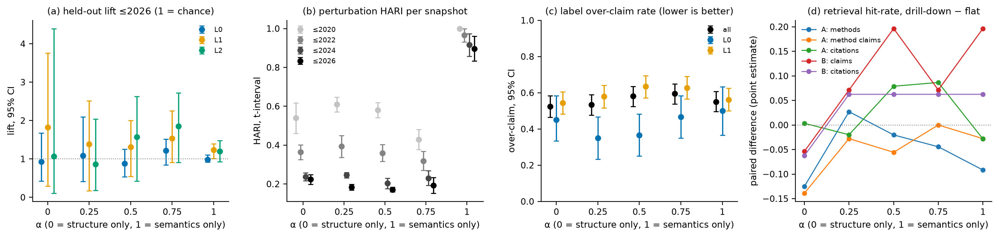

# The Structure–Semantics Trade-off: an α Sweep

*Companion evaluation to `docs/report.md`. Every table is generated by `make_tables.py --sweep`, including the
recommendation of Table S8, and the figure by `eval/figures.py`, both from the `alpha_sweep` section of
`out/metrics.json` only. `make sweep` builds the five runs in `out/sweep/<α>/` and writes that section from them
(`eval/sweep.py`). The text quotes no result values or verdicts, except the record in §9 of how the rule was revised,
whose claim `make_tables.py` checks against the section; it defines the comparison and interprets the tables.*

## 1. Purpose

P3 asks how a method reconciles structure and semantics where the two disagree, and requires that the trade-off be
stated and justified. In SHAC the trade-off is a single weight: every merge score is s = αF_S + (1 − α)F_H, the mix
of the rank-calibrated semantic term F_S (character n-gram similarity of names) and the rank-calibrated structural term
F_H (shared hyper-edges on the collapsed incidence), so that α = 0 builds the hierarchy from structure alone and α = 1
from names alone (report §2). Before the sweep the method had one value, the default α = 0.5 <!-- claim:reference_doc -->, set before any result.
This sweep measures what the choice costs or gains on each of the four evaluation criteria of the brief, and
recommends a value by the rule of §8, which was revised once after the results were read (§9).

## 2. Design

Throughout this document *the default* is that pre-sweep default, α = 0.5, the reference of every paired
comparison; after the sweep the configured default is the recommended variant (§8). Five variants are built,
α ∈ {0, 0.25, 0.5, 0.75, 1} <!-- claim:sweep_grid_doc -->, and every other setting is held at its configured default:
the temporal prior weight γ, the size cap ρ, the edge weights, the hub fraction, the LSA dimension, the budgets and
the snapshots, the labeller and the judge. Each variant is a complete run (`tkh/pipeline.run`: hierarchy, persistent
identities, events, labels), validated by `validate.py`, and evaluated with exactly the protocol of the main report.
Two points of that protocol matter for a fair comparison. First, the configuration null of the coherence test is
rebuilt at the variant's own α, so each variant is compared with chance as defined for its own merge rule. Second,
the paired comparisons with the default use the same randomness on both sides: the perturbation runs of every
variant remove the same hyper-edges (seed by seed), and the cross-snapshot comparison uses the same node subsamples.
The main run in `out/` is built with the configured default, which is now the recommended variant; Table S1
reports whether that variant reproduces the main run. For the hierarchy this tests that the build is deterministic;
for labels and judgements, which are replayed from the LLM cache, it tests only the replay.

*Table S1. Sweep setup (`alpha_sweep.protocol`, `alpha_sweep.variants.<α>.protocol`).*

<!-- table:sweep_setup -->
| Setting | Value |
|---|---|
| α (semantic weight; 0 = structure only, 1 = semantics only) | 0, 0.25, 0.5, 0.75, 1 |
| Fixed at the defaults: γ, ρ, edge weights, hub fraction h, LSA dimension | 0.5, 2.0, relation_balanced, 0.2, 100 |
| Snapshots; budgets N_0, N_1, N_2 | 2020, 2022, 2024, 2026; 15, 60, 240 |
| Per α: coherence nulls (configuration rebuilds at that α, random labels) | 99, 999 |
| Per α: perturbation seeds × edge fraction; new-paper null R | 5 × 0.1; 99 |
| Per α: labeller / judge; retrieval beam, k | qwen2.5:7b-instruct / phi4; 10/20/40, 10 |
| Reference for paired comparisons | α = 0.5 (the configured default before the sweep) |
| Significance level of all null tests | 0.05 |
| Variant α = 0.75 (the configured default) against the main run | hierarchy.json identical at 4 of 4 snapshots; metrics.json sections identical: coherence, stability, faithfulness, retrieval of 4 |
<!-- /table:sweep_setup -->

## 3. How α changes the hierarchy

Before the four criteria, Table S2 shows how much the hierarchy itself moves with α. The adjusted Rand index (ARI)
between a variant's tree and the default tree at the last snapshot measures how many of the default's groupings
survive, per level; 1 means the same partition. The share of merges whose two items share at least one clustering
edge shows how much each variant relies on structure: a merge without a shared edge receives no structural credit
and can only be carried by names or, from the second snapshot on, by the temporal prior. At α = 0 such a merge
scores zero unless the prior supports it (both items hold stable nodes that shared an earlier super-node); otherwise
it is decided by the deterministic tie-break (the lowest item index). The α = 0 hierarchy is therefore arbitrary
only on the merges without a shared edge and without prior support; the share column bounds how many these are. The largest L0 super-node, against its size cap, and the number of singleton
super-nodes at L2 show whether a variant produces a few dominant groups or many isolated ones.

*Table S2. Tree change against the default, structural share of merges and group sizes at the last snapshot
(`alpha_sweep.variants.<α>.tree`).*

<!-- table:sweep_tree -->
| α | ARI with the pre-sweep default tree at ≤2026, L0 / L1 / L2 | Merges sharing an edge at ≤2026, L0 / L1 / L2 | Largest L0 super-node (cap) | L2 singletons |
|---|---|---|---|---|
| 0 | 0.07 / 0.23 / 0.48 | 89% / 97% / 99% | 526 (530.7) | 58 |
| 0.25 | 0.13 / 0.27 / 0.61 | 98% / 97% / 97% | 520 (530.7) | 3 |
| 0.5 (pre-sweep default) | 1.00 / 1.00 / 1.00 | 91% / 88% / 92% | 512 (530.7) | 0 |
| 0.75 (default) | 0.07 / 0.13 / 0.34 | 100% / 67% / 78% | 476 (530.7) | 0 |
| 1 | 0.02 / 0.04 / 0.07 | 100% / 82% / 28% | 528 (530.7) | 3 |
<!-- /table:sweep_tree -->

## 4. Coherence

Coherence is measured exactly as in report §5.1.1: the period-adjusted lift of bibliographic coupling between
concept-disjoint papers whose concepts a level co-assigns, with the residual name filter, tested against the
configuration null and random labels under five period schemes. After the residual name filter the held-out ruler
shares no direct input with either term of the merge score, so it can compare α = 0, intermediate values and α = 1
without favouring one by construction; this is the property that makes the trade-off measurable. The filter removes
citations to identically (exact) or similarly (fuzzy) named works only, so some name similarity may remain in the
coupling, and any such residue would favour the higher values of α; the fuzzy counts in Table S3 bound it. A cell (snapshot × level) is *robust* if it beats both nulls under every scheme,
and *below both nulls* if it lies under the 2.5% quantile of both null distributions under every scheme. Table S3
counts these cells per variant and gives the lifts at the last snapshot, and Table S4 the verdict of every cell, so
that a gain at one level can be told apart from a loss at another.

*Table S3. Coherence per variant: robust and below-null cells over all snapshots and levels, and the lift at the
last snapshot (interval scheme, exact filter) with its paper-bootstrap 95% CI.*

<!-- table:sweep_coherence -->
| α | Robust cells (exact / fuzzy) | Cells below both nulls (exact / fuzzy) | Lift L0 ≤2026 [95% CI] | Lift L1 | Lift L2 |
|---|---|---|---|---|---|
| 0 | 2 / 2 of 12 | 1 / 1 | 0.93 [0.42, 1.67] | 1.83 [0.30, 3.76] | 1.07 [0.11, 4.40] |
| 0.25 | 3 / 3 of 12 | 2 / 3 | 1.09 [0.41, 2.10] | 1.39 [0.18, 2.51] | 0.86 [0.18, 2.03] |
| 0.5 (pre-sweep default) | 3 / 5 of 12 | 3 / 1 | 0.88 [0.53, 1.25] | 1.31 [0.54, 2.00] | 1.57 [0.43, 2.63] |
| 0.75 (default) | 7 / 7 of 12 | 0 / 0 | 1.22 [0.85, 1.52] | 1.53 [0.91, 2.26] | 1.85 [0.91, 2.72] |
| 1 | 0 / 0 of 12 | 0 / 0 | 0.98 [0.92, 1.10] | 1.24 [1.01, 1.40] | 1.20 [0.92, 1.48] |
<!-- /table:sweep_coherence -->

*Table S4. Coherence verdict of every cell per variant, exact filter (robust; sig. k/5: significant against both nulls
under the primary scheme and k of the five schemes; n.s.: not significant; below: below both nulls in every scheme;
n.e.: not evaluable, one interval-scheme stratum; —: undefined, no co-assigned evaluable pair).*

<!-- table:sweep_coherence_grid -->
| Snapshot | Level | α = 0 | α = 0.25 | α = 0.5 (pre-sweep default) | α = 0.75 (default) | α = 1 |
|---|---|---|---|---|---|---|
| ≤2020 | L0 | n.e. | n.e. | n.e. | n.e. | n.e. |
| ≤2020 | L1 | n.e. | n.e. | n.e. | n.e. | n.e. |
| ≤2020 | L2 | — | — | — | n.e. | n.e. |
| ≤2022 | L0 | n.s. | below | below | sig. 3/5 | n.s. |
| ≤2022 | L1 | n.s. | below | n.s. | **robust** | n.s. |
| ≤2022 | L2 | n.s. | **robust** | n.s. | sig. 4/5 | n.s. |
| ≤2024 | L0 | n.s. | n.s. | below | **robust** | n.s. |
| ≤2024 | L1 | **robust** | sig. 4/5 | sig. 4/5 | **robust** | n.s. |
| ≤2024 | L2 | below | n.s. | **robust** | **robust** | n.s. |
| ≤2026 | L0 | n.s. | **robust** | below | **robust** | n.s. |
| ≤2026 | L1 | **robust** | **robust** | **robust** | **robust** | n.s. |
| ≤2026 | L2 | n.s. | n.s. | **robust** | **robust** | n.s. |
<!-- /table:sweep_coherence_grid -->

The cell counts weigh every snapshot and level equally, although the held-out evidence grows with the corpus (report
Table 5), so cells of the last snapshots are better powered. The recommendation (§8) decides on the exact-filter
count; Table S4 shows where a difference in counts comes from. Compared with the default, a cell that becomes robust
from any other state is a gain, a robust cell that becomes anything else is a loss, and a cell that falls below both
nulls is a loss even where neither variant is robust there.

## 5. Stability

Stability is measured as in report §5.1.2. Perturbation robustness rebuilds the whole chain after removing a fraction
of the hyper-edges and compares each perturbed snapshot with the unperturbed one by HARI, the level-pooled ARI;
because the removed edges are the same for every variant, the per-seed differences to the default are paired, and
their t-interval is reported. Cross-snapshot agreement is tested against the new-paper null, and Table S5 counts the
indices above it; the paired HARI difference to the default over node half-subsamples is given for the last
transition. Localisation counts the level × transition cells in which old nodes touched by new papers are reassigned
more often than untouched ones (ratio interval above 1), together with the share of all reassignment that falls on
untouched nodes.

*Table S5. Stability per variant (`alpha_sweep.variants.<α>.stability` and `.paired`).*

<!-- table:sweep_stability -->
| α | Perturbation HARI ≤2020 | Perturbation HARI ≤2026 [t-interval] | Paired difference to the pre-sweep default, ≤2026 | Cross-snapshot indices above the new-paper null (p ≤ 0.05) | Cross-snapshot HARI difference to the pre-sweep default, 2024→2026 | Localised cells (ratio CI > 1) | Untouched share of reassignment |
|---|---|---|---|---|---|---|---|
| 0 | 0.54 | 0.22 [0.20, 0.25] | 0.05 [0.02, 0.08] | 2 of 12 | -0.03 [-0.05, -0.02] | 7 of 9 | 88%–95% |
| 0.25 | 0.61 | 0.18 [0.17, 0.20] | 0.01 [-0.01, 0.03] | 2 of 12 | -0.06 [-0.08, -0.04] | 9 of 9 | 81%–91% |
| 0.5 (pre-sweep default) | 0.58 | 0.17 [0.16, 0.18] | — | 1 of 12 | — | 9 of 9 | 78%–89% |
| 0.75 (default) | 0.43 | 0.19 [0.15, 0.23] | 0.02 [-0.03, 0.07] | 2 of 12 | 0.03 [0.01, 0.05] | 9 of 9 | 73%–92% |
| 1 | 1.00 | 0.90 [0.83, 0.96] | 0.73 [0.67, 0.79] | 4 of 12 | 0.07 [0.06, 0.09] | 6 of 9 | 88%–97% |
<!-- /table:sweep_stability -->

Names do not change when edges are removed, so a variant that weighs names more is expected to be more robust to
perturbation simply because less of its score depends on the perturbed signal. A higher perturbation HARI is
therefore a property of the input the variant relies on, not by itself evidence of better groupings, and it is
traded against coherence in the recommendation rather than maximised on its own. Whether the intermediate values of
α follow this expectation is read from Table S5; it need not hold between them, since every variant except α = 1
still depends on the edges.

## 6. Label faithfulness

Labels and glosses are generated and judged as in report §5.1.3: the labeller sees one half of each super-node's
evidence, and a judge of another model family checks the atomic claims of label and gloss against the held-out half.
Every variant has its own super-nodes and therefore its own labels and its own evidence; the labeller, the judge,
the prompts and the splitting procedure (seeded, stratified by evidence kind) are the same, so the comparison is not
paired. Table S6 gives the over-claim rate, the share of labels with at least one unsupported
claim, overall and per level, with bootstrap intervals over labels.

*Table S6. Label over-claim per variant against held-out evidence (`alpha_sweep.variants.<α>.faithfulness`).*

<!-- table:sweep_faithfulness -->
| α | Labels judged | Over-claim [95% CI] | Over-claim L0 | Over-claim L1 | Claim-level unsupported | Named non-member flags |
|---|---|---|---|---|---|---|
| 0 | 288 | 0.52 [0.47, 0.58] | 0.45 [0.33, 0.58] | 0.54 [0.48, 0.61] | 0.43 | 41 |
| 0.25 | 300 | 0.53 [0.48, 0.59] | 0.35 [0.23, 0.47] | 0.58 [0.52, 0.64] | 0.41 | 37 |
| 0.5 (pre-sweep default) | 296 | 0.58 [0.52, 0.64] | 0.37 [0.25, 0.48] | 0.64 [0.57, 0.69] | 0.45 | 33 |
| 0.75 (default) | 299 | 0.60 [0.54, 0.65] | 0.47 [0.35, 0.58] | 0.63 [0.56, 0.69] | 0.48 | 31 |
| 1 | 300 | 0.55 [0.50, 0.61] | 0.50 [0.37, 0.63] | 0.56 [0.50, 0.62] | 0.41 | 31 |
<!-- /table:sweep_faithfulness -->

A group that is coherent in meaning should be easier to describe without over-claiming, so lower over-claim is
expected where coherence is higher, and Tables S3 and S6 show whether the variants bear this out; the judge is not
validated and there is no null baseline, so the rates compare
the variants with one another, not with an absolute standard.

## 7. Retrieval

The drill-down agent and the flat baseline are those of report §5.1.4, with the same questions, scorer, beam and answer
length. Flat search does not use the hierarchy, so its results are identical for every variant, which Table S7
asserts; only the drill-down columns change. A tick marks a measure on which drill-down beats flat search for that
variant, and the last row counts the measures favouring drill-down, flat search and neither.

*Table S7. Drill-down retrieval per variant against flat search; means (steps: medians), no CIs
(`alpha_sweep.variants.<α>.retrieval`).*

<!-- table:sweep_retrieval -->
| Type | Metric | Flat (every α) | Drill-down, α = 0 | Drill-down, α = 0.25 | Drill-down, α = 0.5 (pre-sweep default) | Drill-down, α = 0.75 (default) | Drill-down, α = 1 |
|---|---|---|---|---|---|---|---|
| A | hit-rate, methods | 0.295 | 0.170 | 0.322 ✓ | 0.275 | 0.251 | 0.204 |
| A | hit-rate, method claims | 0.306 | 0.167 | 0.278 | 0.250 | 0.306 | 0.278 |
| A | hit-rate, citations | 0.578 | 0.581 ✓ | 0.558 | 0.657 ✓ | 0.664 ✓ | 0.549 |
| A | error rate | 0.033 | 0.033 | 0.025 ✓ | 0.042 | 0.042 | 0.025 ✓ |
| A | reach | 1.000 | 0.667 | 0.833 | 0.833 | 0.667 | 0.667 |
| A | steps to first item (median) | 10.5 | 154.5 | 148.0 | 206.5 | 149.0 | 265.5 |
| A | steps to 50% of items (median) | 28.5 | 438.5 | 269.5 | 413.0 | 359.0 | 1465.0 |
| B | hit-rate, claims | 0.543 | 0.490 | 0.615 ✓ | 0.740 ✓ | 0.615 ✓ | 0.740 ✓ |
| B | hit-rate, citations | 0.375 | 0.312 | 0.438 ✓ | 0.438 ✓ | 0.438 ✓ | 0.438 ✓ |
| B | reach | 1.000 | 0.750 | 1.000 | 1.000 | 1.000 | 1.000 |
| B | steps to first item (median) | 2.0 | 137.0 | 133.0 | 143.0 | 143.0 | 141.0 |
| B | steps to 50% of items (median) | 6.5 | 425.5 | 150.5 | 152.5 | 147.5 | 145.5 |
|  | measures favouring drill-down / flat / tie |  | 1 / 10 / 1 | 4 / 7 / 1 | 3 / 8 / 1 | 3 / 7 / 2 | 3 / 8 / 1 |
<!-- /table:sweep_retrieval -->

The comparison has no intervals and few questions, and its settings were chosen on the default hierarchy, so it is
the weakest of the four criteria and enters the recommendation only as context.

## 8. Recommendation

The desired outcome is the one the brief sets: super-nodes that are coherent in meaning (P3, the central criterion of
the method), that stay stable over time (P5), whose labels are faithful (P6) and that help a downstream task (T6).
`make_tables.py` applies the rule below. Its step 2 was revised after the results were read, for the reason given
in §9.

1. Each criterion has one headline: the number of robust coherence cells (exact filter); the perturbation HARI at
   the last snapshot; the over-claim rate (lower is better); and the number of retrieval measures favouring
   drill-down.
2. A variant is *eligible* unless it is distinguishably worse than the default on a headline that has an
   interval: the t-interval of its perturbation HARI difference to the default, paired by seed, lies wholly below
   zero, or its over-claim interval lies wholly above the default's. The coherence and retrieval counts have no
   interval and exclude no variant.
3. Among the eligible variants, the recommended one has the most robust coherence cells. Ties are broken by the
   higher perturbation HARI, then by closeness to the default.

Coherence decides because it is the only criterion that tests whether groups mean something, and because it is
measured with a ruler independent of both signals that α mixes. Stability and faithfulness act as guards against the
method as it stands: a variant that buys coherence at a clear loss of robustness or label faithfulness relative to
the default is not recommended. The guards compare with the default rather than with the best variant, because the
most robust variant is robust for a reason unrelated to the quality of its groups (§5). Retrieval is reported
but does not decide, for the reasons given in §7.

*Table S8. Headlines, eligibility and the recommendation (rule above).*

<!-- table:sweep_summary -->
| α | P3 robust cells (exact) | P5 perturbation HARI ≤2026 [t-interval] | P6 over-claim [95% CI] | T6 measures favouring drill-down | Eligible (not distinguishably worse than the pre-sweep default on HARI or over-claim) | Recommendation |
|---|---|---|---|---|---|---|
| 0 | 2 | 0.22 [0.20, 0.25] | 0.52 [0.47, 0.58] | 1 | yes |  |
| 0.25 | 3 | 0.18 [0.17, 0.20] | 0.53 [0.48, 0.59] | 4 | yes |  |
| 0.5 (pre-sweep default) | 3 | 0.17 [0.16, 0.18] | 0.58 [0.52, 0.64] | 3 | yes |  |
| 0.75 (default) | 7 | 0.19 [0.15, 0.23] | 0.60 [0.54, 0.65] | 3 | yes | **recommended** |
| 1 | 0 | 0.90 [0.83, 0.96] | 0.55 [0.50, 0.61] | 3 | yes |  |

Recommended: α = 0.75. Eligible: 0, 0.25, 0.5, 0.75, 1; retrieval counts are out of 12 measures (point estimates, no CIs).
<!-- /table:sweep_summary -->

*Figure S1. Per variant: (a) held-out lift at the last snapshot per level; (b) perturbation HARI per snapshot;
(c) over-claim rate, overall and per level; (d) retrieval hit-rate differences, drill-down minus flat.*

## 9. Caveats

- **Selection on the evaluation data.** The variants are compared, and one is recommended, on the same metrics that
  report its quality, so the recommended variant's scores are optimistic: some of its advantage over the others is
  the noise that the selection favours. With five variants, a difference of one or two robust cells may be no
  larger than what selection alone produces. An unbiased estimate would need the
  choice to be made on one half of the held-out citations and reported on the other.
- **The rule was revised after the results.** As first stated, step 2 compared every variant with the *most*
  robust and the *most* faithful variant. The most robust variant was α = 1, robust because edge removal does not
  change names (§5), and its interval excluded every other variant; the rule then recommended a variant without a
  single robust coherence cell, the outcome the §5 reading warns against <!-- claim:original_rule -->. Step 2 now compares with the default.
  The revision changes only the guard, not the deciding criterion, but it was made with the results in view and is a
  further selection step on the evaluation data.
- **Uncorrected tests.** Each robust cell is a set of uncorrected tests; across five variants, twelve cells and five
  schemes, some significant results are expected by chance. Robustness across the five period schemes, rather than
  single p-values, is what the deciding count rewards; it uses the exact filter, and the fuzzy count in Table S3 is a
  check, not part of the rule.
- **Structure only is partly arbitrary.** At α = 0 merges between items that share no edge and have no prior
  support are decided by index order (§3), so the α = 0 variant is a reference for structure alone rather than a
  fully specified candidate.
- **One parameter at a time.** All other parameters stay at their defaults, so the sweep says nothing about
  interactions, for example between α and the hub fraction, which changes how much structure exists at all.
- **Labels depend on the tree.** Each variant's labels describe different groups, so differences in over-claim mix
  the effect of α on the groups with the noise of one labeller and one judge.

## 10. Integration into the report

The recommended variant is the configured default (`configs/default.toml`), and the main run in `out/` is built with
it. `docs/report.md` §5.2 presents the comparison as Table 3 (the headlines of Table S8, generated by
`make_tables.py` with the same rule) and Table 4 (the recommended variant against the pre-sweep default and the best
variant per headline), states the rule and the trade-offs, and ships the recommended variant; report §5.3 evaluates
that variant in detail. The tables of this document give the per-criterion detail behind report Tables 3–4.
