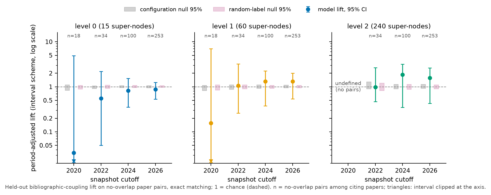
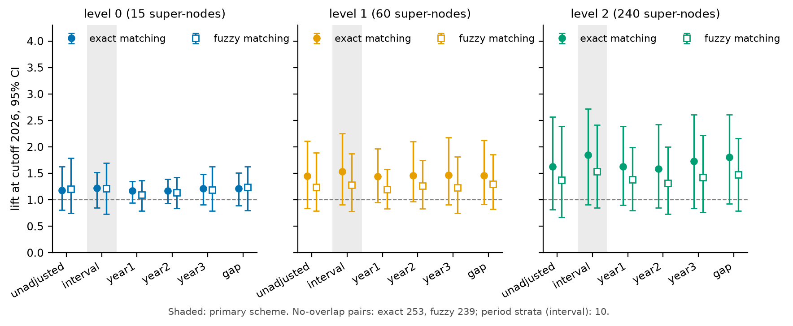
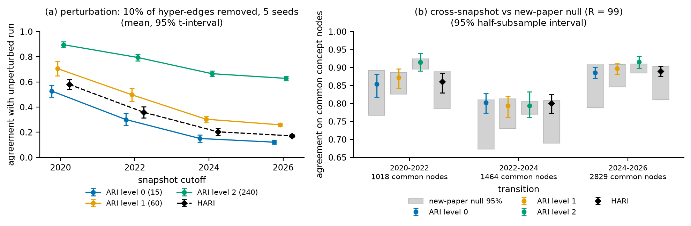

# Appendix A. Formal details, metric definitions and full results

*Appendix to `docs/report.md` (the main report). Every table is generated from `out/metrics.json` by
`make_tables.py --doc appendix`; Appendix B (`docs/alpha_sweep.md`) holds the α sweep.*

## A.0 Positioning against the closest prior work

*Table A0. What SHAC borrows from each work and what it does differently.*

<!-- table:literature -->
| Work | Borrowed | Done differently, and why |
|---|---|---|
| h-Louvain [1] | hyper-edge-aware affinity; multilevel aggregation | no modularity optimum setting the counts; exact nested budgets; a semantic term |
| Featured Graph Coarsening [2] | joint topology–feature coarsening | on the hyper-edge incidence; greedy merges; no similarity guarantee claimed |
| DynHAC [3] | average linkage; change confined to affected regions | a soft prior, not recomputation (frozen regions would hold budget slots); H is not reducible |
| HyperEF 2.0 [4] | hyper-edge contraction with explicit coarse edges | fixed counts, no spectral target; multi-way edges scored by the connectivity cut |
<!-- /table:literature -->

## A.1 Leaves, budgets and feasibility

The output of each snapshot has three super-node levels, L0 (coarsest), L1 and L2 (finest), each a partition of the
whole snapshot. The leaves are implicit: every node of the snapshot is its own leaf, whose parent is the L2 super-node
that holds it (`schema/hierarchy.schema.json`). Leaves are not a budgeted level. Concept nodes are clustered; every
other node is a member of its anchor's super-node at every level.

**Lemma (budget feasibility).** If ρ ≥ 2 and K > N_k items remain at level k, the two smallest items have total size
≤ 2n_t/K < ρ·n_t/N_k, so a feasible merge exists, and every level reaches exactly min(N_k, #items) super-nodes. Sizes
count concept nodes only, so a super-node's total membership, anchored nodes included, can exceed the cap.

## A.2 Resources

Notation per level: n items, m clustering edges (columns of the incidence), d ≤ 100 LSA dimensions, and K′ ≤ N_k the
number of the previous snapshot's level-k super-nodes that hold stable nodes. The figures below follow the
implementation (`_Level` in `tkh/hierarchy.py`), not an idealised data structure.

- **Memory.** The incidence is stored densely: endpoint counts C and presence X, each n × m. The semantic sums are
  n × d, the prior membership matrix n × K′. One n × n score matrix is kept for the level, together with the frozen
  mid-rank distributions of S and H over up to n(n − 1)/2 pairs; initialisation allocates several further n × n
  temporaries. Peak memory is O(n² + n(m + d + K′)); because m varies independently of n, the nm term is not
  bounded by n².
- **Initialisation per level.** S costs O(n²d), H a dense product O(n²m), Π O(n²K′), and building the two mid-rank
  distributions sorts O(n²) values, O(n² log n): in total O(n²(m + d + K′ + log n)).
- **Per merge.** The merged item's incidence, semantic and prior rows are updated, and one row and column of S, H
  and Π are recomputed, O(n(m + d + K′)); their ranks are looked up in the frozen distributions, O(n log n). The best
  pair comes from maintained row maxima in O(n); rows whose best partner took part in the merge are rescanned, O(n)
  each and O(n²) in the worst case.
- **Per level and in total.** A level performs #items − min(N_k, #items) merges: n_t − N_2 at the finest level and
  N_{k+1} − N_k above it. The finest level of each snapshot dominates, at O(n_t²(m + d + K′ + log n_t)) for
  initialisation plus up to O(n_t³) over its merges in the worst case; the total is the sum over snapshots.
- **Preprocessing per snapshot.** Hub detection and the incidence take one pass over the edges, O(Σ_e |e|); the
  semantic vectors take a TF-IDF of character 3–5-grams and a truncated SVD (exact for small matrices, ARPACK
  otherwise); anchoring and the stable set take a further pass over the edges; the coarse hyper-edge records take
  O(L·Σ_e |e|) over the L levels.

## A.3 Merge statistics

`out/<t>/coarse_hyperedges.json` records every coarse edge of each level with its class (internal, partial,
uncollapsed), the multi-way flag and per-level counts. `out/run_info.json` records per snapshot and level how many
merges share an edge (`linked`), share one with two or more endpoints on one side, where native and clique scores
differ (`multi_endpoint`), and fall under the prior (`prior`).

## A.4 Metric definitions

### Coherence

SHAC groups concept nodes because their names are similar (the semantic term) or because they occur together in the
six clustering relations (the structural term). A coherence score computed from either signal would be high by
construction: the method merged exactly the pairs that score well on it, so the score would restate the merge
criterion instead of testing whether a group is meaningful. This is the circularity hazard of the brief.
`eval/coherence.py` removes it in four steps and then compares the result with two null models.

The first step replaces the ruler by a held-out signal, *bibliographic coupling*: two papers are coupled to the extent
that they cite the same works. We measure it as c_pq, the cosine similarity (Salton's measure) of the two papers'
cited-work sets, in which each cited work is weighted by its inverse document frequency (IDF, the logarithm of the
inverse share of citing papers that cite it), so that widely cited works count less. Citations never enter G_t, z_v
or Π, so the method cannot have optimised c_pq.

The second step closes a leak through names. A paper often cites the work that introduced a concept it uses, so that
"extends X" and "cites X" occur together, and coupling would then partly reflect shared concept names. A *residual
name filter* therefore drops every citation to a work named like one of the citing paper's own concepts. The *exact*
filter requires a shared normalised name; the stricter *fuzzy* filter also drops a citation when one name contains the
other, for names of at least four characters. Both filters are run, and the exact one is primary.

The third step scores only *no-overlap pairs*, paper pairs that share no concept node and no concept name. For such a
pair, the hierarchy can relate the two papers only by grouping different concepts together, so a shared node or name
cannot explain a high score.

The fourth step controls for publication period. The co-assignment a_pq = Σ_S n_S(p) n_S(q) / (n_p n_q) measures how
much a level puts the two papers' concepts into the same super-nodes (n_S(p): concepts of p in super-node S; n_p: all
concepts of p). The *lift* Σ a_pq c_pq / Σ a_pq e_pq asks whether the pairs a level co-assigns are more strongly
coupled than expected, where e_pq is the mean coupling of the no-overlap pairs whose papers fall in the same *period
stratum* as p and q; 1 is chance. Standardising by e_pq removes a confounder: papers of the same era cite the same
works and also share vocabulary and relations, so an unadjusted lift would reward a hierarchy for grouping by era.
Because the choice of strata is itself arbitrary, five *period schemes* are run: the snapshot cutoff intervals
(*interval*, primary), bins of one, two and three years (*year1*, *year2*, *year3*), and the absolute difference of the
two publication years (*gap*). Intervals for the lift come from a paper-cluster bootstrap.

The lift is then compared with two null models, each with a fixed number of replicates. The *configuration null*
rebuilds the whole hierarchy on a shuffled export in which hyper-edge members are traded between edges of the same
relation, period and member type, so that every node keeps its degree and every edge its arity [5]. It keeps the real
names, so it asks what the observed hyper-edge structure adds beyond degrees. The *random-label null* permutes concept
nodes within type × entry interval over the fixed tree, which keeps the size and period mix of every super-node but
breaks its membership. Each p-value is one-sided, (1 + #{null ≥ observed}) / (R + 1). A cell (snapshot × level) is
*robust* if its lift beats both nulls at the significance level under every period scheme, and *below both nulls* if
under every scheme it lies below the 2.5% quantile of both null distributions. A cell is *not evaluable* if its
primary scheme has a single period stratum, because neither that scheme nor the random-label null, which permutes
within the same strata, then controls for period, and *undefined* if the level co-assigns the concepts of no
evaluable pair. p-values are not corrected across cells. A robust cell means that its level co-assigns concepts of
citation-coupled, concept-disjoint papers more than both nulls under every period scheme; a cell below both nulls
means that the citation signal does not support that level's groupings. The tests are conditional on the corpus, so a
robust cell reads "better than chance on this corpus", not a population estimate.

### Stability

Stability is measured in three ways: robustness of one snapshot to perturbed input, agreement between consecutive
snapshots, and whether the change between snapshots stays where the corpus changed. All three are computed on concept
nodes only, because anchored nodes follow their anchors and would inflate agreement.

*Perturbation robustness* follows the brief: a fraction of all hyper-edges is removed for several seeds, stratified by
period × relation so that no period or relation loses a disproportionate share, and the whole snapshot chain is
rebuilt. Each perturbed snapshot is compared with the unperturbed one by the adjusted Rand index (ARI) per level,
which is 0 for chance agreement and 1 for identical partitions, and by HARI, a laminar analogue that pools the
pair-counting terms of ARI over the levels, HARI = Σ_k(I_k − E_k) / Σ_k(M_k − E_k). Here I_k is the number of concept
pairs that share a super-node at level k in both hierarchies, E_k its expectation under a random relabelling and M_k
its maximum. HARI is 1 for identical trees and weighs each level by its pair mass M_k − E_k, so the coarsest level
dominates it. Intervals are t-intervals over the seeds.

*Cross-snapshot agreement* compares consecutive snapshots on the concept nodes they share, with the same indices and
percentile intervals over half-subsamples of those nodes. Agreement alone says little here, since most of an old
snapshot survives into the next and the prior pulls stable nodes together. It is therefore tested against a
*new-paper null*: the new papers keep their edges, but each of their old endpoints is redrawn among the old nodes of
its type in proportion to degree, and snapshot t is rebuilt from the real hierarchy at t−1. The null keeps the past
graph, the past hierarchy and the prior and replaces only which old nodes the new papers touch, so an index above the
null shows that the real attachment pattern preserves more of the hierarchy than random attachment would, and an
index that is not above it is explained by what the null shares with the run.

*Localisation of change* tests the requirement of P5 that change stays where the corpus changed. For each transition
and level, the *reassignment* of an old concept node is 1 − the Jaccard similarity of its co-member sets in the two
snapshots, 0 if it keeps exactly its co-members and 1 if it keeps none. Localisation compares the mean reassignment of
old nodes that new papers touch (members of any edge of a new paper, any relation; unlike the prior's touched set, no hub-status changes) with that
of untouched old nodes; a ratio whose node-bootstrap interval lies above 1 means that change concentrates on touched
nodes. The share of all reassignment that falls on untouched nodes complements the ratio: a share near zero would
mean that untouched regions are frozen, a large share that they still move.

### Label faithfulness

L0–L1 labels and one-sentence glosses come from the labeller. The *evidence* of a super-node is a list of text lines
from its snapshot: member concept names with types and aliases, clustering facts (each incident edge written as
"method, relation, members"), member claims, future-work topics and paper titles. Citations are excluded, because they
are the coherence ruler. The evidence is split 50/50 with a fixed seed, stratified by kind, into a *seen half*, which
the labeller receives, and a *held-out half*, which only the judge receives; both halves are recorded in
`out/<t>/label_inputs.json`. To make labels discriminative, the labeller also sees as *contrast* a few seen-half
concept names of the same-level groups that share the most clustering edges with this one, and is asked for a label
that fits this group and not those. A judge from another model family splits label and gloss into at most three
*atomic claims* and checks each against the held-out half. A claim counts as supported only if the judge cites a
held-out line that exists, a deterministic check against a judge that agrees without evidence. The decomposition is
subject to a *content check*: each claim must reuse at least 80% of its content words from label and gloss and keep a
specific word. If any claim fails the check, or no claim is returned, the decomposition fails and label and gloss are
judged as two claims instead, so that no part of the label goes unjudged. As a sensitivity check, the over-claim rate
is also computed under the alternative rule that drops the failing claims and judges the remaining ones, falling back to label and
gloss only when none remain (Table A6 note). The *over-claim rate* is the share of
labels with at least one unsupported claim, and the claim-level rate the share of unsupported claims. Deterministic
checks without an LLM flag years after the cutoff, method or dataset names that belong to no member, and entities
that first appear after the cutoff. Because the judge reads only the held-out half, restating the labeller's input
cannot pass, but both halves use the same kinds of text, so shared vocabulary between them is not controlled. The
judge is not validated and there is no null baseline, so the rate is descriptive, and the deterministic flags count
name matches that were not adjudicated by hand.

### Extrinsic utility

The extrinsic task is question answering over the hierarchy. An agent answers the questions of `data/questions.csv`
at the latest snapshot not after the date the question names, or the last snapshot if it names none (type A, a
specific search for methods, their claims and their citations; type B, a synthesis of the claims and citations behind
a statement). The *drill-down* agent starts at L0 and runs a beam search: at each level it scores the children of the
super-nodes kept at the level above and keeps the best few (the *beam*), and the leaves of the kept L2 super-nodes
form a pool that is ranked to give the k answers. Every text, whether a super-node's label, gloss and member centroid
or a leaf's name, aliases, relation neighbours and paper title, is scored by keyword overlap with the question. The
*flat* baseline ranks all leaves of the answer kinds in the snapshot with the same scorer. Only the evaluator reads the ground truth
(`data/ground_truth.json`) and resolves each gold item to graph nodes by exact name or acronym; gold items that no
node can match are excluded, and the rest are called *attainable*. Table A7 gives the attainable and total counts
next to each hit-rate, and an *end-to-end* rate that counts unattainable items as misses. The attainable-only rate
compares the two systems on what the graph can answer, and the end-to-end rate measures answers against the full
ground truth.

The measures are computed on attainable items:
- **Hit-rate:** the share of gold items the answer returns, per kind: methods; method claims; claims; and citations.
- **Error rate:** the share of returned items that the ground truth lists as wrong-domain or outdated.
- **Items inspected (the reader's effort):** the labelled L0 and L1 super-nodes the drill-down shows, then the item's
  rank in its ranked pool of leaves (not only the k returned answers). For flat search it is the item's rank among all
  leaves of the answer kinds. It is counted to the first item and to 50% of the
  items. An item that is never reached is censored at the number of candidate leaves plus one, and the counts are
  summarised by medians.
- **Reach:** the share of questions with at least one target anywhere in the system's ranked leaves. Flat search
  ranks every leaf, so its reach is 1 by construction. Reach therefore measures the targets that drill-down loses by
  pruning, and it can favour only flat search or neither.
- **Candidates scored (computation):** the super-nodes scored at every level plus the pooled leaves ranked. For flat
  search it is every leaf of the answer kinds. This count is not a wall-clock latency, which was not measured. It is
  reported apart from the other measures and is not part of the count of measures favouring a system.

The scope of the evaluation is limited in three ways:
- **Claims are credited by source article, not by content.** A method claim is a hit when a found method comes with
  a claim from one of its evidence papers. A required type-B claim is a hit when the answer returns any claim from one
  of its source articles. The returned claim's text is never compared with the requested assertion, so one returned
  claim can credit several assertions of the same sources, and several required claims of one question can share the
  same set of acceptable claims. A method returns its first graph claims in a fixed order, so the method
  claims it returns do not depend on the question. The claim hit-rates therefore measure *source-associated*
  retrieval, not retrieval or entailment of each required claim; validating claims is left to future work (main report, §6).
- **All values are point estimates over few questions.** There are 14 type-A and 4 type-B questions, with no
  intervals and no paired tests, so no difference between drill-down and flat search is established. Type B in
  particular is descriptive.
- **The settings were chosen with these questions in view.** These are the beam, k, the label weight and the answer
  kinds. There is no development/test split, so every T6 number is in-sample.

## A.5 Full results of the shipped run (α = 0.75)

The run in `out/` is the α = 0.75 variant of the sweep. Its results are those on which α was selected, so they are
optimistic in the sense of the main report, §5.2.

### Coherence

*Table A1. Coverage of the held-out ruler per snapshot (`coherence.snapshots.<t>.coverage`).*

<!-- table:coherence_coverage -->
| Snapshot | Citing papers | No-overlap pairs | Coupled pairs (exact / fuzzy) | Filtered citations (exact / fuzzy) | Period strata (interval scheme) |
|---|---|---|---|---|---|
| ≤2020 | 9 | 18 | 5 / 4 | 38 / 56 | 1 |
| ≤2022 | 14 | 34 | 11 / 10 | 73 / 107 | 3 |
| ≤2024 | 25 | 100 | 21 / 20 | 162 / 222 | 6 |
| ≤2026 | 37 | 253 | 58 / 51 | 260 / 342 | 10 |
<!-- /table:coherence_coverage -->

*Table A2. Held-out lift, interval scheme, exact filter, against both nulls; verdicts computed from all period schemes
under the exact and the fuzzy filter (`coherence.snapshots.<t>.levels[k]`).*

<!-- table:coherence -->
| Snapshot | Level | Lift, interval, exact [95% CI] | Null means (config. / labels) | p (config. / labels) | Schemes passed (exact / fuzzy) | Verdict, exact | Verdict, fuzzy |
|---|---|---|---|---|---|---|---|
| ≤2020 | L0 | 0.42 [0.10, 2.01] | 0.97 / 0.98 | 1 / 1 | 0 / 0 | not evaluable (one interval-scheme stratum) | not evaluable (one interval-scheme stratum) |
| ≤2020 | L1 | 1.02 [0.35, 2.28] | 0.97 / 0.99 | 0.33 / 0.339 | 2 / 5 | not evaluable (one interval-scheme stratum) | not evaluable (one interval-scheme stratum) |
| ≤2020 | L2 | 0.82 [0.12, 2.44] | 1.02 / 0.99 | 0.93 / 0.923 | 0 / 0 | not evaluable (one interval-scheme stratum) | not evaluable (one interval-scheme stratum) |
| ≤2022 | L0 | 1.33 [0.47, 2.76] | 1.02 / 1.00 | 0.01 / 0.001 | 3 / 3 | significant, 3/5 schemes | significant, 3/5 schemes |
| ≤2022 | L1 | 1.74 [0.45, 3.29] | 1.06 / 1.00 | 0.01 / 0.001 | 5 / 5 | **robust** | **robust** |
| ≤2022 | L2 | 1.48 [0.40, 2.47] | 1.14 / 1.00 | 0.01 / 0.001 | 4 / 5 | significant, 4/5 schemes | **robust** |
| ≤2024 | L0 | 1.34 [0.75, 1.90] | 1.03 / 1.00 | 0.01 / 0.001 | 5 / 5 | **robust** | **robust** |
| ≤2024 | L1 | 1.61 [0.72, 2.19] | 1.06 / 1.00 | 0.01 / 0.001 | 5 / 5 | **robust** | **robust** |
| ≤2024 | L2 | 1.59 [0.72, 2.07] | 1.11 / 1.00 | 0.01 / 0.001 | 5 / 3 | **robust** | significant, 3/5 schemes |
| ≤2026 | L0 | 1.22 [0.85, 1.52] | 1.01 / 1.00 | 0.01 / 0.001 | 5 / 5 | **robust** | **robust** |
| ≤2026 | L1 | 1.53 [0.91, 2.26] | 1.04 / 1.01 | 0.01 / 0.001 | 5 / 5 | **robust** | **robust** |
| ≤2026 | L2 | 1.85 [0.91, 2.72] | 1.06 / 1.00 | 0.01 / 0.001 | 5 / 5 | **robust** | **robust** |
<!-- /table:coherence -->

*Figure A1. Period-adjusted held-out lift (exact filter) with both null bands; 1 = chance.*

*Figure A2. Held-out lift per period scheme at the last snapshot, exact and fuzzy citation filter, with 95% CI;
1 = chance.*

### Stability

*Table A3. Perturbation robustness against the unperturbed run, mean [t-interval] over seeds
(`stability.perturbation`).*

<!-- table:perturbation -->
| Snapshot | ARI L0 | ARI L1 | ARI L2 | HARI |
|---|---|---|---|---|
| ≤2020 | 0.36 [0.30, 0.41] | 0.62 [0.57, 0.66] | 0.88 [0.85, 0.91] | 0.43 [0.38, 0.48] |
| ≤2022 | 0.26 [0.21, 0.32] | 0.44 [0.41, 0.48] | 0.75 [0.71, 0.79] | 0.32 [0.27, 0.37] |
| ≤2024 | 0.18 [0.14, 0.23] | 0.32 [0.28, 0.35] | 0.62 [0.60, 0.64] | 0.23 [0.19, 0.27] |
| ≤2026 | 0.15 [0.11, 0.20] | 0.26 [0.23, 0.30] | 0.55 [0.53, 0.58] | 0.19 [0.15, 0.23] |
<!-- /table:perturbation -->

*Table A4. Cross-snapshot agreement against the new-paper null (`stability.cross_snapshot`).*

<!-- table:cross_snapshot -->
| Transition | Common nodes | ARI L0: run vs null mean (p) | ARI L1 | ARI L2 | HARI | Indices above the null (p ≤ 0.05, uncorrected) |
|---|---|---|---|---|---|---|
| 2020→2022 | 1018 | 0.84 vs 0.85 (p 0.71) | 0.90 vs 0.87 (p 0.07) | 0.91 vs 0.90 (p 0.11) | 0.86 vs 0.86 (p 0.61) | 0/4 |
| 2022→2024 | 1464 | 0.75 vs 0.80 (p 0.91) | 0.81 vs 0.78 (p 0.05) | 0.81 vs 0.79 (p 0.06) | 0.77 vs 0.80 (p 0.88) | 1/4 |
| 2024→2026 | 2829 | 0.92 vs 0.92 (p 0.37) | 0.90 vs 0.90 (p 0.57) | 0.94 vs 0.91 (p 0.01) | 0.92 vs 0.91 (p 0.4) | 1/4 |
<!-- /table:cross_snapshot -->

*Figure A3. (a) Perturbation ARI and HARI; (b) cross-snapshot agreement against the new-paper null band.*

*Table A5. Localisation of change (`stability.localisation`).*

<!-- table:localisation -->
| Transition | Old nodes touched / untouched | Ratio L0 [95% CI] | Ratio L1 | Ratio L2 | Untouched reassignment L0 / L1 / L2 | Share of reassignment on untouched | Levels localised (CI > 1) |
|---|---|---|---|---|---|---|---|
| 2020→2022 | 40 / 978 | 2.19 [1.63, 2.88] | 2.37 [1.43, 3.45] | 4.75 [3.25, 6.41] | 0.18 / 0.13 / 0.09 | 84%–92% | 3/3 |
| 2022→2024 | 87 / 1377 | 1.91 [1.63, 2.20] | 2.47 [2.08, 2.87] | 3.35 [2.82, 3.93] | 0.29 / 0.21 / 0.17 | 83%–89% | 3/3 |
| 2024→2026 | 111 / 2718 | 4.34 [3.41, 5.41] | 4.41 [3.71, 5.10] | 9.02 [7.54, 10.64] | 0.09 / 0.12 / 0.06 | 73%–85% | 3/3 |
<!-- /table:localisation -->

### Label faithfulness

*Table A6. Label over-claim against held-out evidence, bootstrap 95% CI over labels (`faithfulness`).*

<!-- table:faithfulness -->
| Group | Labels judged | Over-claim rate [95% CI] | Claim-level unsupported |
|---|---|---|---|
| All cutoffs, L0–L1 | 299 | 0.63 [0.58, 0.68] | 0.48 |
| L0 | 60 | 0.47 [0.35, 0.60] | 0.34 |
| L1 | 239 | 0.67 [0.61, 0.73] | 0.51 |
| ≤2020 | 74 | 0.65 [0.54, 0.76] | 0.52 |
| ≤2022 | 75 | 0.65 [0.55, 0.76] | 0.53 |
| ≤2024 | 75 | 0.61 [0.51, 0.72] | 0.39 |
| ≤2026 | 75 | 0.60 [0.49, 0.71] | 0.47 |

Labels 300, judged 299 (no held-out evidence: 1); decomposition passes its content check for 54% (every claim kept 163, some claims failing 135, none returned or kept 2; a failed decomposition is judged as label and gloss); sensitivity, failing claims dropped and the survivors judged: over-claim 0.60 [0.54, 0.65]; cited-line rejections 22; deterministic flags: year after cutoff 0, named non-member 31, future entity 3.
<!-- /table:faithfulness -->

### Extrinsic utility

*Table A7. Drill-down retrieval against flat search; means (items inspected and candidates scored: medians) and
paired differences over attainable items (candidates scored: every answered question, independent of the gold),
point estimates without CIs; attainable and total gold items, and end-to-end rates over all gold items with the number
of questions; claims are credited by source article (A.4). The favoured column is a descriptive simplification, not
independent votes; candidates scored are not counted (`retrieval.summary`, `retrieval.diagnostics`).*

<!-- table:retrieval -->
| Type | Metric | n | Attainable / total items | Drill-down | Flat | Paired difference (mean; medians: inspection, computation) | End to end, drill-down / flat | Favoured (point estimate) |
|---|---|---|---|---|---|---|---|---|
| A | hit-rate, methods | 12 | 45/63 | 0.251 | 0.295 | -0.044 | 0.147 / 0.176 (n = 14) | flat |
| A | hit-rate, method claims, by source article | 9 | 54/188 | 0.306 | 0.306 | +0.000 | 0.066 / 0.066 (n = 14) | tie |
| A | hit-rate, citations | 14 | 65/71 | 0.664 | 0.578 | +0.087 | 0.608 / 0.527 (n = 14) | drill-down |
| A | error rate | 12 | — | 0.042 | 0.033 | +0.008 | — | flat |
| A | reach | 12 | — | 0.667 | 1.000 | -0.333 | — | flat |
| A | items inspected to first item (median) | 12 | — | 64.5 | 10.5 | +61.0 | — | flat |
| A | items inspected to 50% of items (median) | 12 | — | 278.5 | 28.5 | +156.0 | — | flat |
| A | candidates scored (median; computation, not counted) | 14 | — | 571.5 | 2524.0 | -1952.5 | — | not counted |
| B | hit-rate, claims, by source article | 4 | 32/36 | 0.615 | 0.543 | +0.071 | 0.565 / 0.493 (n = 4) | drill-down |
| B | hit-rate, citations | 4 | 14/19 | 0.438 | 0.375 | +0.062 | 0.312 / 0.263 (n = 4) | drill-down |
| B | reach | 4 | — | 1.000 | 1.000 | +0.000 | — | tie |
| B | items inspected to first item (median) | 4 | — | 63.0 | 2.0 | +61.0 | — | flat |
| B | items inspected to 50% of items (median) | 4 | — | 65.5 | 6.5 | +59.5 | — | flat |
| B | candidates scored (median; computation, not counted) | 4 | — | 359.0 | 690.0 | -331.0 | — | not counted |

Drill-down diagnostics: kept/frontier L0 0.67, L1 0.45, L2 0.50; per question, super-nodes scored 128–151, of them labelled (shown to the reader) 54–64; pool leaves 208–513; never reached: Q4 (lost at L1), Q7 (lost at L1), Q9 (lost at L1), Q10 (lost at L1).
<!-- /table:retrieval -->
