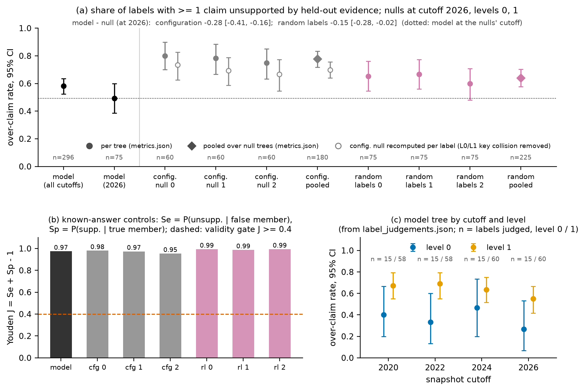

# Evaluation report: SHAC hierarchy on the TKH graph (run out/, 2026-10-24)

All numbers in this report are read from files in `out/` (mainly `out/metrics.json`) or recomputed from them by read-only scripts. Recomputed values are marked *(derived)*, with a note on how each was obtained. The JSON path of every reported result is listed in the Appendix. Snapshots are written ≤t (cutoff year t) and levels as L0 (15 super-nodes, coarsest), L1 (60) and L2 (240, finest).

## 1. Summary

The three-level hierarchy (budgets 15 / 60 / 240) was evaluated at four snapshots (cutoffs 2020–2026) on three properties: held-out semantic coherence (P3), temporal stability (P5) and label faithfulness (P6). The main findings are as follows.

- **Coherence.** At ≤2024 and ≤2026 the finer levels group concepts of citation-coupled, concept-disjoint papers more than both nulls do. At ≤2022 this holds only under fuzzy matching (L1) or only under the `year1` scheme (exact). Under the strict criterion (exact matching, all five period schemes), three cells are robust: ≤2026 L1 and L2, and ≤2024 L2. L0 shows no coherence at any snapshot. Under exact matching, every lift rests on 5–58 coupled pairs (fuzzy: 4–51), and every paper-bootstrap CI includes 1, so this is evidence for the corpus at hand, not a population estimate.
- **Stability.** Cross-snapshot persistence is high (HARI 0.80–0.89). It is about as high when new papers attach at random (new-paper null), so it is not due to the real attachment pattern; it comes from what the null keeps (the real ≤t−1 graph, the real t−1 hierarchy and the γ = 0.5 prior), and which of these is responsible is not separated. Per node, touched nodes are reassigned 2.4–7.0× as often as untouched ones (all CI lower bounds ≥ 2.0), but 78–89% of total reassignment falls on untouched nodes. Robustness to a 10% edge perturbation is low at the coarse levels of late snapshots (≤2026 L0 ARI 0.12). There is no γ = 0 control on the current build (§4, §7.2).
- **Labels.** The judge passes its validity gate by a wide margin, but only on name-lookup controls. Model labels over-claim in 0.58 of cases. At 2026 they do better than both nulls. The configuration-null comparison in `metrics.json` is biased in the model's favour by a key-collision bug (§5.6).

| Property | Test | Result | Verdict |
|---|---|---|---|
| P1 laminarity, P2 budgets | Read-only check of `out/<t>/hierarchy.json` (§6) | 15 / 60 / 240 super-nodes at every snapshot; each member in exactly one super-node per level; every child a subset of its parent | Holds (by construction; re-checked) |
| P3 coherence | Held-out coupling lift, interval scheme, exact matching, vs 99 configuration-null rebuilds and 999 random-label permutations (§3) | ≤2026 L1 1.31 [0.541, 2.00], L2 1.57 [0.426, 2.63]; ≤2024 L2 1.86 [0.348, 3.17]; p at the floors 0.01 / 0.001 | Robust (exact, 5/5 schemes) at ≤2026 L1–L2 and ≤2024 L2; ≤2024 L1 robust under fuzzy only (exact fails `gap`: lift 1.10, p = 0.10 / 0.152); not at L0; ≤2022 depends on scheme and matching; ≤2020 not evidence (L2 undefined) |
| P3, L0 | Same test | 0.879 (≤2026), 0.825 (≤2024), 0.550 (≤2022); p = 1.0 | No coherence |
| P5 persistence | Cross-snapshot ARI/HARI vs new-paper null, R = 99 (§4.3) | HARI 0.86 / 0.80 / 0.89; all 12 values above the null mean by 0.005–0.055; 1 of 12 outside the null band | High, but no higher than under random attachment; not evidence that the corpus' own evolution is stable |
| P5 localisation | Reassignment of touched vs untouched old nodes (§4.4) | Ratio 2.4–7.0, all CI lower bounds ≥ 2.0; 78–89% of reassignment on untouched nodes | Per node, change concentrated on touched nodes; most total change on untouched nodes; untouched regions held, not frozen |
| Robustness | 10% edge perturbation, 5 seeds (§4.2) | ≤2026 ARI L0 0.12 [0.11, 0.13], L2 0.63 [0.61, 0.65]; HARI 0.17 [0.16, 0.18] | L2 the most robust level (ARI 0.63–0.90), only moderately robust late; L0–L1 at late snapshots are not (0.12–0.30) |
| P6 judge validity | Known-answer member-name controls, gate J ≥ 0.4 (§5.2) | Model J 0.974; all trees ≥ 0.95 | Gate passes; does not cover topical claims (cross-support 0.17) |
| P6 faithfulness | Over-claim against held-out evidence (§5.3) | 0.58 [0.52, 0.64], n = 296; never-tuned cells 0.64 [0.58, 0.71] | Most labels assert at least one unsupported claim |
| P6 vs nulls (2026) | Model minus null over-claim (§5.6) | Random labels −0.15 [−0.28, −0.02]; configuration null −0.28 reported, −0.20 [−0.33, −0.08] after fixing the key collision *(derived)* | Model better than both nulls at 2026; significant at L1 (n = 60; −0.19 [−0.33, −0.04], −0.14 [−0.29, −0.01]); at L0 (n = 15) the point differences are similar (−0.27, −0.16) but the CIs include 0 *(derived)* |
| P6 temporal honesty | Deterministic checks (§5.4) | 0 years after the cutoff; 4 `future_entity` flags, all surface-form collisions | No leak found |

## 2. Run and protocol

### 2.1 Data and method

| Item | Value | Source |
|---|---|---|
| Inputs | `data/tkh_collection10.json`, `data/collection10_articles.csv` | `out/run_config.toml [inputs]` |
| Cutoffs | 2020, 2022, 2024, 2026 | `[snapshots]` |
| Budgets | [15, 60, 240] (L0 coarsest) | `[hierarchy]` |
| Method | α = 0.5, γ = 0.5, ρ = 2.0, `relation_balanced` edge weights, `hub_frac` = 0.2, `lsa_dim` = 100 | `[method]`; `run_info.cid` = `a0.5_g0.5_r2_relation_balanced_h0.2_d100` |
| Labels | labeller `qwen2.5:7b-instruct`, judge `phi4`, `contrast` = 10, `max_items` = 40, `seed` = 0, `mode` = "offline" | `[labels]` |
| Build runtime | 476.2 s | `run_info.runtime_s` |

Per snapshot (`out/run_info.json → snapshots.<t>`):

| Snapshot | Concept nodes | Clustering edges | Anchored nodes | Stable set \|U_t\| | Hubs | Super-nodes L0 / L1 / L2 | Max size L0 / L1 / L2 (cap) |
|---|---|---|---|---|---|---|---|
| ≤2020 | 1018 | 141 | 457 | 0 | 5 | 15 / 60 / 240 | 135 (135.73) / 33 (33.93) / 8 (8.48) |
| ≤2022 | 1464 | 230 | 680 | 876 | 8 | 15 / 60 / 240 | 194 (195.2) / 45 (48.8) / 12 (12.2) |
| ≤2024 | 2829 | 406 | 1265 | 1169 | 7 | 15 / 60 / 240 | 359 (377.2) / 93 (94.3) / 23 (23.57) |
| ≤2026 | 3980 | 554 | 1818 | 2629 | 6 | 15 / 60 / 240 | 512 (530.67) / 120 (132.67) / 33 (33.17) |

Max sizes and caps count concept nodes only. ≤2020 has no temporal prior (no earlier snapshot), so its stable set is empty.

### 2.2 What each check uses

| Check | Input | References | Code |
|---|---|---|---|
| Coherence (§3) | Concept co-assignment per level; bibliographic coupling of citing papers, which the clustering never sees | 99 configuration-null rebuilds; 999 random-label permutations | `eval/coherence.py`, `eval/experiments.py` (`coherence_check`); formal statement §8 |
| Stability (§4) | Concept-node partitions of the run, of 5 perturbed rebuilds per snapshot, and of 99 new-paper-null rebuilds per transition; `out/temporal_events.json` | Unperturbed run; new-paper (attachment) null | `eval/stability.py`, `tkh/null.py`, `tkh/temporal.py`; formal statement §9 |
| Labels (§5) | Labels and glosses at L0–L1, all snapshots; seen/held-out evidence in `out/<t>/label_inputs.json` | Known-answer controls; 3 configuration-null and 3 random-label trees at 2026 | `eval/labels.py`, `tkh/label.py`, `configs/prompts/` |

### 2.3 Provenance

- **Coherence and stability.** `coherence` and `stability` in `out/metrics.json` are byte-identical to the committed results at HEAD (87ba2ce), from the rebuild with the verification fixes (γ = 0.5).
- **Partitions unchanged.** The later rebuild with the contrastive labeller changed only labels. `out/<t>/hierarchy.json` differs from HEAD only in `label` and `gloss` fields; `levels` and super-node membership are identical at all four cutoffs. The coherence and stability results therefore describe the current tree.
- **Labels.** `labels` comes from a new standard-rigor run (`labels.rigor` = "standard"), run 2026-10-24 ~03:47, on labels from the current contrastive labeller (`contrast` = 10). Per-judgement records are in `out/label_judgements.json` (7072 records).
- **Committed with this report:** the label rebuild (`out/<t>/hierarchy.json`, `out/<t>/label_inputs.json`, `out/run_config.toml`, `out/run_info.json`), the labels run (`out/metrics.json`, `out/label_judgements.json`), `data/llm_cache.json`, `eval/figures.py` (`make figures`) and `docs/figures/`.

### 2.4 Reproduction

```
make build        # SHAC hierarchy for every snapshot -> out/
make validate     # validate.py against out/run_config.toml
make coherence    # 99 configuration-null rebuilds, 999 random labels
make stability    # perturbation (10%, 5 seeds), cross-snapshot vs new-paper null
make labels       # RIGOR=standard by default
make figures      # docs/figures/*.png from out/metrics.json and out/label_judgements.json
make test
```

`make all` runs build → validate → coherence → stability → labels → test. All LLM calls replay from the response cache `data/llm_cache.json` when `TKH_LLM_MODE` is unset (offline, the default). If `TKH_LLM_MODE=live` is exported, `make build` and `make labels` call a local Ollama server instead; run `unset TKH_LLM_MODE` first. The cache that matches this run is the uncommitted working copy of `data/llm_cache.json`. No step was re-run for this report.

## 3. Coherence: held-out bibliographic coupling (P3)

### 3.1 What is measured and why it is held out

The check asks whether the hierarchy groups concepts from papers that are close in meaning. The proxy for closeness is **bibliographic coupling**: the IDF-weighted Salton cosine c_pq of two citing papers' cited-work sets (`Ruler` in `eval/coherence.py`). The signal is independent of the method's inputs in three ways.

- **The relation is not an input.** The clustering hypergraph uses only the six method-centred relations. `cites`, `claims`, `presents`, `authored_by` and `proposes_future_work` never enter it (`tkh/coarsen.py`, module docstring). In `tkh/hierarchy.py`, citations are used only to anchor non-concept cited-work nodes (formal statement §5). Co-assignment uses concept nodes only (`Ruler.Pn`).
- **A residual filter removes name leakage.** A paper's citations are dropped when the cited work is named like one of that paper's own non-hub concept nodes, so "extends X / cites X" does not count. *Exact* matching requires equal normalised names. *Fuzzy* matching also accepts containment for names of at least 4 characters.
- **Only no-overlap pairs are scored.** These are citing-paper pairs that share no concept node and no concept name. The evaluator's own hub set is excluded, with `EVAL_HUB_FRAC` = 0.4, independent of the method's `hub_frac` = 0.2. On these pairs, shared structure cannot explain co-assignment.

The co-assignment of papers p and q at a level is a_pq = Σ_S n_S(p) n_S(q) / (n_p n_q). The lift is Σ a·c / Σ a·e, where e is the expected coupling. Without adjustment, e is the mean coupling over all no-overlap pairs. With period adjustment (indirect standardisation), e is the mean coupling of no-overlap pairs in the same period stratum. The primary scheme is `interval` (the snapshot cutoff intervals); the sensitivity schemes are `year1`, `year2`, `year3` (year bins) and `gap` (absolute year gap). A lift of 1 means chance.

Each lift is compared with two references:
- **Configuration null:** R = 99 rebuilds of the whole pipeline on type- and period-preserving hypergraph configuration-model graphs.
- **Random labels:** R = 999 permutations of concept ids within (type, entry interval) over the evaluated tree.

p-values are one-sided, p = (1 + #null ≥ obs)/(R + 1), with floors 0.01 and 0.001 (`coherence.p`, `coherence.R`, `coherence.R_labels`). The 95% CIs come from a paper-cluster bootstrap with B = 200 draws (`Ruler.bootstrap`). Draws with no co-assigned pair are dropped, and `bootstrap_defined` reports how many remain.

### 3.2 Verdict criterion

Formal statement §8 calls a cell **robust** only if it beats both nulls under every period scheme. §8 states no significance threshold; this report uses **p ≤ 0.05 against both nulls** (an assumption). Almost every passing cell is at the floor (p = 0.01 / 0.001). Only two passing cells are off the floor:
- exact, ≤2022, L2, `year1`: p = 0.03 / 0.008;
- fuzzy, ≤2022, L2, `interval`: random-label p = 0.002.

Two failing cells are close to the threshold:
- exact, ≤2024, L1, unadjusted: configuration-null p = 0.04, random-label p = 0.101;
- exact, ≤2024, L1, `gap`: p = 0.10 / 0.152 (`coherence.snapshots.2024.levels[1].exact.gap`). This cell decides the exact verdict for ≤2024 L1.

Because most passing p-values sit at the floors, p cannot rank the strength of passing results. The z-scores in §3.4 (z = (lift − null mean)/null SD, `<null>.z`) are the graded measure in the file; each lift also carries a bootstrap standard error (`se`).

"Every scheme" means the five period-adjusted schemes. The unadjusted lift is shown for reference but is not required: it rewards same-era citation, which both nulls preserve.

### 3.3 Coverage per snapshot

| Snapshot | Citing papers (exact / fuzzy) | No-overlap pairs | Coupled no-overlap pairs | Interval strata | Citations removed by residual filter |
|---|---|---|---|---|---|
| ≤2020 | 9 / 9 | 18 / 18 | 5 / 4 | 1 / 1 | 38 / 56 |
| ≤2022 | 14 / 14 | 34 / 34 | 11 / 10 | 3 / 3 | 73 / 107 |
| ≤2024 | 25 / 24 | 100 / 94 | 21 / 20 | 6 / 6 | 162 / 222 |
| ≤2026 | 37 / 36 | 253 / 239 | 58 / 51 | 10 / 10 | 260 / 342 |

Pairs are unordered (upper triangle of the mask). "Coupled" means c_pq > 0. Under exact matching, every lift rests on 5–58 coupled pairs. At ≤2020 there is a single interval stratum, so the interval-adjusted lift equals the unadjusted one.

### 3.4 Primary result: interval-adjusted, exact matching

Each null column gives the null mean [2.5%, 97.5% quantiles]; p is one-sided; z = (lift − null mean)/null SD (`configuration_null.z`, `random_labels.z`). The ≤2020 |z| values are extreme, but they rest on 5 coupled pairs and are not evidence (§3.7).


*Figure 1 (`docs/figures/coherence_lift.png`). Interval-adjusted lift, exact matching, with both null bands; log y-axis, chance = 1 dashed. Triangles mark intervals clipped at the axis (≤2020 lower bounds at L0 and L1). ≤2020 L2 is shown as undefined.*

| Snapshot | Level (super-nodes) | Lift [95% bootstrap CI] | Defined draws | Configuration null | p | z | Random labels | p | z |
|---|---|---|---|---|---|---|---|---|---|
| ≤2026 | 0 (15) | 0.879 [0.532, 1.25] | 200/200 | 1.00 [0.950, 1.06] | 1.0 | −4.5 | 1.01 [0.964, 1.06] | 1.0 | −5.4 |
| ≤2026 | 1 (60) | 1.31 [0.541, 2.00] | 200/200 | 1.01 [0.945, 1.08] | **0.01** | 8.2 | 1.01 [0.940, 1.07] | **0.001** | 9.3 |
| ≤2026 | 2 (240) | 1.57 [0.426, 2.63] | 200/200 | 1.01 [0.920, 1.13] | **0.01** | 9.8 | 0.993 [0.899, 1.10] | **0.001** | 11 |
| ≤2024 | 0 (15) | 0.825 [0.353, 1.54] | 199/200 | 1.01 [0.953, 1.06] | 1.0 | −6.2 | 1.02 [0.960, 1.07] | 1.0 | −6.8 |
| ≤2024 | 1 (60) | 1.32 [0.377, 2.25] | 199/200 | 1.01 [0.925, 1.11] | **0.01** | 7.4 | 1.00 [0.924, 1.08] | **0.001** | 8.0 |
| ≤2024 | 2 (240) | 1.86 [0.348, 3.17] | 199/200 | 1.02 [0.895, 1.13] | **0.01** | 13 | 0.995 [0.874, 1.12] | **0.001** | 14 |
| ≤2022 | 0 (15) | 0.550 [0.050, 2.18] | 195/200 | 0.986 [0.909, 1.05] | 1.0 | −12 | 1.00 [0.921, 1.08] | 1.0 | −11 |
| ≤2022 | 1 (60) | 1.06 [0.260, 3.20] | 195/200 | 0.999 [0.878, 1.10] | 0.17 | 1.0 | 1.00 [0.894, 1.10] | 0.139 | 1.1 |
| ≤2022 | 2 (240) | 0.987 [0.466, 2.67] | 195/200 | 1.08 [0.894, 1.28] | 0.76 | −0.86 | 1.01 [0.826, 1.20] | 0.60 | −0.27 |
| ≤2020 | 0 (15) | 0.034 [0.002, 4.93] | 165/200 | 0.959 [0.831, 1.10] | 1.0 | −14 | 0.985 [0.888, 1.08] | 1.0 | −19 |
| ≤2020 | 1 (60) | 0.155 [0.000, 6.98] | 129/200 | 0.962 [0.823, 1.08] | 1.0 | −13 | 0.978 [0.846, 1.10] | 1.0 | −13 |
| ≤2020 | 2 (240) | undefined | 0/200 | 1.03 [0.795, 1.33] | – | – | 1.03 [0.811, 1.26] | – | – |

After interval adjustment, both null means are 0.96–1.08 in every cell, so the adjustment does what it is meant to do. Without it, the L2 null means are 1.20 / 1.21 (≤2026) and 1.22 / 1.22 (≤2024), the same-period inflation described in formal statement §8. With it, they fall to 1.01 / 0.993 and 1.02 / 0.995.

### 3.5 Fuzzy matching (interval-adjusted)

| Snapshot | Level | Lift [95% CI] | Defined draws | Configuration null | p | Random labels | p |
|---|---|---|---|---|---|---|---|
| ≤2026 | 0 | 0.972 [0.676, 1.39] | 200/200 | 1.01 [0.959, 1.05] | 0.92 | 1.02 [0.971, 1.06] | 0.971 |
| ≤2026 | 1 | 1.50 [0.856, 2.42] | 200/200 | 1.02 [0.955, 1.10] | **0.01** | 1.02 [0.955, 1.08] | **0.001** |
| ≤2026 | 2 | 1.85 [0.705, 2.89] | 200/200 | 1.02 [0.919, 1.14] | **0.01** | 1.00 [0.905, 1.12] | **0.001** |
| ≤2024 | 0 | 0.919 [0.443, 1.55] | 200/200 | 1.02 [0.949, 1.07] | 1.0 | 1.02 [0.965, 1.08] | 1.0 |
| ≤2024 | 1 | 1.64 [0.448, 2.93] | 200/200 | 1.02 [0.919, 1.11] | **0.01** | 1.00 [0.930, 1.08] | **0.001** |
| ≤2024 | 2 | 2.02 [0.465, 3.51] | 200/200 | 1.03 [0.884, 1.16] | **0.01** | 0.991 [0.863, 1.12] | **0.001** |
| ≤2022 | 0 | 0.811 [0.053, 2.42] | 195/200 | 0.994 [0.911, 1.07] | 1.0 | 1.01 [0.937, 1.10] | 1.0 |
| ≤2022 | 1 | 1.84 [0.262, 3.65] | 195/200 | 1.01 [0.874, 1.16] | **0.01** | 1.02 [0.894, 1.13] | **0.001** |
| ≤2022 | 2 | 1.56 [0.651, 3.20] | 195/200 | 1.09 [0.850, 1.38] | **0.01** | 1.02 [0.772, 1.28] | **0.002** |
| ≤2020 | 0 | 0.038 [0.0001, 4.03] | 165/200 | 0.968 [0.825, 1.07] | 1.0 | 0.985 [0.897, 1.07] | 1.0 |
| ≤2020 | 1 | 0.136 [0.000, 9.05] | 129/200 | 0.983 [0.794, 1.16] | 1.0 | 0.986 [0.854, 1.13] | 1.0 |
| ≤2020 | 2 | undefined | 0/200 | 1.05 [0.740, 1.42] | – | 1.04 [0.761, 1.34] | – |

Fuzzy matching removes more citations (342 against 260 at ≤2026) and leaves slightly fewer coupled pairs (51 against 58). Under the interval scheme it gives higher lifts at L1–L2 at ≤2022–≤2026 (not at ≤2020 L1: 0.136 against 0.155 exact); under some sensitivity schemes it is also lower (≤2024 L2 `year1`: 1.60 against 1.80). At ≤2022 it makes L1 and L2 significant under the primary scheme. At L0 it brings the lift closer to 1 (0.972 at ≤2026, inside both null bands) but never significantly above the nulls.

### 3.6 Period-scheme sensitivity

Lifts per scheme. **Bold** marks a lift that beats both nulls at p ≤ 0.05. The last column counts the period-adjusted schemes passed, out of 5.


*Figure 2 (`docs/figures/coherence_period_sensitivity.png`). Lift at ≤2026 for each period scheme and level, exact vs fuzzy matching; the primary scheme is shaded.*

**Exact matching**

| Snapshot | Level | Unadjusted | Interval | Year1 | Year2 | Year3 | Gap | Adjusted schemes passed |
|---|---|---|---|---|---|---|---|---|
| ≤2026 | 0 | 0.839 | 0.879 | 0.859 | 0.877 | 0.889 | 0.818 | 0/5 |
| ≤2026 | 1 | **1.25** | **1.31** | **1.24** | **1.17** | **1.24** | **1.22** | 5/5 |
| ≤2026 | 2 | **1.52** | **1.57** | **1.65** | **1.55** | **1.60** | **1.60** | 5/5 |
| ≤2024 | 0 | 0.741 | 0.825 | 0.824 | 0.900 | 0.887 | 0.730 | 0/5 |
| ≤2024 | 1 | 1.18 | **1.32** | **1.60** | **1.23** | **1.28** | 1.10 | 4/5 |
| ≤2024 | 2 | **1.58** | **1.86** | **1.80** | **1.50** | **1.68** | **1.47** | 5/5 |
| ≤2022 | 0 | 0.526 | 0.550 | 0.657 | 0.649 | 0.556 | 0.471 | 0/5 |
| ≤2022 | 1 | 1.06 | 1.06 | **1.29** | 0.989 | 1.08 | 0.921 | 1/5 |
| ≤2022 | 2 | 1.01 | 0.987 | **1.16** | 0.943 | 0.891 | 0.914 | 1/5 |
| ≤2020 | 0 | 0.034 | 0.034 | 0.366 | 0.507 | 0.074 | 0.086 | 0/5 |
| ≤2020 | 1 | 0.155 | 0.155 | **2.54** | **3.03** | **3.76** | 0.182 | 3/5 |
| ≤2020 | 2 | – | – | – | – | – | – | not evaluable |

**Fuzzy matching**

| Snapshot | Level | Unadjusted | Interval | Year1 | Year2 | Year3 | Gap | Adjusted schemes passed |
|---|---|---|---|---|---|---|---|---|
| ≤2026 | 0 | 0.975 | 0.972 | 0.912 | 0.982 | 0.998 | 0.932 | 0/5 |
| ≤2026 | 1 | **1.42** | **1.50** | **1.39** | **1.37** | **1.41** | **1.41** | 5/5 |
| ≤2026 | 2 | **1.86** | **1.85** | **1.96** | **1.90** | **1.96** | **1.99** | 5/5 |
| ≤2024 | 0 | 0.937 | 0.919 | 0.842 | 1.03 | 1.04 | 0.897 | 0/5 |
| ≤2024 | 1 | **1.48** | **1.64** | **1.59** | **1.45** | **1.54** | **1.32** | 5/5 |
| ≤2024 | 2 | **1.80** | **2.02** | **1.60** | **1.64** | **1.88** | **1.65** | 5/5 |
| ≤2022 | 0 | 0.851 | 0.811 | 0.715 | 0.807 | 0.719 | 0.627 | 0/5 |
| ≤2022 | 1 | **1.82** | **1.84** | **1.33** | **1.47** | **1.60** | **1.38** | 5/5 |
| ≤2022 | 2 | **1.50** | **1.56** | 1.14 | 1.22 | 1.20 | 1.12 | 1/5 |
| ≤2020 | 0 | 0.038 | 0.038 | 0.676 | 0.554 | 0.090 | 0.867 | 0/5 |
| ≤2020 | 1 | 0.136 | 0.136 | **2.75** | **2.51** | **4.25** | **3.78** | 4/5 |
| ≤2020 | 2 | – | – | – | – | – | – | not evaluable |

**Does the conclusion change across schemes?**
- At ≤2026, L1 and L2 pass under all five schemes with both matchings, and the lift varies little (exact: 1.17–1.31 at L1, 1.55–1.65 at L2).
- At ≤2024, L2 passes everywhere. Exact L1 fails only under `gap` (1.10; p = 0.10 / 0.152), and its unadjusted lift (1.18) also fails the random-label null (p = 0.101).
- At ≤2022 the conclusion depends on the scheme under exact matching: only `year1` passes, at both L1 and L2. Under fuzzy matching, L1 passes everywhere and L2 only under `interval`.
- At ≤2020, the year-binned L1 lifts (2.5–4.3) come from a 9-paper snapshot in which only 114 of 200 bootstrap draws are defined under the year-bin schemes. They are not evidence (§7.1).

### 3.7 Verdict per snapshot and level

| Snapshot | L0 (15) | L1 (60) | L2 (240) |
|---|---|---|---|
| ≤2026 | **No coherence**; under exact matching below both null bands under every scheme (0.818–0.889); under fuzzy matching inside or below the bands (0.912–0.998), never significant | **Robust** (exact and fuzzy, 5/5) | **Robust** (exact and fuzzy, 5/5) |
| ≤2024 | **No coherence** (exact 0.73–0.90; fuzzy 0.84–1.04, never significant) | **Robust under fuzzy only**; exact 4/5 (fails `gap`) | **Robust** (exact and fuzzy, 5/5) |
| ≤2022 | **No coherence** (exact 0.47–0.66) | **Not robust under exact** (1/5); robust under fuzzy (5/5) | **Not robust** (exact 1/5, fuzzy 1/5) |
| ≤2020 | Not evidence (9 papers, 1 stratum) | Not evidence (exact: passes only the year bins, 3/5, on 5 coupled pairs; fuzzy: year bins and `gap`, 4/5, on 4 coupled pairs) | **Not evaluable**: no co-assigned no-overlap pair (0/200 defined draws) |

Under the strict criterion (exact matching, all five schemes), three cells are robust: ≤2026 L1 and L2, and ≤2024 L2. With fuzzy matching, ≤2024 L1 and ≤2022 L1 also qualify. At ≤2024 and ≤2026, the finer levels group the concepts of citation-coupled, concept-disjoint papers more than a degree-preserving rebuild or a random relabelling does (≤2024 L1 under exact matching fails `gap`). At ≤2022 this holds only under fuzzy matching at L1 (5/5) and under exact `year1` at L1 and L2; under the primary exact scheme, ≤2022 L1 (1.06, p = 0.17 / 0.139) and L2 (0.987, below the configuration-null mean of 1.08; p = 0.76 / 0.60) do not beat the nulls. The coarsest level does not beat them anywhere. Where the evidence is clearest (≤2026, ≤2024), the lift increases with resolution.

### 3.8 Why L0 behaves differently

Under exact matching, at every snapshot and under every scheme, the L0 lift is below 1 and below the lower edge of both null bands (p = 1.0). At ≤2026 (interval) it is 0.879, against null 2.5% quantiles of 0.950 and 0.964. Conditional on the snapshot's papers, coupled concept-disjoint papers are placed in the same coarse super-node *less* often than under either null. Under fuzzy matching, L0 is never significant but not always below the bands: ≤2026 interval 0.972 lies inside both (configuration-null q2.5 0.959, random-label q2.5 0.971; p = 0.92 / 0.971), and ≤2024 `year2` and `year3` are 1.03 and 1.04 (p = 0.51 / 0.43 and 0.40 / 0.374), so there L0 is at chance rather than below it.

- **Coarse groups are very large.** At ≤2026 the 15 L0 super-nodes have a median of 264 member ids (min 56, max 854; 5798 in total). The median is 90 at L1 and 19 at L2 (`out/2026/hierarchy.json`). With so few, so large groups, we expect a_pq to vary little across pairs and the ratio Σa·c / Σa·e to be driven by a handful of groups. This is a hypothesis, not measured: neither quantity is in `metrics.json` (a per-super-node breakdown would test it, §8.3 item 6).
- **The sub-chance values are not explained by these files.** They suggest that the coarse cut divides along an axis that cuts across citation lineages. Candidates are task or dataset families rather than method lineages, or the γ = 0.5 prior holding coarse groups to their earlier shape. Neither is tested.
- **Not shown by this run.** The formal statement attributes L0's loss to the temporal prior on the basis of a γ = 0 comparison (`out/gamma/gamma.json`), which predates the verification fixes and is stale (§8).

A direct diagnostic would be a per-super-node breakdown of the coupled pairs, which is not in `metrics.json`. In practice, L0 is a coarse overview whose groupings the citation signal does not support; claims of semantic closeness should be made at L1–L2.

## 4. Stability (P5)

### 4.1 Definitions (as implemented in `eval/stability.py`)

The protocol is `stability.protocol`: frac = 0.1, seeds 0–4, R = 99, n_sub = 200. The parameters in `stability.params` match `out/run_config.toml`.

- **Scope.** All scores use concept nodes only; anchored nodes follow their anchor and would inflate agreement.
- **ARI** is the adjusted Rand index per level: 0 at chance, 1 for identical partitions.
- **HARI** is the level-pooled laminar analogue, Σ_k (I_k − E_k) / Σ_k (M_k − E_k), built from each level's pair-counting index, expectation and maximum. It is 1 for identical trees and has expectation 0 under one node permutation applied at every level. Each level is weighted by its pair mass, so **L0 dominates HARI** (the code docstring puts its weight at about 75% at these budgets). HARI should be read next to the per-level ARIs.
- **Perturbation.** Each seed removes 10% of the hyper-edges in every (publication period × relation) stratum and rebuilds the whole chain 2020 → 2026 with the run's parameters. Each snapshot is scored against the unperturbed run. The interval is a t-interval over the 5 seeds (df = 4).
- **Cross-snapshot.** Per transition t−1 → t, ARI and HARI are computed on the concept nodes present in both snapshots. The 95% interval is the 2.5–97.5 percentile range over 200 random half-subsamples of those nodes.
- **New-paper (attachment) null** (`tkh.null.attachment_null`). Edges up to t−1 stay real. Each clustering edge of a new paper (year in (t−1, t]) keeps its paper, year, arity and head (`members[0]`). Every tail member (`members[1:]`) that is an old node (entry year ≤ t−1) of a type with a pool is redrawn among old nodes of the same type, with probability proportional to their tail degree on clustering edges up to t−1 (nodes that never occur in a tail are never drawn; `tkh/null.py`, `attachment_null`). Non-clustering edges of new papers stay real. Snapshot t is then rebuilt from the real t−1 hierarchy with the prior. R = 99 replicates per transition; z = (obs − null mean)/null SD; p = (1 + #{null ≥ obs})/(R + 1), with floor 0.01.
- **Localisation.** A *touched* node is an old concept node that is a member of any edge of a new paper, of any relation. This is the evaluator's definition, not the method's stable set U_t (`tkh.hierarchy.stable_nodes`), which uses clustering relations only, ignores hub members and also removes nodes affected by hub churn; neither set contains the other. A node's *reassignment* is 1 − Jaccard of its co-members among old nodes before and after the transition. The ratio is the mean reassignment of touched over untouched nodes, with a CI from a 1000-draw node bootstrap stratified by touched/untouched.
- **Events** come from `out/temporal_events.json`, produced by `tkh/temporal.py` by largest-overlap matching on the **full** memberships, anchored nodes included. *Continue* = identical membership, *growth* = strict superset, *change* = any other persisting membership. A *merge* is one event per new super-node formed from several old ones; a *split* is one event per old super-node that divides. Deaths cannot occur, because snapshots only grow.


*Figure 3 (`docs/figures/stability.png`). (a) Perturbation ARI per level and HARI, mean with t-interval. (b) Cross-snapshot ARI per level and HARI with 95% intervals, each next to its new-paper null band (R = 99).*

### 4.2 Perturbation robustness (10% edge removal, 5 seeds)

| Snapshot | ARI L0 (15) | ARI L1 (60) | ARI L2 (240) | HARI | Per-seed HARI min–max |
|---|---|---|---|---|---|
| ≤2020 | 0.53 [0.48, 0.57] | 0.71 [0.65, 0.76] | 0.90 [0.87, 0.92] | 0.58 [0.54, 0.62] | 0.558–0.628 |
| ≤2022 | 0.30 [0.25, 0.35] | 0.50 [0.45, 0.55] | 0.79 [0.77, 0.82] | 0.36 [0.32, 0.40] | 0.307–0.393 |
| ≤2024 | 0.15 [0.12, 0.18] | 0.30 [0.28, 0.33] | 0.67 [0.64, 0.69] | 0.20 [0.18, 0.23] | 0.185–0.231 |
| ≤2026 | 0.12 [0.11, 0.13] | 0.26 [0.24, 0.27] | 0.63 [0.61, 0.65] | 0.17 [0.16, 0.18] | 0.157–0.184 |

Mean over seeds with 95% t-interval (n = 5).

- **Level order.** Robustness rises from coarse to fine at every snapshot. L2 keeps ARI 0.63–0.90, while L0 falls to 0.12 at ≤2026. Because L0 dominates HARI, HARI follows it closely (0.58 → 0.17).
- **Decline over snapshots.** Robustness falls monotonically from ≤2020 to ≤2026 at every level. ≤2020 has no prior, so it measures the static algorithm alone. Later snapshots inherit the perturbed early hierarchy through the prior, so the decline is consistent with the path dependence described in formal statement §9. It is also consistent with a second explanation that this run cannot separate: later graphs are larger (3980 concept nodes at ≤2026 against 1018 at ≤2020; `run_info.snapshots.<t>.n_concept`) under the same fixed budgets. Separating the two needs a γ = 0 perturbation run on the current build.
- **Seed spread.** The per-seed HARI ranges of the four snapshots are disjoint (the closest pair is ≤2024, minimum 0.185, against ≤2026, maximum 0.184), so the decline is not seed noise.
- **Practical meaning.** A 10% edge deletion spread across the history gives a very different 15-group partition at ≤2026 (ARI 0.12). L2 is the most robust level (ARI 0.90 / 0.79 / 0.67 / 0.63 at ≤2020–≤2026), but only moderately robust at late snapshots: at ≤2026 (0.63 [0.61, 0.65]) the deletion also changes a substantial part of the finest partition. L0–L1 are not robust late (L0 0.12, L1 0.26 at ≤2026). Statements about specific coarse super-nodes at late snapshots describe one plausible partition among many.

### 4.3 Cross-snapshot persistence vs the new-paper null

| Transition | Common nodes | Score | Observed [95% half-subsample CI] | Null mean | Null 2.5–97.5% | z | p |
|---|---|---|---|---|---|---|---|
| 2020→2022 | 1018 | ARI L0 | 0.854 [0.818, 0.881] | 0.839 | 0.767–0.892 | 0.42 | 0.37 |
| | | ARI L1 | 0.872 [0.842, 0.896] | 0.859 | 0.826–0.886 | 0.72 | 0.25 |
| | | ARI L2 | 0.915 [0.890, 0.940] | 0.910 | 0.896–0.924 | 0.70 | 0.24 |
| | | HARI | 0.860 [0.830, 0.884] | 0.847 | 0.787–0.889 | 0.49 | 0.33 |
| 2022→2024 | 1464 | ARI L0 | 0.803 [0.773, 0.828] | 0.748 | 0.673–0.811 | 1.49 | 0.07 |
| | | ARI L1 | 0.794 [0.761, 0.820] | 0.774 | 0.730–0.813 | 0.94 | 0.17 |
| | | ARI L2 | 0.794 [0.761, 0.833] | 0.788 | 0.770–0.805 | 0.57 | 0.35 |
| | | HARI | 0.801 [0.773, 0.825] | 0.755 | 0.689–0.809 | 1.51 | 0.06 |
| 2024→2026 | 2829 | ARI L0 | 0.886 [0.871, 0.901] | 0.855 | 0.788–0.908 | 1.12 | 0.13 |
| | | ARI L1 | 0.897 [0.881, 0.911] | 0.880 | 0.846–0.909 | 1.05 | 0.13 |
| | | ARI L2 | 0.916 [0.897, 0.932] | 0.898 | 0.885–0.910 | 2.49 | 0.01 |
| | | HARI | 0.890 [0.875, 0.904] | 0.862 | 0.810–0.903 | 1.23 | 0.12 |

R = 99 for every row.

- **Persistence is high.** ARI is 0.79–0.92 at every level and transition, HARI 0.80–0.89. 2022→2024 is the least stable transition at all levels.
- **The null is almost as stable.** All 12 observed values lie above the null mean, by +0.005 to +0.055 *(derived from the same fields)*. Only 2024→2026 L2 leaves the null's 2.5–97.5% band (0.916 against an upper edge of 0.910; z = 2.49; p = 0.01, the floor, meaning no replicate reached the observed value). The 12 tests are not independent (HARI pools the levels, and all tests at a transition share one real tree), and no multiplicity correction is applied. A Bonferroni threshold of 0.05/12 ≈ 0.004 lies below the p floor at R = 99, so this exceedance cannot be called significant under that correction; it is suggestive at most. The consistent positive sign is not a valid sign test, for the same reason.
- **What not beating the null means.** The null keeps the real old graph, the real t−1 hierarchy and the prior, and randomises only *which* old nodes new papers attach to. Persistence is about as high when new papers attach at random, so it is not due to the real attachment pattern. It comes from what the null keeps: the real ≤t−1 graph, the real t−1 hierarchy and the γ = 0.5 prior. Which of these is responsible is not separated without a γ = 0 control on the current build (§7.2). This is consistent with the by-construction behaviour intended for P5; it is **not** evidence that the corpus' own evolution is stable.
- **Persistence is not robustness.** L0 ARI is 0.89 across 2024→2026 but 0.12 under perturbation at ≤2026. The run is consistent with its own past, not converging to a partition determined by the data.

### 4.4 Change localisation


*Figure 4 (`docs/figures/localisation.png`). (a) Reassignment rate of touched vs untouched old concept nodes per transition and level. (b) Touched/untouched ratio with node-bootstrap CI; 1 means no localisation.*

| Transition | Touched / untouched (share touched) | Level | Reassignment touched | Reassignment untouched | Ratio [95% bootstrap CI] | Touched share of total reassignment |
|---|---|---|---|---|---|---|
| 2020→2022 | 40 / 978 (3.9%) | 0 | 0.463 | 0.148 | 3.1 [2.2, 4.1] | 11% |
| | | 1 | 0.597 | 0.159 | 3.8 [2.8, 4.7] | 13% |
| | | 2 | 0.684 | 0.101 | 6.8 [5.2, 8.5] | 22% |
| 2022→2024 | 87 / 1377 (5.9%) | 0 | 0.504 | 0.203 | 2.5 [2.0, 2.9] | 14% |
| | | 1 | 0.569 | 0.234 | 2.4 [2.0, 2.9] | 13% |
| | | 2 | 0.607 | 0.170 | 3.6 [3.0, 4.2] | 18% |
| 2024→2026 | 111 / 2718 (3.9%) | 0 | 0.589 | 0.138 | 4.3 [3.6, 4.9] | 15% |
| | | 1 | 0.624 | 0.118 | 5.3 [4.6, 6.1] | 18% |
| | | 2 | 0.642 | 0.092 | 7.0 [6.0, 8.0] | 22% |

Two columns are *derived*: share touched = touched/(touched + untouched); touched share of total reassignment = touched·reassign_touched / (touched·reassign_touched + untouched·reassign_untouched).

- **Per node, change is concentrated on touched nodes.** Touched nodes are reassigned 2.4–7.0 times as often as untouched ones, with every CI lower bound ≥ 2.0. L2 has the highest ratio in every transition; L0 and L1 are about equal at 2022→2024 (2.5, 2.4) and L1 is higher in the other two transitions. Localisation is therefore sharpest where groups are smallest.
- **Untouched regions are held, not frozen.** Untouched reassignment is 0.09–0.23. Touched nodes are few (3.9–5.9% of old nodes), so they account for only 11–22% of all reassignment, and **78–89% of reassignment happens on untouched nodes**. This is expected with γ = 0.5: the prior enters the merge score as s_t = (1 − γ)·s + γ·Π, biasing merges without imposing them. Untouched nodes also move because fixed budgets force regrouping as the node set grows, because their co-member sets change when touched co-members leave or groups merge, and because the evaluator's untouched set includes hub-churn nodes that the method did not treat as stable.
- **Attribution to the prior is not established.** A ratio above 1 could arise partly without any prior, because touched nodes are by definition those whose local structure changed. Attributing it to γ needs a γ = 0 control on the current build.

### 4.5 Lifecycle events

| Transition | Level | birth | continue | growth | change | merge | split | Total events |
|---|---|---|---|---|---|---|---|---|
| 2020→2022 | 0 | 0 | 3 | 6 | 3 | 1 | 1 | 14 |
| | 1 | 7 | 23 | 17 | 6 | 7 | 0 | 60 |
| | 2 | 32 | 144 | 28 | 6 | 24 | 3 | 237 |
| 2022→2024 | 0 | 0 | 1 | 5 | 9 | 0 | 0 | 15 |
| | 1 | 2 | 11 | 21 | 11 | 6 | 4 | 55 |
| | 2 | 27 | 104 | 70 | 21 | 18 | 0 | 240 |
| 2024→2026 | 0 | 0 | 1 | 2 | 9 | 1 | 1 | 14 |
| | 1 | 1 | 8 | 21 | 23 | 3 | 2 | 58 |
| | 2 | 11 | 118 | 52 | 39 | 14 | 3 | 237 |

A missing key is shown as 0. Totals count events, not super-nodes (a merge or split is one event involving several super-nodes).

- **L2 is mostly persistent.** Continue plus growth covers 172/237 (73%), 174/240 (72%) and 170/237 (72%) of events. Births fall from 32 to 27 to 11, and splits are rare (≤ 3).
- **The coarse levels reshuffle more over time.** At L0, continue plus growth falls from 9/14 to 6/15 to 3/14, and *change* rises from 3 to 9 to 9. At L1, change rises from 6 to 11 to 23, and continue plus growth falls from 40/60 to 32/55 to 29/58. Because memberships include anchored nodes and snapshots only add nodes, *continue* requires that no new node joined, which is rare for large L0 groups; *growth* is the normal persisting outcome.
- **Event labels are bookkeeping, not effect sizes.** The matcher is the simplest consistent largest-overlap matcher, and *change* covers any membership that is neither equal nor a superset, however small the loss. Effect size is what ARI and reassignment measure.

## 5. Label faithfulness (P6)

The question is whether the L0 and L1 labels assert things about their super-nodes that evidence the labeller never saw can confirm. Values come from `out/metrics.json → labels` and `out/label_judgements.json`.

### 5.1 Protocol

| Component | What the code does |
|---|---|
| Labeller | `qwen2.5:7b-instruct`, prompt `configs/prompts/labeller.txt`. Writes a label of at most 6 words and a one-sentence gloss of at most 30 words, using only the **seen** half of the super-node's evidence. It also sees a contrast list: the 10 same-level groups sharing the most clustering edges with this one, each shown as up to 4 concept names from that neighbour's seen half. The prompt forbids years, outside knowledge and names not in the evidence. |
| Evidence and split | Evidence lines are member concepts (`name [type]`), facts from incident clustering edges (with `evaluated_on` results), claims, future-work topics and paper titles, all within the snapshot; cited works and authors are excluded. `split_evidence` makes a 50/50 split, seeded by the sorted member ids and stratified by kind; each half is capped at 40 lines, ranked by paper count. The seen and held-out lists are stored in `out/<t>/label_inputs.json`. |
| Judge | `phi4`, a different model family. (1) **Decompose** (`claims_split.txt`): exactly 3 claims "The group contains …". A claim is kept only if ≥ 80% of its content words come from the label and gloss and it keeps at least one non-generic word (`_content_ok`); if none survive, the claims fall back to `[label, gloss]`. (2) **Entail** (`claim_entail.txt`): the numbered **held-out** lines, answer `{"line", "verdict"}`. A claim is *supported* only if the verdict is "supported" **and** the cited line exists. A fact whose head method lies outside the group is shown to the judge with "…, which is NOT in this group" (`Evidence.judge_view`). |
| Over-claim | Share of judged labels with at least one unsupported claim; bootstrap 95% CI over labels (B = 2000). `claim_unsupported` is the pooled share of unsupported claims. |
| Known-answer controls | Judged against the same held-out lines. **True**: `The group has a member named "<X>"`, X a held-out member (2 per label). **False**: same template with a concept from another same-level super-node that appears nowhere in this group's evidence (2 per label). In the code's naming the positive class is *unsupported*: **Se = P(judged unsupported \| false control)**, **Sp = P(judged supported \| true control)**, J = Se + Sp − 1. Validity gate J ≥ 0.4 (`labels.j_min`). |
| Correction | If the gate passes, Rogan–Gladen on the claim rate: u = clip((u_obs + Sp − 1)/J, 0, 1); then `corrected_over_claim` = mean over labels of 1 − (1 − u)^n_claims. |
| Cross / sibling | **Cross-support**: the label's first claim judged against the held-out lines of 2 random other same-level super-nodes; it should be unsupported, and a high rate flags generic labels or a lenient judge. **Sibling support**: a sibling's first claim judged against this group's held-out lines; diagnostic only, as siblings share a field. At L0, which has no parent, the code falls back to a random other L0 super-node (`eval/labels.py:265`), so L0 sibling support is effectively a third cross-support trial. |
| Deterministic checks | No LLM. On label + gloss: (a) a year after the cutoff; (b) `named_non_member`: a proper-name-like method or dataset name (≥ 2 capitals, or letters plus digits, whole-word) whose nodes are all outside the group; (c) `future_entity`: such a name whose nodes all enter after the cutoff. |
| Nulls (2026 only) | Same labeller and judge on 3 configuration-null rebuilds and 3 random-label trees (concept ids permuted within (type, entry interval)). `model_minus_null` = model over-claim at 2026 minus pooled null over-claim, with an independent bootstrap CI that resamples the pooled null labels as iid (`_ci`, `_diff`), so it ignores between-tree variance (§7.3). |

The design assumes that a label written from half of a coherent group's evidence should carry over to the other half, and that a label of an incoherent group should not. All LLM answers are served from `data/llm_cache.json`, so the run replays offline.



*Figure 5 (`docs/figures/labels.png`). (a) Over-claim with 95% CI for the model tree (all cutoffs and 2026), each null tree and the pooled nulls; open markers show the recomputed configuration-null rates (§5.6). (b) Youden J per tree against the J ≥ 0.4 gate. (c) Model-tree over-claim by cutoff and level, recomputed from `out/label_judgements.json`.*

### 5.2 Judge validity

| Tree | Labels / judged | Se | Sp | J | Gate |
|---|---|---|---|---|---|
| model (all cutoffs) | 300 / 296 | 0.997 | 0.977 | 0.974 | pass |
| configuration_null_0 / 1 / 2 | 75 / 60 each | 0.993 / 0.987 / 0.993 | 0.987 / 0.987 / 0.960 | 0.980 / 0.973 / 0.953 | pass |
| random_labels_0 / 1 / 2 | 75 / 75 each | 1.000 / 1.000 / 0.993 | 0.993 / 0.987 / 1.000 | 0.993 / 0.987 / 0.993 | pass |

(The configuration-null `judged` count of 60 is a symptom of the key collision in §5.6; Se, Sp and J are per record and unaffected.)

J is at least 0.95 in every tree and in every cutoff × level cell of the model tree (lowest cell 0.964, *derived*). These controls test only member-name lookup, a near string match. They do not test whether a topical claim such as "contains models for structural relaxation" is entailed. High J shows that the judge reads and cites lines reliably, not that it is accurate on label claims (see cross-support, §5.3).

### 5.3 Model over-claim

| Metric | Value |
|---|---|
| Over-claim (labels with ≥ 1 unsupported claim) | **0.58** [0.52, 0.64], n = 296 |
| Claim-level unsupported rate | 0.45 (757 claims) |
| Rogan–Gladen corrected claim rate u | 0.44 *(derived; reproduces the code's intermediate value)* |
| `corrected_over_claim` | 0.76 (not a valid estimate; see below) |
| Cross-support | 0.17 |
| Sibling support | 0.23 |
| `decomposition_ok` | 0.61 |
| `quote_rejected` | 33 judgements (9 label claims, 13 cross, 11 sibling; *derived*) |
| `no_held_out` | 4 labels not judged (2020 L1.31, L1.33; 2022 L1.31, L1.33) |

**Why `corrected_over_claim` (0.76) exceeds the raw rate (0.58).** The correction itself barely matters: with Se ≈ 1 and Sp = 0.977 it lowers the claim rate from 0.452 to 0.441. The increase comes from the second step, 1 − (1 − u)^n, which assumes that a label's claims fail independently. They do not: among the 182 labels with 3 claims, 55 have all 3 unsupported and 68 have none, against about 18 and about 28 expected under independence at these labels' own unsupported rate of 0.46 *(derived)*; the pooled rate of 0.452 gives about 17 and 30. Plugging the *uncorrected* 0.452 into the same formula already gives 0.77 *(derived)*. The 0.76 is an artefact of the independence assumption. The raw 0.58 together with the corrected claim rate of 0.44 is the better summary.

**Decomposition and the quote check.** For 39% of the 300 labels (1 − `trees.model.decomposition_ok`; the 4 labels without held-out evidence included), at least one decomposed claim was dropped by `_content_ok` (the 80% content-word reuse test or the non-generic-word test), or decomposition returned no claims; those labels were judged on the surviving claims, or on `[label, gloss]` (17 labels have 1 claim and 97 have 2; *derived*). Decomposition can drop part of a label: 2024:L1.33 "E(3)-equivariant GNNs" was judged only on "contains models for phase-space integration". The cited-line check overturns few label verdicts (9 of 757); it mainly converts lenient "supported" verdicts on cross and sibling controls into unsupported.

**Cross-support as a leniency check.** In 17% of cases a label's first claim is judged *supported* by a random **other** group's held-out evidence, whereas false name controls are accepted 0.3% of the time (1 − Se). So on topical claims the judge is more lenient, or some labels are generic, or both. Either way, the name-control Se and Sp overstate the judge's accuracy on label claims.

### 5.4 Deterministic checks

Names behind the flags were listed by running `eval.labels.NameChecker` offline on the stored labels (deterministic, no LLM).

| Check | Model labels flagged (of 300) | Meaning in this run |
|---|---|---|
| `year_after_cutoff` | 0 | No label mentions a year after its snapshot. |
| `named_non_member` | 33 | 36 name hits: "DFT" 22, "GNN" 6, "DeePMD" 3, "Deep Potential MD" 2, "DFT+U" 2, "EquiformerV2" 1. Most are generic acronyms that happen to be method-node surface forms, so the count overstates real naming of non-members. |
| `future_entity` | 4 | "Deep Potential MD" in two 2020 labels (its only node enters in 2021) and "GNN" in two 2024 labels (node enters in 2025). Surface-form collisions, not leaked future items; labels use export-wide names (assumption A4 in the formal statement). |

### 5.5 Breakdowns (model tree)

*Derived* from `out/label_judgements.json`. `metrics.json` has no per-cutoff breakdown; the overall totals and the 2026 row match it (`trees.model.over_claim`, `model_on_null_cutoffs`).

| Cutoff | Judged | Over-claim [95% CI] | Claim-unsupported | Cross-support | Sibling support |
|---|---|---|---|---|---|
| 2020 | 73 | 0.62 [0.51, 0.73] | 0.51 | 0.09 | 0.16 |
| 2022 | 73 | 0.62 [0.51, 0.73] | 0.47 | 0.11 | 0.22 |
| 2024 | 75 | 0.60 [0.49, 0.71] | 0.47 | 0.21 | 0.25 |
| 2026 | 75 | 0.49 [0.39, 0.60] | 0.37 | 0.27 | 0.29 |

Sibling support rises with the cutoff and peaks at 0.60 in 2026 L0 (n = 15), next to that cell's cross-support of 0.57.

| Level | Judged | Over-claim [95% CI] | Claim-unsupported | Cross-support | Sibling support |
|---|---|---|---|---|---|
| L0 (15 groups) | 60 | 0.37 [0.25, 0.48] | 0.27 | 0.28 | 0.37 |
| L1 (60 groups) | 236 | 0.64 [0.57, 0.70] | 0.50 | 0.14 | 0.20 |

L0 has no parent, so its "sibling" is a random other L0 group (§5.1); the L0 sibling support of 0.37 measures the same thing as cross-support.

| Cutoff | L0 over-claim (n = 15) | L1 over-claim |
|---|---|---|
| 2020 | 0.40 | 0.67 (n = 58) |
| 2022 | 0.33 | 0.69 (n = 58) |
| 2024 | 0.47 | 0.63 (n = 60) |
| 2026 | 0.27 [0.07, 0.53] | 0.55 [0.42, 0.67] (n = 60) |

The two 2026 cells together reproduce `model_on_null_cutoffs` (0.493, n = 75).

**By held-out evidence size** *(derived; line counts from `out/<t>/label_inputs.json`)*:

| Held-out lines | Labels | Over-claim | Claim-unsupported |
|---|---|---|---|
| 1–5 | 40 | 0.90 | 0.82 |
| 6–10 | 29 | 0.86 | 0.61 |
| 11–20 | 52 | 0.64 | 0.52 |
| 21–39 | 75 | 0.49 | 0.34 |
| 40 (cap) | 100 | 0.41 | 0.30 |

Over-claim falls steeply with the number of held-out lines (0.90 for 1–5 lines, n = 40, to 0.41 at the 40-line cap, n = 100). This gradient is confounded with level and cutoff (41 of the 60 L0 groups sit at the cap, against 59 of the 240 L1 groups; *derived*), and no analysis here adjusts for them. In a small group the defining member often lands in the seen half, and the held-out half cannot support the label: 2020:L1.47 "GAP for silicon" has 5 held-out lines, none mentioning silicon or GAP, while the seen half has one; 2020:L1.42 "Fracture prediction models" has 2 held-out lines. L0 does better on over-claim, but its claims are broader: cross-support is 0.28 at L0 against 0.14 at L1, and 0.57 at 2026 L0 *(derived)*. Because L0 and 2026 groups have larger evidence pools and higher cross-support, their lower over-claim may reflect evidence size and label genericity; this run does not separate these factors from level or cutoff.

**Examples** (claim, verdict, cited held-out line):
- *Supported*: 2020:L1.5 "SchNet-based models", claim "contains models using SchNet for molecular property prediction", line "SchNet uses component Continuous-filter convolution (cfconv) layer, …". Both cross controls were unsupported, so the label is specific.
- *Supported*: 2022:L1.20 "Diffusion Modeling Techniques", claim "…predicting ionic diffusion coefficients in solid electrolytes", line "DeePMD training protocol for diffusion coefficient computation is evaluated on Li10GeP2S12, …".
- *Unsupported, evidence missing*: 2024:L1.6 "Gaussian Approximation Potentials", claim "contains Gaussian Approximation Potentials"; the 4 held-out lines (elastic-constant and slab components) contain neither "Gaussian" nor "GAP".
- *Unsupported, probably a judge miss*: 2024:L0.5 "Graph Neural Networks", claim "contains graph neural networks"; the held-out half includes "Phonax (E(3)-equivariant graph neural network framework …)".
- *Lenient cross-support*: 2026:L0.10 "Graph Neural Networks", claim "contains models for structural relaxation", accepted on another group's line "Gaussian approximation potentials addresses Atomistic simulations of liquid carbon, …".

### 5.6 Null comparison (cutoff 2026)

| Tree | Over-claim [95% CI] | n | Cross-support |
|---|---|---|---|
| Model at 2026 (`model_on_null_cutoffs`) | 0.49 [0.39, 0.60] | 75 | 0.27 *(derived)* |
| Random labels, pooled | 0.64 [0.58, 0.70] | 225 | 0.34–0.37 per tree |
| random_labels_0 / 1 / 2 | 0.65 [0.55, 0.76] / 0.67 [0.56, 0.77] / 0.60 [0.48, 0.71] | 75 each | 0.37 / 0.34 / 0.36 |
| Configuration null, pooled, as reported | 0.78 [0.72, 0.83] | 180 | 0.28–0.37 per tree |
| Configuration null, pooled, recomputed per label *(derived)* | **0.70** [0.64, 0.76] | 225 | — |

| Configuration-null tree | Reported (n = 60) | Recomputed per label (n = 75) *(derived)* |
|---|---|---|
| configuration_null_0 | 0.80 | 0.73 [0.63, 0.83] |
| configuration_null_1 | 0.78 | 0.69 [0.59, 0.79] |
| configuration_null_2 | 0.75 | 0.67 [0.55, 0.77] |

| Model minus null | As reported | Recomputed *(derived)* |
|---|---|---|
| vs random labels | −0.15 [−0.28, −0.02] | −0.15 [−0.28, −0.02] (identical) |
| vs configuration null | −0.28 [−0.41, −0.16] | **−0.20 [−0.33, −0.08]** |

**Null-tree diagnostics** (`labels.trees.<tree>`; each tree has 75 labels). Fields marked † are affected by the key collision described below.

| Tree | Claim-unsupported | Sibling support † (cfg) | `decomposition_ok` † (cfg) | `quote_rejected` | `corrected_over_claim` † (cfg) | `named_non_member` |
|---|---|---|---|---|---|---|
| configuration_null_0 / 1 / 2 | 0.58 / 0.51 / 0.52 | 0.35 / 0.33 / 0.35 | 0.39 / 0.65 / 0.61 | 13 / 14 / 13 | 0.88 / 0.86 / 0.85 | 4 / 5 / 10 |
| random_labels_0 / 1 / 2 | 0.50 / 0.52 / 0.51 | 0.40 / 0.36 / 0.44 | 0.56 / 0.56 / 0.57 | 12 / 14 / 11 | 0.81 / 0.81 / 0.82 | 5 / 8 / 4 |
| model at 2026 *(derived)* | 0.37 | 0.29 | – | – | – | – |

`year_after_cutoff` and `future_entity` are 0 in every null tree. The claim-level unsupported rate pools all label claims and is not affected by the collision, so it is a comparison with the configuration null that the defect does not touch: 0.51–0.58 for both kinds of null against 0.37 for the model at 2026. Sibling support of the null trees (0.33–0.44) is higher than the model's (0.23 overall, 0.29 at 2026), consistent with vaguer null labels.

**Defect in the configuration-null scoring.** `_labelled` / `null_trees` in `eval/labels.py` key configuration-null super-nodes as `cfg<s>:<cutoff>:<group id>`. The rebuild numbers groups from 0 on each level, so the 15 L0 keys collide with L1 keys. `judge_trees` then merges the two labels' records into one entry: `judged` is 60 instead of 75, and each collided key pools up to 6 claims from two labels, which inflates over-claim (`_over`) and makes `model_minus_null` too favourable to the model. Three other fields are also affected. `corrected_over_claim` is affected through the key-pooled per-label claim lists (`nclaims` up to 6; `eval/labels.py:276–286`). `decomposition_ok` reads `claims_of` by key (line 292), and because L1 rows come after L0 rows, the L0 rows take the colliding L1 row's flag. The sibling control of L0 rows reads `claims_of[...][0][0]` (line 266): the choice of sibling row is unaffected, but its claim text is the first claim of the colliding L1 label, so configuration-null `sibling_support` is also invalid (in all 3 trees, all 15 L0 sibling claims equal an L1 label's first claim; *derived* from the record blocks). Se, Sp, J, cross-support, `claim_unsupported` (pooled over all label-claim records) and the deterministic counts are per record and correct. Model and random-label keys use hierarchy ids such as `L0.1` and do not collide.

The per-label values were recovered by splitting the ordered records into per-row blocks (label claims followed by their controls). The split reproduces the four trees without colliding keys exactly (model 0.581, random-label pooled 0.640, `model_minus_null` −0.147), which validates it. The level is now part of the key in `eval/labels.py` (`_labelled`), with the regression test `test_null_tree_keys_are_unique_across_levels`. `metrics.json` predates the fix; rescoring is open (§8.3).

**Interpretation.** At 2026, model labels carry over to held-out evidence better than labels of random-label groups (−0.15, CI excludes 0) and of configuration-null groups (−0.20 after the fix, CI excludes 0). The null labels also have higher cross-support, so their over-claim is already helped by vaguer labels, which makes the gap conservative on that count. By level at 2026 *(derived)*, the gap holds at L1 (vs configuration null −0.19 [−0.33, −0.04]; vs random labels −0.14 [−0.29, −0.01]); at L0 (n = 15 against 45) the CIs include 0. Three caveats:
1. The nulls exist only at 2026, the model's best cutoff; over all cutoffs the model's rate is 0.58.
2. Evidence size, strongly associated with over-claim in §5.5, is not recorded for null groups, so part of the gap may be a size effect rather than a coherence effect.
3. The prompts were iterated on 2026 L0 (the dev set); 2026 L1 was the test set of that development and has been looked at (§5.7).

### 5.7 Development history (context only, not results of this run)

The judge and labeller prompts were developed on quick runs (`AI_USAGE.md` entry 30; logs in `out/label_dev/*.json`), with a dev set (2026 L0, 15 labels), a confirmation set (2022 and 2024 L0, 30 labels) and a test set (2026 L1, 60 labels). The changes were numbered judge evidence with a cited-line check, the "The group contains" decomposition with a generic-claim filter, the out-of-group head flag and the contrastive labeller. Baseline → iteration 10, paired bootstrap over super-nodes (recomputed with `eval.labels.paired` from `it0x3_dev.json` (dev baseline with 3 cross trials), `base_confirm.json` and `base_test.json` against `it10_*.json`; values match the entry):
- J improved with CIs excluding 0 on dev (+0.09 [0.02, 0.18]) and confirmation (+0.13 [0.06, 0.24]); on test it rose from 0.95 to 0.97, +0.02 [−0.02, 0.07], not significant.
- Over-claim did not improve with a CI excluding 0 on any set: dev −0.20 [−0.53, 0.13], confirmation +0.07 [−0.17, 0.27], test +0.05 [−0.10, 0.20]. Entry 30 calls the dev gain a selection effect.
- The aim of showing an improvement in both metrics was not met.

The development sets overlap with this run: 2026 L0, 2026 L1, 2022 L0 and 2024 L0 (the 2026 L1 rate here, 0.55, equals it10's test value). The cells never used in development (2020 L0 and L1, and L1 at 2022 and 2024) have over-claim **0.64 [0.58, 0.71]**, n = 191 *(derived)*, the least selection-biased estimate in this run.

## 6. Overall assessment against the brief

Statuses follow the formal statement's §6 property table, updated with this run's evidence. Properties not tested by this run are marked as such.

| Property (brief §2) | Status | Evidence in this run |
|---|---|---|
| P1 laminar refinement | By construction | Re-checked read-only on `out/<t>/hierarchy.json`: at all 4 snapshots every member id lies in exactly one super-node per level, all levels cover the same ids (1475, 2144, 4094, 5798), and every child's members are a subset of its parent's. `validate.py` was not re-run. |
| P2 size budget | By construction | `run_info.snapshots.<t>.levels[k].super_nodes` = 15 / 60 / 240 at every snapshot; no empty super-node; max sizes within the ρ-cap (§2.1). |
| P3 semantic coherence | Empirical, partly supported | Robust at L1–L2 for ≤2026 and at L2 for ≤2024 (also L1 under fuzzy matching); not at L0 anywhere; ≤2022 fragile; ≤2020 not evidence (§3.7). The proxy is citation coupling on few pairs, and the evidence is conditional on the corpus. The structure–semantics trade-off itself (α) was not re-evaluated in this run. |
| P4 hyper-edge fidelity | By construction; not tested here | No evaluation in this run speaks to it. |
| P5 temporal stability | By construction (prior, persistent ids, event log); size of effect empirical | Persistence high (HARI 0.80–0.89) but at the level of a null that shares the mechanism; per node, change concentrated on touched nodes (ratio 2.4–7.0), although 78–89% of total reassignment falls on untouched nodes; identity log with birth / continue / growth / change / merge / split; deaths impossible by construction. Attribution to the prior is untested (no γ = 0 control). Robustness to perturbation is low at coarse late levels. |
| P6 interpretable, faithful labels | Empirical, not satisfied | Labels exist for every L0–L1 super-node, but 0.58 of judged labels assert at least one claim the held-out evidence does not support (0.64 on cells never used in development). Better than both nulls at 2026. Temporal honesty: no post-cutoff years and no real future-entity leaks found. L2 labels were not evaluated. |
| Extrinsic utility (brief T6) | Not evaluated in this run | No extrinsic, task-grounded result in `out/metrics.json` (sections `coherence`, `stability`, `labels` only) and no such evaluation in `eval/`. The brief states that intrinsic metrics alone are not enough. |
| Variant comparison (brief T6) | Not done on the current build | The brief asks to compare method variants and say which to ship. The only γ and parameter comparisons are the stale `out/gamma/` and `out/sweep.json` (§8.1). |
| Label circularity (brief T6) | Controlled by design, partly | The judge checks claims against the held-out half of a seeded 50/50 evidence split (`tkh/label.py`, `split_evidence`) that the labeller never sees. The held-out half uses the same kinds of text as the seen half, including concept surface forms that also drive clustering, so the split controls for the labeller's input, not for shared vocabulary. |

In short: P1, P2 and the structural parts of P5 hold by construction; P3 is supported at the finer levels only; P5's localisation is observed but its cause is not isolated; P6's faithfulness target ("nothing the members do not support") is not met by the current labeller, as measured by this judge. The brief's extrinsic evaluation and variant comparison are not part of this run.

## 7. Limitations and threats to validity

### 7.1 Coherence
- **Few coupled pairs.** Lifts rest on 5, 11, 21 and 58 coupled no-overlap pairs (exact) at ≤2020–≤2026. The ≤2022 and ≤2024 verdicts can turn on a few pairs, which explains their sensitivity to scheme and matching.
- **Wide bootstrap CIs against tight null bands.** The null tests are conditional on the snapshot's papers (fixed ruler, varying partition), with narrow bands (about ±0.05–0.15 at ≤2026). The paper bootstrap asks how the lift would vary over other paper samples; its CI includes 1 in **every** cell. The evidence is "better than chance for this corpus", not a population estimate.
- **≤2020 is not evaluable.** 9 citing papers, 18 no-overlap pairs, 1 interval stratum; L2 lift undefined; 165 and 129 of 200 draws defined at L0–L1 (114 under the year-bin schemes at L1). Its year-bin passes are small-sample artefacts.
- **Floored p-values.** p = 0.01 (R = 99) and 0.001 (R = 999) mean no null draw reached the observed lift. The 5% threshold is an assumption.
- **No multiplicity correction across cells or matchings.** The all-schemes rule is an intersection test within a cell, so it needs no within-cell correction. Across the 9 cells at ≤2022–≤2026, a Bonferroni threshold of 0.05/9 ≈ 0.0056 lies below the configuration-null p floor of 0.01 at R = 99 (`coherence.R`), so no cell could pass such a correction against that null at this R; per-cell significance against the configuration null is uncorrected.
- **Name-based residual filter.** Leakage through paraphrased or unnormalised names is not excluded; the stricter fuzzy filter strengthens rather than weakens the L1–L2 result.
- **Coupling is a proxy.** Papers can cite the same works for unrelated reasons (a shared benchmark or survey), and related work in a sparse citation network may share no citations.

### 7.2 Stability
- **No γ = 0 control on the current build.** That the prior produces persistence and localisation, and that it costs perturbation robustness, is argued by design, not measured on this run. The perturbation decline over snapshots is confounded with graph growth under fixed budgets.
- **Weak null evidence.** p floor 0.01 at R = 99; 12 dependent, uncorrected tests; the null shares the prior and the real t−1 hierarchy, so it tests only the attachment pattern.
- **Interval semantics.** Cross-snapshot intervals come from half-subsamples of nodes on fixed trees (node sampling only, and wider than full-size resampling). Perturbation intervals are t-intervals with n = 5. Localisation CIs treat nodes as independent, although co-members are not.
- **HARI is dominated by L0.**
- **Definitions differ from the method's.** The evaluator's touched set (any relation, hubs included, hub-churn removals not excluded) is not U_t, so the localisation ratio is not a direct check of U_t. Events use full memberships (anchored and new nodes); ARI and reassignment use common concept nodes.

### 7.3 Labels
- **One judge (phi4) and one labeller.** No human or second-judge agreement; judge error on topical claims is unmeasured. Name controls do not transfer to topical claims; cross-support (0.17) and the examples show the judge is lenient in some cases and strict in others.
- **Configuration-null key collision.** `metrics.json` over-states the configuration-null over-claim (0.78 vs 0.70 recomputed) and the model's advantage over it (−0.28 vs −0.20) (§5.6).
- **`corrected_over_claim` is not usable.** It assumes independent claims; the Rogan–Gladen step relies on Se and Sp from name controls.
- **The held-out half is one sample.** Capped at 40 lines and split by one seed, so "unsupported" often means "not in this half". The strong size gradient shows the metric partly measures evidence size. No repeated split.
- **Small nulls at one cutoff.** 3 + 3 trees at 2026 only; null evidence sizes not recorded. The null CIs resample labels pooled over the 3 trees (`labels.protocol.R_config` = `R_labels` = 3) as iid and ignore between-tree variance, so they are conditional on those trees. The per-tree rates span 0.60–0.67 (random labels) and 0.67–0.73 (configuration null, recomputed).
- **Selection.** Prompts were tuned on cells that overlap this run (2026 L0/L1, 2022 L0, 2024 L0); the never-tuned estimate is 0.64.
- **Decomposition.** The content-word filter changes what is judged for 39% of labels and can drop label content.
- **Nondeterminism.** Controlled by the response cache: results replay exactly, but they are one sample of each model's output. A prompt edit invalidates the cache and gives different labels and verdicts.
- **L2 labels are not evaluated** (standard rigor covers levels 0–1).

### 7.4 General
- **One corpus, one configuration.** All results are for the shipped parameters on this export; no parameter sensitivity is reported here (the sweep is stale, §8).
- **Uncommitted state.** The labels results, the updated hierarchy labels and the matching LLM cache are uncommitted (§2.3).

## 8. Stale or excluded outputs, and open items

### 8.1 Excluded from this report
- **`out/gamma/` (including `gamma.json`) and `out/sweep.json`.** Produced before the verification fixes; not used. They contain the only γ = 0 comparison and parameter sweep in the repo.
- **`out/label_dev/*.json` and `AI_USAGE.md` entry 30.** Quick development runs of the judge and labeller; cited only as development context (§5.7).

### 8.2 Stale documentation
- `docs/formal_statement.md` §6 property table: the P3 entry claims robustness at ≤2022 L1–L2 (not supported, §3.7); the P5 entry gives cross-snapshot HARI 0.83–0.95 (now 0.80–0.89); the P6 entry says labels are placeholders and faithfulness is not evaluated.
- `docs/formal_statement.md` §8 table is pre-fix (commit c8e09c8: "formal statement numbers still pre-fix"):

  | Cell (exact, interval) | §8 table | `metrics.json` |
  |---|---|---|
  | ≤2026 L0 | 1.00 | 0.879 |
  | ≤2022 L1 | 1.91, robust | 1.06, p = 0.17 |
  | ≤2022 L2 | 2.31, robust | 0.987, p = 0.76 |
  | ≤2024 L1 | 1.85, robust | 1.32, 4/5 (fails `gap`, p = 0.10 / 0.152) |
  | ≤2024 L2 | 2.64 | 1.86 |

  Its statement that fuzzy ≤2024 L0 is robust also does not hold (0/5 schemes).
- `docs/formal_statement.md` §9: cross-snapshot HARI given as 0.95, 0.88, 0.83 (now 0.86, 0.80, 0.89), and the null described as a restricted configuration model with 19 seeds (the code uses a degree-weighted attachment null with R = 99). The attribution of L0's coherence loss to the prior relies on the stale γ comparison. The §9 perturbation table (e.g. ≤2026 L0 0.12 [0.08, 0.16], now [0.11, 0.13]; L2 0.66, now 0.63), the localisation table (2020→2022 ratios 8.7 / 5.5 / 24.4, now 3.1 / 3.8 / 6.8; `stability.localisation`), the events table and the U_t counts (983 / 1382 / 2723, now `n_stable` 876 / 1169 / 2629 in `out/run_info.json → snapshots.<t>.n_stable`) are pre-fix. §9 describes the perturbation as stratified by period only; the code stratifies by period × relation (`eval/stability.py`, `remove_edges`).
- `docs/formal_statement.md` lines 15, 264–268 and 314 (and the A4 note at line 311) still describe placeholder labels.
- The `eval/labels.py` module docstring describes sibling-based false controls; the code uses member-name false controls.
- `configs/prompts/README.md` lists the entailment output field as `quote`; the prompt asks for `line`.

### 8.3 Open items
1. Rescore the labels with `make labels`. The configuration-null key is fixed in `eval/labels.py` (the level is part of the key), but `metrics.json` was produced before the fix. Rescoring is not a pure cache replay: the label, true, false and cross prompts are unchanged and replay from the cache, but the sibling controls of the 45 configuration-null L0 rows (15 per tree; `eval/labels.py:244` and `:266`) get new claim text, because today they use the colliding L1 label's first claim (in each tree only 1–2 of these 15 claims also occur among the L0 first claims, so about 40 of the 45 prompts change; *derived*). Those entailment prompts are not in `data/llm_cache.json`, and offline mode raises `CacheMiss` on an uncached prompt (`tkh/llm.py:81–82`). They need `TKH_LLM_MODE=live`, or the sibling records must be excluded or held fixed.
2. Regenerate formal statement §6, §8 and §9 from `out/metrics.json`, and update its label description, the `eval/labels.py` docstring and `configs/prompts/README.md`.
3. Run a γ = 0 control (perturbation, cross-snapshot and localisation) on the current build, and re-run `make gamma` / `make sweep` if those analyses are to be reported.
4. Labels: record held-out evidence size for null groups, run nulls at more than one cutoff, repeat the evidence split, add a second judge or human agreement on topical claims, and drop or replace `corrected_over_claim`.
5. Coherence: add a per-super-node breakdown of coupled pairs to diagnose L0.

## Appendix A. Metric definitions

| Metric | Definition |
|---|---|
| Coupling c_pq | IDF-weighted Salton cosine of two citing papers' cited-work sets, after the residual name filter |
| Co-assignment a_pq | Σ_S n_S(p) n_S(q) / (n_p n_q) over the super-nodes S of a level, concept nodes only |
| Lift | Σ a·c / Σ a·e over no-overlap pairs; e = mean coupling (unadjusted) or mean coupling in the same period stratum (adjusted); 1 = chance |
| Null p | One-sided (1 + #null ≥ obs)/(R + 1); floors 0.01 (R = 99) and 0.001 (R = 999) |
| Robust (coherence) | p ≤ 0.05 against both nulls under all five period-adjusted schemes |
| ARI | Adjusted Rand index per level on concept nodes |
| HARI | Σ_k (I_k − E_k) / Σ_k (M_k − E_k) over levels; pair-mass weighted, dominated by L0 |
| Reassignment | 1 − Jaccard of a node's old co-members before and after a transition |
| Localisation ratio | Mean reassignment of touched / untouched old concept nodes |
| Over-claim | Share of judged labels with ≥ 1 unsupported claim against held-out evidence |
| Claim-unsupported | Pooled share of unsupported claims |
| Se / Sp (code naming) | Se = P(judged unsupported \| false member-name control); Sp = P(judged supported \| true member-name control) |
| J | Se + Sp − 1; validity gate J ≥ 0.4 |
| Rogan–Gladen u | clip((u_obs + Sp − 1)/J, 0, 1) |
| Cross-support | Share of labels' first claims judged supported by another same-level group's held-out evidence |
| Sibling support | Share of siblings' first claims judged supported by this group's held-out evidence (diagnostic) |
| model_minus_null | Model over-claim at 2026 minus pooled null over-claim, independent bootstrap CI |

## Appendix B. Result paths

All paths are in `out/metrics.json` unless stated otherwise. `<t>` is a cutoff (2020, 2022, 2024, 2026), `<tr>` a transition (`2020-2022`, `2022-2024`, `2024-2026`), `[k]` a level index (0–2).

| Result | Path |
|---|---|
| Run parameters | `out/run_config.toml`; `out/run_info.json → params, cid, budgets, cutoffs, runtime_s` |
| Snapshot sizes, caps, stable set | `out/run_info.json → snapshots.<t>.{n_concept, n_edges, n_anchored, n_stable, hubs, levels[k].{super_nodes, cap, max_size}}` |
| Laminarity, sizes, labels | `out/<t>/hierarchy.json → supernodes[].{id, level, parent_id, member_ids, label, gloss}` |
| Coherence parameters | `coherence.{params, budgets, primary, periods, R, R_labels, p}` |
| Coherence coverage | `coherence.snapshots.<t>.coverage.<exact\|fuzzy>.{citing_papers, no_overlap_pairs, coupled_no_overlap_pairs, period_strata, filtered_citations}` |
| Coherence lifts and nulls | `coherence.snapshots.<t>.levels[k].<exact\|fuzzy>.<unadjusted\|interval\|year1\|year2\|year3\|gap>.{lift, ci95, bootstrap_defined, configuration_null.{mean, q2.5, q97.5, p}, random_labels.{mean, q2.5, q97.5, p}}` |
| Stability parameters | `stability.{params, budgets, protocol}` |
| Perturbation | `stability.perturbation.<t>.{ari[k].{mean, lo, hi, n}, hari.{mean, lo, hi}, per_seed_hari}` |
| Cross-snapshot | `stability.cross_snapshot.<tr>.{common_nodes, ari[k], hari}.{value, ci95, new_paper_null.{R, mean, q2.5, q97.5, z, p}}` |
| Localisation | `stability.localisation.<tr>[k].{touched, untouched, reassign_touched, reassign_untouched, ratio, ratio_ci95}` |
| Events | `stability.events.<tr>.<k>.<type>`; source `out/temporal_events.json` |
| Label protocol | `labels.{rigor, protocol, labeller_model, judge_model, j_min}` |
| Label trees | `labels.trees.<model\|configuration_null_{0,1,2}\|random_labels_{0,1,2}>.{labels, judged, over_claim, claim_unsupported, Se, Sp, J, valid, corrected_over_claim, cross_support, sibling_support, decomposition_ok, quote_rejected, no_held_out, deterministic}` |
| Label nulls | `labels.model_on_null_cutoffs`; `labels.nulls.<configuration_null\|random_labels>.{over_claim, model_minus_null}` |
| Per-judgement records (derived breakdowns, recomputed configuration null) | `out/label_judgements.json` (7072 records; model keys `<t>:L<k>.*`) |
| Label evidence (held-out line counts) | `out/<t>/label_inputs.json` |
| Development logs (context only) | `out/label_dev/*.json`; `AI_USAGE.md` entry 30 |
| Figures | `docs/figures/{coherence_lift, coherence_period_sensitivity, stability, localisation, labels}.png`, produced by `eval/figures.py` (`make figures`) |
