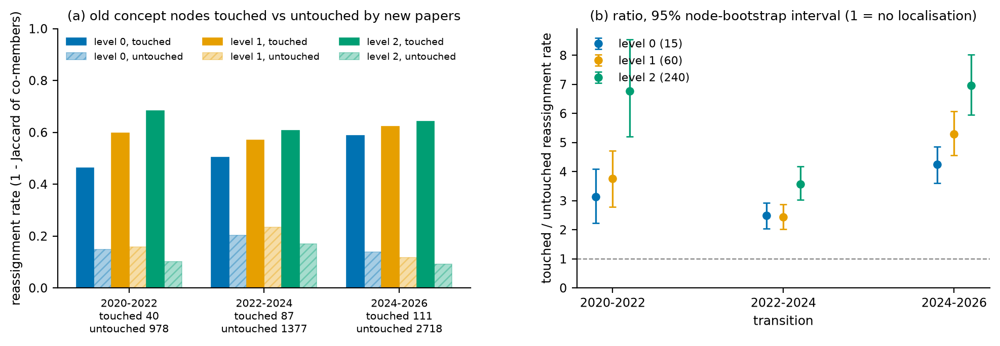
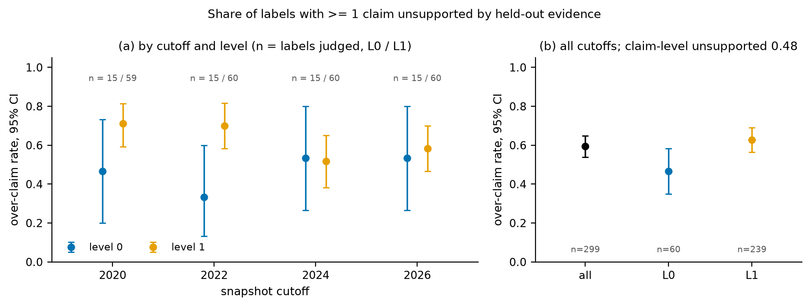
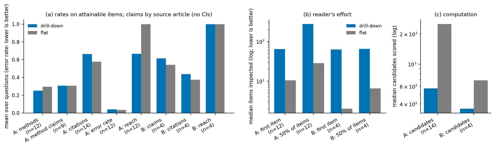

# Budgeted Semantic–Hypergraph Agglomeration over an Evolving Knowledge Hypergraph

**Alexey Reznik**

**Abstract.** We build a budgeted, laminar, three-level abstraction of a temporal knowledge hypergraph cut into four
cumulative snapshots at year cutoffs. The method (SHAC) is a deterministic greedy agglomeration whose merge score mixes, on a common
rank scale, a name-similarity term and a structural term computed on the collapsed hyper-edge incidence, with a
localised prior from the previous snapshot. Laminarity, exact budgets and the hyper-edge collapse rule hold by
construction. Coherence is graded with a signal the method never sees, bibliographic coupling of concept-disjoint
papers, against a configuration null and random labels; stability against perturbation and against a random-attachment
null; label faithfulness against held-out evidence; and extrinsic utility by drill-down retrieval against flat search.
Five values of the semantic weight α are compared on all four criteria; the recommended α = 0.75 is the shipped
default (§5.2) <!-- claim:recommended -->, and its verdicts are computed from the run outputs and summarised in Table 12 (§5.4).
The recommendation rests on coherence, stability and faithfulness. Its utility for navigation is mixed and not
established: drill-down scores fewer candidates than flat search, but needs more inspection and reaches fewer
type-A questions <!-- claim:navigation_not_established -->.

*Every result number, every table and every figure is generated from `out/metrics.json`: tables and verdicts by
`make_tables.py` (`make tables`), including the recommendation of Table 3 and the verdicts of Table 12, and figures by
`eval/figures.py`. The text quotes no result values, except §5.2, which names the recommended variant and reads its
trade-offs off Tables 3, 4 and 11; elsewhere it interprets the tables. Each hand-written claim about the results
carries a tag that `make_tables.py` checks against `out/metrics.json` on every run. Snapshots are written ≤t; levels
are L0 (coarsest), L1 and L2 (finest).*

## 1. Problem definition

The Temporal Knowledge Hypergraph (TKH) represents scientific literature as typed nodes (methods, tasks, datasets,
metrics, …) joined by dated hyper-edges of arbitrary arity. The assignment asks for a multi-resolution semantic
abstraction: per snapshot H(t), a laminar sequence of partitions under hard per-level budgets (P1, P2) whose
super-nodes are close in meaning (P3), computed on the hypergraph rather than a pairwise projection (P4), evolving
smoothly with trackable identities (P5), and labelled without unsupported claims (P6). The tasks cover the method and
its formal statement (T2), temporal coupling (T3), an implemented hyper-edge collapse rule (T4), labelling (T5) and a
circularity-safe evaluation (T6). We use the provided temporal export and cut it into four cumulative snapshots,
≤2020, ≤2022, ≤2024 and ≤2026, where snapshot ≤t contains every node and hyper-edge of the papers published in year t
or earlier.

## 2. Formal statement

The export contains two kinds of nodes. We call *concept nodes* the nodes of the seven types that name a scientific
idea (method, task, problem, technique, component, dataset and metric), and write V_t for the concept nodes of
snapshot t, n_t = |V_t|. The remaining nodes (articles, claims, authors and cited works) record papers rather than
ideas: grouping them by meaning is ill-defined, and the citations among them must stay outside the method so that
§5.1 can use them as an independent ruler. SHAC therefore clusters V_t only, the budgets count groups of ideas, and
the other nodes are placed afterwards, as described at the end of this section.

Structure enters through the *clustering hypergraph* G_t = (V_t, E_t). Six relations of the export connect concept
nodes to one another (addresses, solves, extends, uses_component, uses_technique and evaluated_on), and every
hyper-edge of these relations is centred on a method of one paper: its first member is that method and the others
are the concepts the paper relates to it. E_t holds these edges from papers of year ≤ t, restricted to concept
members. A concept that occurs in more than a fraction h of the snapshot's papers, which we call a *hub*, would join
the edges of almost every paper into one connected block and leave structure unable to tell groups apart. Hubs are
therefore removed from the edges, and edges left with fewer than two members are dropped, but hubs stay in V_t and are
grouped by their names alone. An edge has weight w_e = 1/(|e| − 1), rescaled so that every relation carries the same
total weight; the first factor keeps a large edge from counting once per member pair, the rescaling keeps the most
frequent relation from dominating. Citations, claims, authorship and titles never enter G_t.

Semantics enters through a text vector z_v per concept node: the TF-IDF vector of the character 3–5-grams of its name
and aliases, reduced by truncated singular value decomposition (latent semantic analysis, LSA) fitted on the
snapshot's concept nodes, then centred and L2-normalised. Character n-grams relate names that share words or word
parts, such as spelling variants, without an external model whose training data could postdate a snapshot.

SHAC returns, for budgets (N_0, N_1, N_2), nested partitions P_{t,0} ⪰ P_{t,1} ⪰ P_{t,2} of V_t, each refining
the one above, with exactly |P_{t,k}| = min(N_k, n_t) super-nodes. The brief fixes only the scale of the coarsest
level (N_0 ≈ 10–15) and constrains neither the number of levels nor the finer budgets. We chose three levels, N_0 at
the upper end of the brief's range and a factor of four between consecutive levels. These values are
arbitrary defaults, neither derived nor tuned: the configuration accepts any number of levels from two upward and any
budget list, and `validate.py` checks a run against the budgets that built it, but the method was not evaluated under
other numbers of levels or other budgets (§6).

A nested partition under hard budgets contains NP-hard single-level problems (modularity maximisation, normalised
cut), so SHAC (semantic–hypergraph agglomerative coarsening) optimises no global objective. It is a deterministic
greedy procedure that builds the levels from the finest to the coarsest. The *items* of level k are the super-nodes of
level k+1, or the single concept nodes at the finest level, and SHAC repeatedly merges the feasible pair of items with
the largest score until min(N_k, #items) remain, so that each level coarsens the next:

$$ s(A,B) = \alpha\,F_S\big(S(A,B)\big) + (1-\alpha)\,F_H\big(H(A,B)\big), $$
$$ s_t(A,B) = (1-\gamma)\,s(A,B) + \gamma\,\Pi(A,B)\ \text{ if both } A, B \text{ hold stable old nodes, else } s(A,B). $$

- **Semantic term** S(A,B) = ⟨z̄_A, z̄_B⟩, the inner product of the mean member vectors, i.e. average linkage.
- **Structural term** H(A,B) = Σ_{e: A∈e, B∈e} w_e / √(d_A d_B), with hyperdegree d_A = Σ_{e∋A} w_e. Here A ∈ e iff e
  has a member in A, so an edge counts each super-node it touches once, however many of its members lie there; this
  *collapsed incidence* is the T4 rule of §4. The numerator is the reduction of the connectivity cut that the merge
  achieves (Proposition 1, §4), and the normaliser keeps high-degree super-nodes from absorbing everything.
- **Rank calibration.** S and H live on incommensurable scales, so each is replaced by its rank: F_S is the mid-rank
  empirical distribution function of S over all item pairs at the start of the level, F(x) = (#{pairs < x} +
  ½·#{pairs = x}) / #pairs, and F_H that of H over the pairs with H > 0, with F_H(0) = 0; both are frozen per level.
  Both terms then lie in [0, 1], and α is an explicit structure–semantics weight (α = 0 structure only, α = 1
  semantics only).
- **Temporal prior** Π(A,B) = Σ_c M_{A,c} M_{B,c} / (u_A u_B), the share of pairs of stable members of A and B that
  shared a level-k super-node c at t−1 (M_{A,c}: A's stable members in c; u_A = |A ∩ U_t|; the stable set U_t is
  defined in §3).
- **Feasibility.** A merge is allowed only if |A| + |B| ≤ ρ·n_t/N_k, a cap of ρ times the mean super-node size, which
  keeps a single super-node from absorbing the level and guarantees the budget (lemma below).
- **Ties.** S and H are rounded to 1e-12 and scores to 1e-9; ties of s_t are broken by s, then by the lowest item
  index, which makes the build deterministic.

α = 0.75 was selected by the comparison of five values in §5.2 <!-- claim:recommended -->; γ and ρ are stated priors, not selected on any
result.

**Lemma (budget feasibility).** If ρ ≥ 2 and K > N_k items remain, the two smallest have total size
≤ 2n_t/K < ρ·n_t/N_k, so a feasible merge exists and every level meets its budget exactly.

**Complexity.** Per level with n items, m edges and LSA dimension d: O(n²(m + d)) initialisation, O(n(m + d)) per
merge (O(n²) worst case), O(n²) memory.

Every non-concept node is finally *anchored*: at every level it joins the super-node of one concept node, its anchor.
A claim is anchored to the method on its claims edge (or, failing that, to the method its paper presents), an article
to the method it presents, and any other node (an author or a cited work, for example) to the method presented by
the earliest paper in which it occurs. Anchoring makes each level a partition of the whole snapshot, as P1 requires, and lets a reader or an agent
drilling down reach the papers and claims behind a group, while citations, claims and authorship still have no
influence on how concept nodes are grouped. Table 1 lists which properties follow from this construction and which
are measured.

*Table 1. Guaranteed and measured properties.*

<!-- table:properties -->
| Property | Status | Evidence |
|---|---|---|
| P1 laminarity, P2 budgets | by construction (merge-only levels; budget lemma) | `validate.py` on every run |
| P4 hyper-edge fidelity | by construction (score on the collapsed incidence; multi-way edges kept whole) | §4 |
| No future information (structure, membership) | by construction (snapshot-only edges, hubs, LSA, anchors) | `validate.py` member cutoffs |
| Structure–semantics trade-off (P3) | empirical (α sweep; α chosen on these results) | Tables 3–4, Fig. 1 |
| P3 semantic coherence | empirical | Tables 5–6, Fig. 2 |
| P5 temporal stability | by construction (prior, persistent ids); size empirical | Tables 7–9, Figs. 3–4 |
| P6 faithful labels | empirical | Table 10, Fig. 5 |
| T6 extrinsic utility | empirical | Table 11, Fig. 6 |
<!-- /table:properties -->

We rejected two credible alternatives. Hypergraph modularity (h-Louvain [1]) sets the number of communities only
through a resolution parameter and does not nest across resolutions, whereas P2 is a hard constraint and P1 requires
nesting. A two-stage scheme, clustering by structure first and by semantics second, would freeze single-paper bundles
before names could join them across papers.

## 3. Method and literature positioning

The central question of P3 is how to reconcile structure and semantics where they disagree. We assume that names
relate generic tasks and techniques better than proper-named methods (a shared "-Net" suffix does not make a family),
and that structure relates mainly concepts used together within one paper, since every clustering edge comes from one
paper's relations around its method. SHAC therefore resolves the disagreement per merge rather than per level: on the
common rank scale either signal can carry a merge, and a pair that shares no edge receives no structural credit and
can win only on semantics, at weight α. Because the trade-off is a single scalar on a common scale, it can also be
evaluated: the coherence ruler of §5.1 sees neither signal, so structure-only (α = 0), mixed and semantics-only
(α = 1) builds can be compared on equal footing. §5.2 makes this comparison over five values of α and
selects the shipped value.

Temporal stability (T3) is enforced by a soft prior over a *stable set*. When snapshot t is built, the old concept
nodes, those already present at t−1, are divided into touched and stable ones. A node is *touched* if it is a member
of a clustering edge from a new paper, if its hub status changed, or if it shares an old edge with a node whose hub
status changed; the remaining old nodes form the stable set U_t. The structural neighbourhood of a
stable node is the same as at t−1, apart from edge weights rebalanced by the new edges, so the corpus gives no reason
to change its grouping. Only pairs of items that both hold stable nodes receive Π, while new and touched nodes are
placed by structure and names alone. Change can thus occur where the corpus changed, and untouched regions are pulled,
not forced, to stay together. Super-node identities and the log of births, growths, merges and splits come from
largest-overlap matching of super-nodes between consecutive snapshots (`tkh/temporal.py`) and are checked by
`validate.py`; deaths cannot occur because snapshots only grow. The mechanism costs O(n²N_k) extra initialisation per
level and makes each snapshot depend on the path of the earlier builds.

*Table 2. Positioning against the closest prior work.*

<!-- table:literature -->
| Work | Borrowed | Done differently, and why |
|---|---|---|
| h-Louvain [1] | hyper-edge-aware affinity on the native incidence; multilevel aggregation | no modularity or resolution parameter; exact nested budgets; a semantic term |
| Featured Graph Coarsening [2] | joint topology–feature coarsening | on the hyper-edge incidence; greedy merges, not a learned coarse graph; no similarity guarantee claimed |
| DynHAC [3] | average linkage; confining change to affected regions | a soft prior instead of affected-region recomputation (frozen regions would occupy budget slots); its locality theorem needs a reducible linkage, which H is not |
| HyperEF 2.0 [4] | contracting hyper-edges while keeping coarse edges explicit | no ratio or spectral target (P2 fixes the counts); multi-way edges scored by the connectivity cut |
<!-- /table:literature -->

The hypergraph setting needs these departures because a clique projection counts a multi-way edge once per member
pair, rewarding already-large paper bundles (§4); the temporal setting needs them because static or
ratio-controlled coarseners give neither persistent identities nor fixed display sizes. The structural null follows
the hypergraph configuration model [5], and Π is an evolutionary-clustering term [6]. The contribution is their
integration under hard budgets with an evaluation that does not reuse the method's signals.

## 4. Coarsening decision

When the endpoints of a fine hyper-edge fall into super-nodes, the edge must be given a form at the coarser level.
For a fine edge e of reduced arity n_e (its members after hub removal), let c_S(e) be the number of its endpoints in
super-node S, λ_e = #{S : c_S(e) > 0} the number of super-nodes it touches, and m_e = max_S c_S(e) the largest number
of endpoints that share one super-node, the brief's m. `tkh/coarsen.py` assigns every edge to exactly one of three
classes:

- **m_e = n_e (λ_e = 1): internal.** The edge drops out of every H numerator, but its weight stays in d_A, which damps
  super-nodes that have already absorbed much of their incident weight.
- **1 < m_e < n_e (2 ≤ λ_e < n_e): partial.** The edge becomes one coarse hyper-edge over its λ_e super-nodes; the
  endpoint counts are kept as metadata, and only presence is scored.
- **m_e = 1 (λ_e = n_e): uncollapsed.** The fine edge itself, with one endpoint per super-node, scored like a partial
  edge.

An edge whose endpoints land in three or more distinct super-nodes (λ_e ≥ 3) is flagged *multi-way*. The flag is not
a fourth class, since a multi-way edge is partial or uncollapsed: it stays one hyper-edge, is never split into pairs,
and adds w_e to the H numerator of every pair of super-nodes it touches.

**Proposition 1.** Let C = Σ_e w_e(λ_e − 1), the weighted number of super-nodes each edge spans beyond its first. C is
zero when every edge lies inside one super-node and is the standard connectivity, or (λ − 1), objective of hypergraph
partitioning. Merging A and B reduces C by exactly Σ_{e∋A,B} w_e, since each such edge loses one distinct super-node
and no other edge changes. The structural numerator is thus the gain in this objective, for any arity.

The rule follows from how the edges arise. Every clustering edge is a star around one paper's method, so a score that
projects the edge onto a clique and rates a pair by the product of endpoint counts, c_A(e)·c_B(e), pays a super-node
more the more of one paper's star it already holds, and thereby rewards bundling the concepts of single papers.
Counting presence credits each edge once per super-node instead, whatever its arity. The rule is the one the method
applies: the incidence is updated after every merge (`_Level.merge`), and the same partition writes
`out/<t>/coarse_hyperedges.json`, which records every coarse edge of each level with its class (internal, partial,
uncollapsed), the multi-way flag and per-level counts. Native and clique scores diverge whenever a shared edge has two
or more endpoints on one side; `out/run_info.json` records per snapshot and level how many merges this holds for
(`multi_endpoint`), together with the merges that share an edge (`linked`) and those under the prior (`prior`).
Whether a clique build would have *chosen* different merges was not measured. The price of the rule is information that the coarse edges no longer
carry into the score: the multiplicity of endpoints within a super-node, which fine members took part (kept only as
fine edge ids in the records) and the identity of a coarse edge across levels. Parallel coarse edges, fine edges that
collapse onto the same super-nodes, are not merged into one, which leaves the score unchanged because H and d_A are
sums over edges.

## 5. Evaluation

The evaluation measures the four properties the brief names (coherence, temporal stability, label faithfulness and
extrinsic utility) under one principle: each property is graded with a signal the method never used and, where the
chance level is not obvious, against a null model that destroys the property while keeping everything else. §5.1
defines the four metrics. §5.2 applies them to five values of the semantic weight α, compares the variants and
recommends one, which is the configured default, α = 0.75 <!-- claim:recommended -->. §5.3 evaluates that variant in detail, and §5.4
summarises the findings.

### 5.1 Metrics

#### 5.1.1 Coherence

SHAC groups concept nodes because their names are similar (the semantic term) or because they occur together in the
six clustering relations (the structural term). A coherence score computed from either signal would be high by
construction: the method merged exactly the pairs that score well on it, so the score would restate the merge
criterion instead of testing whether a group is meaningful. This is the circularity hazard of the brief.
`eval/coherence.py` removes it in four steps and then compares the result with two null models.

The first step replaces the ruler by a held-out signal, *bibliographic coupling*: two papers are coupled to the extent
that they cite the same works. We measure it as c_pq, the cosine similarity (Salton's measure) of the two papers'
cited-work sets, in which each cited work is weighted by its inverse document frequency (IDF, the logarithm of the
inverse share of citing papers that cite it), so that widely cited works count less. Citations never enter G_t, z_v
or Π, so the method cannot have optimised c_pq.

The second step closes a leak through names. A paper often cites the work that introduced a concept it uses, so that
"extends X" and "cites X" occur together, and coupling would then partly reflect shared concept names. A *residual
name filter* therefore drops every citation to a work named like one of the citing paper's own concepts. The *exact*
filter requires a shared normalised name; the stricter *fuzzy* filter also drops a citation when one name contains the
other, for names of at least four characters. Both filters are run, and the exact one is primary.

The third step scores only *no-overlap pairs*, paper pairs that share no concept node and no concept name. For such a
pair, the hierarchy can relate the two papers only by grouping different concepts together, so a shared node or name
cannot explain a high score.

The fourth step controls for publication period. The co-assignment a_pq = Σ_S n_S(p) n_S(q) / (n_p n_q) measures how
much a level puts the two papers' concepts into the same super-nodes (n_S(p): concepts of p in super-node S; n_p: all
concepts of p). The *lift* Σ a_pq c_pq / Σ a_pq e_pq asks whether the pairs a level co-assigns are more strongly
coupled than expected, where e_pq is the mean coupling of the no-overlap pairs whose papers fall in the same *period
stratum* as p and q; 1 is chance. Standardising by e_pq removes a confounder: papers of the same era cite the same
works and also share vocabulary and relations, so an unadjusted lift would reward a hierarchy for grouping by era.
Because the choice of strata is itself arbitrary, five *period schemes* are run: the snapshot cutoff intervals
(*interval*, primary), bins of one, two and three years (*year1*, *year2*, *year3*), and the absolute difference of the
two publication years (*gap*). Intervals for the lift come from a paper-cluster bootstrap.

The lift is then compared with two null models, each with a fixed number of replicates. The *configuration null*
rebuilds the whole hierarchy on a shuffled export in which hyper-edge members are traded between edges of the same
relation, period and member type, so that every node keeps its degree and every edge its arity [5]. It keeps the real
names, so it asks what the observed hyper-edge structure adds beyond degrees. The *random-label null* permutes concept
nodes within type × entry interval over the fixed tree, which keeps the size and period mix of every super-node but
breaks its membership. Each p-value is one-sided, (1 + #{null ≥ observed}) / (R + 1). A cell (snapshot × level) is
*robust* if its lift beats both nulls at the significance level under every period scheme, and *below both nulls* if
under every scheme it lies below the 2.5% quantile of both null distributions. A cell is *not evaluable* if its
primary scheme has a single period stratum, because neither that scheme nor the random-label null, which permutes
within the same strata, then controls for period, and *undefined* if the level co-assigns the concepts of no
evaluable pair. p-values are not corrected across cells. A robust cell means that its level co-assigns concepts of
citation-coupled, concept-disjoint papers more than both nulls under every period scheme; a cell below both nulls
means that the citation signal does not support that level's groupings. The tests are conditional on the corpus, so a
robust cell reads "better than chance on this corpus", not a population estimate.

#### 5.1.2 Stability

Stability is measured in three ways: robustness of one snapshot to perturbed input, agreement between consecutive
snapshots, and whether the change between snapshots stays where the corpus changed. All three are computed on concept
nodes only, because anchored nodes follow their anchors and would inflate agreement.

*Perturbation robustness* follows the brief: a fraction of all hyper-edges is removed for several seeds, stratified by
period × relation so that no period or relation loses a disproportionate share, and the whole snapshot chain is
rebuilt. Each perturbed snapshot is compared with the unperturbed one by the adjusted Rand index (ARI) per level,
which is 0 for chance agreement and 1 for identical partitions, and by HARI, a laminar analogue that pools the
pair-counting terms of ARI over the levels, HARI = Σ_k(I_k − E_k) / Σ_k(M_k − E_k). Here I_k is the number of concept
pairs that share a super-node at level k in both hierarchies, E_k its expectation under a random relabelling and M_k
its maximum. HARI is 1 for identical trees and weighs each level by its pair mass M_k − E_k, so the coarsest level
dominates it. Intervals are t-intervals over the seeds.

*Cross-snapshot agreement* compares consecutive snapshots on the concept nodes they share, with the same indices and
percentile intervals over half-subsamples of those nodes. Agreement alone says little here, since most of an old
snapshot survives into the next and the prior pulls stable nodes together. It is therefore tested against a
*new-paper null*: the new papers keep their edges, but each of their old endpoints is redrawn among the old nodes of
its type in proportion to degree, and snapshot t is rebuilt from the real hierarchy at t−1. The null keeps the past
graph, the past hierarchy and the prior and replaces only which old nodes the new papers touch, so an index above the
null shows that the real attachment pattern preserves more of the hierarchy than random attachment would, and an
index that is not above it is explained by what the null shares with the run.

*Localisation of change* tests the requirement of P5 that change stays where the corpus changed. For each transition
and level, the *reassignment* of an old concept node is 1 − the Jaccard similarity of its co-member sets in the two
snapshots, 0 if it keeps exactly its co-members and 1 if it keeps none. Localisation compares the mean reassignment of
old nodes that new papers touch (members of any edge of a new paper, a wider set than the complement of U_t) with that
of untouched old nodes; a ratio whose node-bootstrap interval lies above 1 means that change concentrates on touched
nodes. The share of all reassignment that falls on untouched nodes complements the ratio: a share near zero would
mean that untouched regions are frozen, a large share that they still move.

#### 5.1.3 Label faithfulness

L0–L1 labels and one-sentence glosses come from the labeller. The *evidence* of a super-node is a list of text lines
from its snapshot: member concept names with types and aliases, clustering facts (each incident edge written as
"method, relation, members"), member claims, future-work topics and paper titles. Citations are excluded, because they
are the coherence ruler. The evidence is split 50/50 with a fixed seed, stratified by kind, into a *seen half*, which
the labeller receives, and a *held-out half*, which only the judge receives; both halves are recorded in
`out/<t>/label_inputs.json`. To make labels discriminative, the labeller also sees as *contrast* a few seen-half
concept names of the same-level groups that share the most clustering edges with this one, and is asked for a label
that fits this group and not those. A judge from another model family splits label and gloss into at most three
*atomic claims* and checks each against the held-out half. A claim counts as supported only if the judge cites a
held-out line that exists, a deterministic check against a judge that agrees without evidence. The decomposition is
subject to a *content check*: each claim must reuse at least 80% of its content words from label and gloss and keep a
specific word. If any claim fails the check, or no claim is returned, the decomposition fails and label and gloss are
judged as two claims instead, so that no part of the label goes unjudged. As a sensitivity check, the over-claim rate
is also computed under the alternative rule that drops the failing claims and judges the remaining ones, falling back to label and
gloss only when none remain (Table 10 note). The *over-claim rate* is the share of
labels with at least one unsupported claim, and the claim-level rate the share of unsupported claims. Deterministic
checks without an LLM flag years after the cutoff, method or dataset names that belong to no member, and entities
that first appear after the cutoff. Because the judge reads only the held-out half, restating the labeller's input
cannot pass, but both halves use the same kinds of text, so shared vocabulary between them is not controlled. The
judge is not validated and there is no null baseline, so the rate is descriptive, and the deterministic flags count
name matches that were not adjudicated by hand.

#### 5.1.4 Extrinsic utility

The extrinsic task is question answering over the hierarchy. An agent answers the questions of `data/questions.csv`
at the latest snapshot not after the date the question names, or the last snapshot if it names none (type A, a
specific search for methods, their claims and their citations; type B, a synthesis of the claims and citations behind
a statement). The *drill-down* agent starts at L0 and runs a beam search: at each level it scores the children of the
super-nodes kept at the level above and keeps the best few (the *beam*), and the leaves of the kept L2 super-nodes
form a pool that is ranked to give the k answers. Every text, whether a super-node's label, gloss and member centroid
or a leaf's name, aliases, relation neighbours and paper title, is scored by keyword overlap with the question. The
*flat* baseline ranks all leaves of the answer kinds in the snapshot with the same scorer. Only the evaluator reads the ground truth
(`data/ground_truth.json`) and resolves each gold item to graph nodes by exact name or acronym; gold items that no
node can match are excluded, and the rest are called *attainable*. Table 11 gives the attainable and total counts
next to each hit-rate, and an *end-to-end* rate that counts unattainable items as misses. The attainable-only rate
compares the two systems on what the graph can answer, and the end-to-end rate measures answers against the full
ground truth.

The measures are computed on attainable items:
- **Hit-rate:** the share of gold items the answer returns, per kind: methods; method claims; claims; and citations.
- **Error rate:** the share of returned items that the ground truth lists as wrong-domain or outdated.
- **Items inspected (the reader's effort):** the labelled L0 and L1 super-nodes the drill-down shows, then the item's
  rank in its ranked pool of leaves (not only the k returned answers). For flat search it is the item's rank among all
  leaves of the answer kinds. It is counted to the first item and to 50% of the
  items. An item that is never reached is censored at the number of candidate leaves plus one, and the counts are
  summarised by medians.
- **Reach:** the share of questions with at least one target anywhere in the system's ranked leaves. Flat search
  ranks every leaf, so its reach is 1 by construction. Reach therefore measures the targets that drill-down loses by
  pruning, and it can favour only flat search or neither.
- **Candidates scored (computation):** the super-nodes scored at every level plus the pooled leaves ranked. For flat
  search it is every leaf of the answer kinds. This count is not a wall-clock latency, which was not measured. It is
  reported apart from the other measures and is not part of the count of measures favouring a system.

The scope of the evaluation is limited in three ways:
- **Claims are credited by source article, not by content.** A method claim is a hit when a found method comes with
  a claim from one of its evidence papers. A required type-B claim is a hit when the answer returns any claim from one
  of its source articles. The returned claim's text is never compared with the requested assertion, so one returned
  claim can credit several assertions of the same sources, and several required claims of one question can share the
  same set of acceptable claims. A method returns its first graph claims in a fixed order, so the method
  claims it returns do not depend on the question. The claim hit-rates therefore measure *source-associated*
  retrieval, not retrieval or entailment of each required claim; validating claims is left to future work (§6).
- **All values are point estimates over few questions.** There are 14 type-A and 4 type-B questions, with no
  intervals and no paired tests, so no difference between drill-down and flat search is established. Type B in
  particular is descriptive.
- **The settings were chosen with these questions in view.** These are the beam, k, the label weight and the answer
  kinds. There is no development/test split, so every T6 number is in-sample.

### 5.2 Choosing α: comparison of variants and recommendation

The semantic weight α is the one parameter that sets the structure–semantics trade-off of P3: α = 0 builds the
hierarchy from structure alone, α = 1 from names alone. It was varied over 0, 0.25, 0.5, 0.75 and 1 <!-- claim:sweep_grid --> with every other
parameter at its default, and each variant was built and evaluated with the full protocol of §5.1 (`make sweep`;
details in `docs/alpha_sweep.md`). The configuration null of the coherence test is rebuilt at each variant's own α.
The stability comparisons with the pre-sweep default, α = 0.5 <!-- claim:reference -->, are paired: the perturbation runs of every variant
remove the same hyper-edges seed by seed, and the cross-snapshot comparison uses the same node subsamples; the other
comparisons are of counts or of separate intervals. Table 3 gives one headline per criterion and variant, and Figure 1 the underlying
per-level and per-snapshot values.

*Table 3. α variants across the four criteria, every other parameter at its default; the recommended variant in bold
(`alpha_sweep`). The T6 column counts point estimates of correlated measures: it is a descriptive simplification, not
independent votes on utility.*

<!-- table:alpha_sweep -->
| α | P3 robust / below-null cells (exact) | P5 perturbation HARI ≤2026 [t-interval] | P5 paired difference to the pre-sweep default | P6 over-claim [95% CI] | T6 measures favouring drill-down / flat / tie | Eligible | Recommendation |
|---|---|---|---|---|---|---|---|
| 0 | 2 / 1 | 0.22 [0.20, 0.25] | 0.05 [0.02, 0.08] | 0.55 [0.49, 0.61] | 1 / 10 / 1 | yes |  |
| 0.25 | 3 / 2 | 0.18 [0.17, 0.20] | 0.01 [-0.01, 0.03] | 0.57 [0.51, 0.63] | 4 / 7 / 1 | yes |  |
| 0.5 (pre-sweep default) | 3 / 3 | 0.17 [0.16, 0.18] | — | 0.61 [0.55, 0.67] | 3 / 8 / 1 | yes |  |
| **0.75 (default)** | **7 / 0** | **0.19 [0.15, 0.23]** | **0.02 [-0.03, 0.07]** | **0.63 [0.58, 0.68]** | **3 / 7 / 2** | **yes** | **recommended** |
| 1 | 0 / 0 | 0.90 [0.83, 0.96] | 0.73 [0.67, 0.79] | 0.57 [0.52, 0.63] | 3 / 8 / 1 | yes |  |

Recommended: α = 0.75. Coherence cells are out of 12 (snapshot × level), retrieval measures out of 12.
<!-- /table:alpha_sweep -->

*Figure 1. Per α: (a) held-out lift at the last snapshot per level; (b) perturbation HARI per snapshot; (c) over-claim
rate, overall and per level; (d) retrieval hit-rate differences, drill-down minus flat.*

The recommendation follows a rule applied by `make_tables.py`. A variant is *eligible* unless it is distinguishably
worse than the pre-sweep default where an interval exists: its paired HARI difference lies wholly below zero, or its
over-claim interval lies wholly above the default's. Among the eligible variants, the one with the most robust
coherence cells is recommended; ties go to the higher HARI, then to the value closer to the pre-sweep default.
Coherence decides because it tests directly whether groups mean something, with a held-out ruler that neither term
of the merge score contains; retrieval is graded against external ground truth too, but with few questions, no
intervals and settings chosen with these questions in view (§5.1.4).
Stability and faithfulness guard against a clear loss relative to the pre-sweep default rather than relative to the
best variant, because a names-only build is insensitive to edge removal for a reason unrelated to the quality of its
groups: removing edges does not change names. This guard was revised once after the results were read
(`docs/alpha_sweep.md` §9).

The rule recommends α = 0.75, and we ship it <!-- claim:recommended -->: it is the configured default from which `out/` is built, and §5.3
evaluates it in detail. Table 4 sets its headlines against the pre-sweep default and against the best variant on
each headline. On coherence, the deciding criterion, α = 0.75 has the most robust cells of all variants and no cell
below both nulls <!-- claim:most_robust -->. At the last snapshot, which the rule uses, its perturbation robustness and its over-claim rate are
not distinguishable from those of the pre-sweep default <!-- claim:last_indistinct -->. The coherence gain is therefore not bought with a measurable
loss of faithfulness, and with a loss of stability only at the first snapshot and across one transition (Table 4) <!-- claim:stability_loss -->.
The trade-offs are the following:

- **Stability is lower at the first snapshot and is not maximised.** Over all snapshots and transitions, Table 4
  lists where the paired HARI differences to the pre-sweep default exclude zero: α = 0.75 is distinguishably less
  robust to perturbation at the first snapshot and agrees less across one transition, and agrees more across another <!-- claim:stability_loss -->.
  The most robust variant to perturbation is α = 1, robust only because removing edges cannot change a grouping made
  from names, and it has no robust coherence cell; every variant that uses structure, α = 0.75 included, is far less
  robust to edge removal <!-- claim:names_most_robust -->.
- **Faithfulness is not maximised.** The variant with the lowest over-claim rate is a different one (Table 4), and
  α = 0.75 does not reduce over-claim relative to the pre-sweep default: more coherent groups did not make labels
  easier to support <!-- claim:faith_tradeoff -->.
- **Retrieval changes in both directions.** Drill-down beats flat search on the same small number of measures as at
  the pre-sweep default (Table 3), but the individual measures move both ways (Table 4): some improve, while others,
  among them type-A reach, are worse, so more questions are never reached. Drill-down scores fewer candidates than
  flat search, but a reader inspects more items before reaching the first target item (Table 11) <!-- claim:retrieval_mixed -->. These are point estimates over
  few questions, without intervals, and do not enter the rule.
- **The choice is optimistic.** The variant was selected on the same evaluation data that report its quality in
  §5.3, so its scores there include the noise the selection favours, and the rule's guard was revised with the
  results in view. An unbiased estimate needs the choice made on one half of the held-out citations and reported on
  the other (§6).

*Table 4. Recommended variant against the pre-sweep default and against the best variant on each headline;
"distinguishable" uses the same intervals as the rule. T6 rows are point estimates without intervals; the favour
count is a descriptive simplification, not independent votes, and candidates scored are not counted.*

<!-- table:alpha_tradeoffs -->
| Headline | Recommended, α = 0.75 (default) | Pre-sweep default, α = 0.5 | Difference | Best variant on this headline | Recommended against the pre-sweep default |
|---|---|---|---|---|---|
| P3 robust coherence cells (exact) | 7 | 3 | +4 | α = 0.75 (default): 7 | better (count, no interval) |
| P3 cells below both nulls (exact) | 0 | 3 | -3 | α = 0.75 (default), α = 1: 0 | better (count, no interval) |
| P5 perturbation HARI ≤2026 | 0.19 [0.15, 0.23] | 0.17 [0.16, 0.18] | 0.02 [-0.03, 0.07] (paired by seed) | α = 1: 0.90 | no distinguishable difference (paired interval contains 0) |
| P5 paired HARI differences, every snapshot and transition | 2 below 0, 1 above 0 | — | of 7 paired intervals | — | worse at ≤2020 (perturbation), 2022→2024 (cross-snapshot); better at 2024→2026 (cross-snapshot) |
| P5 cross-snapshot indices above the new-paper null | 2 | 1 | +1 | α = 1: 4 | better (count, no interval) |
| P5 localised level × transition cells | 9 | 9 | 0 | α = 0.25, α = 0.5 (pre-sweep default), α = 0.75 (default): 9 | same count |
| P6 over-claim rate | 0.63 [0.58, 0.68] | 0.61 [0.55, 0.67] | +0.017 (unpaired) | α = 0: 0.55 | no distinguishable difference (intervals overlap) |
| T6 retrieval measures favouring drill-down (descriptive count, not votes) | 3 | 3 | 0 | α = 0.25: 4 | same count |
| T6 drill-down measures against the pre-sweep default (point estimates) | 5 better / 3 same / 4 worse | — | — | — | worse: A hit-rate, methods; A reach; B hit-rate, claims, by source article; B items inspected to first item (median). Better: A hit-rate, method claims, by source article; A hit-rate, citations; A items inspected to first item (median); A items inspected to 50% of items (median); B items inspected to 50% of items (median) |
<!-- /table:alpha_tradeoffs -->

### 5.3 Evaluation of the recommended variant (α = 0.75)

The tables and figures of this section describe the run in `out/`, built with the configured default α = 0.75 and
identical to the α = 0.75 variant of §5.2 <!-- claim:main_run_identical -->. Its results are those on which α was selected, and the caveat of §5.2
applies to all of them.

#### 5.3.1 Coherence

Table 5 shows how much held-out evidence each snapshot provides, and therefore where the tests of Table 6 are
powered; Table 6 and Figure 2 give the lift and the verdict of every cell.

*Table 5. Coverage of the held-out ruler (`coherence.snapshots.<t>.coverage`).*

<!-- table:coherence_coverage -->
| Snapshot | Citing papers | No-overlap pairs | Coupled pairs (exact / fuzzy) | Filtered citations (exact / fuzzy) | Period strata (interval scheme) |
|---|---|---|---|---|---|
| ≤2020 | 9 | 18 | 5 / 4 | 38 / 56 | 1 |
| ≤2022 | 14 | 34 | 11 / 10 | 73 / 107 | 3 |
| ≤2024 | 25 | 100 | 21 / 20 | 162 / 222 | 6 |
| ≤2026 | 37 | 253 | 58 / 51 | 260 / 342 | 10 |
<!-- /table:coherence_coverage -->

*Table 6. Held-out lift, interval scheme, exact filter, against both nulls; verdicts computed from all period schemes
under the exact and the fuzzy filter (`coherence.snapshots.<t>.levels[k]`).*

<!-- table:coherence -->
| Snapshot | Level | Lift, interval, exact [95% CI] | Null means (config. / labels) | p (config. / labels) | Schemes passed (exact / fuzzy) | Verdict, exact | Verdict, fuzzy |
|---|---|---|---|---|---|---|---|
| ≤2020 | L0 | 0.42 [0.10, 2.01] | 0.97 / 0.98 | 1 / 1 | 0 / 0 | not evaluable (one interval-scheme stratum) | not evaluable (one interval-scheme stratum) |
| ≤2020 | L1 | 1.02 [0.35, 2.28] | 0.97 / 0.99 | 0.33 / 0.339 | 2 / 5 | not evaluable (one interval-scheme stratum) | not evaluable (one interval-scheme stratum) |
| ≤2020 | L2 | 0.82 [0.12, 2.44] | 1.02 / 0.99 | 0.93 / 0.923 | 0 / 0 | not evaluable (one interval-scheme stratum) | not evaluable (one interval-scheme stratum) |
| ≤2022 | L0 | 1.33 [0.47, 2.76] | 1.02 / 1.00 | 0.01 / 0.001 | 3 / 3 | significant, 3/5 schemes | significant, 3/5 schemes |
| ≤2022 | L1 | 1.74 [0.45, 3.29] | 1.06 / 1.00 | 0.01 / 0.001 | 5 / 5 | **robust** | **robust** |
| ≤2022 | L2 | 1.48 [0.40, 2.47] | 1.14 / 1.00 | 0.01 / 0.001 | 4 / 5 | significant, 4/5 schemes | **robust** |
| ≤2024 | L0 | 1.34 [0.75, 1.90] | 1.03 / 1.00 | 0.01 / 0.001 | 5 / 5 | **robust** | **robust** |
| ≤2024 | L1 | 1.61 [0.72, 2.19] | 1.06 / 1.00 | 0.01 / 0.001 | 5 / 5 | **robust** | **robust** |
| ≤2024 | L2 | 1.59 [0.72, 2.07] | 1.11 / 1.00 | 0.01 / 0.001 | 5 / 3 | **robust** | significant, 3/5 schemes |
| ≤2026 | L0 | 1.22 [0.85, 1.52] | 1.01 / 1.00 | 0.01 / 0.001 | 5 / 5 | **robust** | **robust** |
| ≤2026 | L1 | 1.53 [0.91, 2.26] | 1.04 / 1.01 | 0.01 / 0.001 | 5 / 5 | **robust** | **robust** |
| ≤2026 | L2 | 1.85 [0.91, 2.72] | 1.06 / 1.00 | 0.01 / 0.001 | 5 / 5 | **robust** | **robust** |
<!-- /table:coherence -->

*Figure 2. Period-adjusted held-out lift (exact filter) with both null bands; 1 = chance.*

Table 12 lists the robust and below-null cells. The paper-bootstrap intervals of Table 6 give the sampling
uncertainty of each lift, and Table 5 shows which snapshots have too few period strata to be evaluable.

#### 5.3.2 Stability

*Table 7. Perturbation robustness against the unperturbed run, mean [t-interval] over seeds
(`stability.perturbation`).*

<!-- table:perturbation -->
| Snapshot | ARI L0 | ARI L1 | ARI L2 | HARI |
|---|---|---|---|---|
| ≤2020 | 0.36 [0.30, 0.41] | 0.62 [0.57, 0.66] | 0.88 [0.85, 0.91] | 0.43 [0.38, 0.48] |
| ≤2022 | 0.26 [0.21, 0.32] | 0.44 [0.41, 0.48] | 0.75 [0.71, 0.79] | 0.32 [0.27, 0.37] |
| ≤2024 | 0.18 [0.14, 0.23] | 0.32 [0.28, 0.35] | 0.62 [0.60, 0.64] | 0.23 [0.19, 0.27] |
| ≤2026 | 0.15 [0.11, 0.20] | 0.26 [0.23, 0.30] | 0.55 [0.53, 0.58] | 0.19 [0.15, 0.23] |
<!-- /table:perturbation -->

*Table 8. Cross-snapshot agreement against the new-paper null (`stability.cross_snapshot`).*

<!-- table:cross_snapshot -->
| Transition | Common nodes | ARI L0: run vs null mean (p) | ARI L1 | ARI L2 | HARI | Indices above the null (p ≤ 0.05, uncorrected) |
|---|---|---|---|---|---|---|
| 2020→2022 | 1018 | 0.84 vs 0.85 (p 0.71) | 0.90 vs 0.87 (p 0.07) | 0.91 vs 0.90 (p 0.11) | 0.86 vs 0.86 (p 0.61) | 0/4 |
| 2022→2024 | 1464 | 0.75 vs 0.80 (p 0.91) | 0.81 vs 0.78 (p 0.05) | 0.81 vs 0.79 (p 0.06) | 0.77 vs 0.80 (p 0.88) | 1/4 |
| 2024→2026 | 2829 | 0.92 vs 0.92 (p 0.37) | 0.90 vs 0.90 (p 0.57) | 0.94 vs 0.91 (p 0.01) | 0.92 vs 0.91 (p 0.4) | 1/4 |
<!-- /table:cross_snapshot -->

*Figure 3. (a) Perturbation ARI and HARI; (b) cross-snapshot agreement against the new-paper null band.*

Table 7 and Figure 3a give the robustness per level and snapshot, and Table 8 and Figure 3b the agreement between
consecutive snapshots against the new-paper null; Table 12 reports HARI at the first and the last snapshot and counts
the indices above the null.

*Table 9. Localisation of change (`stability.localisation`).*

<!-- table:localisation -->
| Transition | Old nodes touched / untouched | Ratio L0 [95% CI] | Ratio L1 | Ratio L2 | Untouched reassignment L0 / L1 / L2 | Share of reassignment on untouched | Levels localised (CI > 1) |
|---|---|---|---|---|---|---|---|
| 2020→2022 | 40 / 978 | 2.19 [1.63, 2.88] | 2.37 [1.43, 3.45] | 4.75 [3.25, 6.41] | 0.18 / 0.13 / 0.09 | 84%–92% | 3/3 |
| 2022→2024 | 87 / 1377 | 1.91 [1.63, 2.20] | 2.47 [2.08, 2.87] | 3.35 [2.82, 3.93] | 0.29 / 0.21 / 0.17 | 83%–89% | 3/3 |
| 2024→2026 | 111 / 2718 | 4.34 [3.41, 5.41] | 4.41 [3.71, 5.10] | 9.02 [7.54, 10.64] | 0.09 / 0.12 / 0.06 | 73%–85% | 3/3 |
<!-- /table:localisation -->

*Figure 4. Reassignment of touched and untouched old nodes and their ratio with 95% CI.*

Table 9 and Figure 4 give the ratio and the untouched share per transition and level, and Table 12 counts the
localised cells. Without a γ = 0 control on the current build, neither localisation nor robustness can be attributed
to Π.

#### 5.3.3 Label faithfulness

*Table 10. Label over-claim against held-out evidence, bootstrap 95% CI over labels (`faithfulness`).*

<!-- table:faithfulness -->
| Group | Labels judged | Over-claim rate [95% CI] | Claim-level unsupported |
|---|---|---|---|
| All cutoffs, L0–L1 | 299 | 0.63 [0.58, 0.68] | 0.48 |
| L0 | 60 | 0.47 [0.35, 0.60] | 0.34 |
| L1 | 239 | 0.67 [0.61, 0.73] | 0.51 |
| ≤2020 | 74 | 0.65 [0.54, 0.76] | 0.52 |
| ≤2022 | 75 | 0.65 [0.55, 0.76] | 0.53 |
| ≤2024 | 75 | 0.61 [0.51, 0.72] | 0.39 |
| ≤2026 | 75 | 0.60 [0.49, 0.71] | 0.47 |

Labels 300, judged 299 (no held-out evidence: 1); decomposition passes its content check for 54% (every claim kept 163, some claims failing 135, none returned or kept 2; a failed decomposition is judged as label and gloss); sensitivity, failing claims dropped and the survivors judged: over-claim 0.60 [0.54, 0.65]; cited-line rejections 22; deterministic flags: year after cutoff 0, named non-member 31, future entity 3.
<!-- /table:faithfulness -->

*Figure 5. Over-claim rate with 95% CI (a) by cutoff and level and (b) over all cutoffs.*

Table 10 and Figure 5 give the over-claim rate overall, per level and per cutoff, and Table 12 states whether it
exceeds one half and whether the levels differ.

#### 5.3.4 Extrinsic utility

*Table 11. Drill-down retrieval against flat search; means (items inspected and candidates scored: medians) and
paired differences over attainable items (candidates scored: every answered question, independent of the gold),
point estimates without CIs; attainable and total gold items, and end-to-end
rates over all gold items with the number of questions; claims are credited by source article (§5.1.4). The favoured
column is a descriptive simplification, not independent votes; candidates scored are not counted
(`retrieval.summary`, `retrieval.diagnostics`).*

<!-- table:retrieval -->
| Type | Metric | n | Attainable / total items | Drill-down | Flat | Paired difference (mean; medians: inspection, computation) | End to end, drill-down / flat | Favoured (point estimate) |
|---|---|---|---|---|---|---|---|---|
| A | hit-rate, methods | 12 | 45/63 | 0.251 | 0.295 | -0.044 | 0.147 / 0.176 (n = 14) | flat |
| A | hit-rate, method claims, by source article | 9 | 54/188 | 0.306 | 0.306 | +0.000 | 0.066 / 0.066 (n = 14) | tie |
| A | hit-rate, citations | 14 | 65/71 | 0.664 | 0.578 | +0.087 | 0.608 / 0.527 (n = 14) | drill-down |
| A | error rate | 12 | — | 0.042 | 0.033 | +0.008 | — | flat |
| A | reach | 12 | — | 0.667 | 1.000 | -0.333 | — | flat |
| A | items inspected to first item (median) | 12 | — | 64.5 | 10.5 | +61.0 | — | flat |
| A | items inspected to 50% of items (median) | 12 | — | 278.5 | 28.5 | +156.0 | — | flat |
| A | candidates scored (median; computation, not counted) | 14 | — | 571.5 | 2524.0 | -1952.5 | — | not counted |
| B | hit-rate, claims, by source article | 4 | 32/36 | 0.615 | 0.543 | +0.071 | 0.565 / 0.493 (n = 4) | drill-down |
| B | hit-rate, citations | 4 | 14/19 | 0.438 | 0.375 | +0.062 | 0.312 / 0.263 (n = 4) | drill-down |
| B | reach | 4 | — | 1.000 | 1.000 | +0.000 | — | tie |
| B | items inspected to first item (median) | 4 | — | 63.0 | 2.0 | +61.0 | — | flat |
| B | items inspected to 50% of items (median) | 4 | — | 65.5 | 6.5 | +59.5 | — | flat |
| B | candidates scored (median; computation, not counted) | 4 | — | 359.0 | 690.0 | -331.0 | — | not counted |

Drill-down diagnostics: kept/frontier L0 0.67, L1 0.45, L2 0.50; per question, super-nodes scored 128–151, of them labelled (shown to the reader) 54–64; pool leaves 208–513; never reached: Q4 (lost at L1), Q7 (lost at L1), Q9 (lost at L1), Q10 (lost at L1).
<!-- /table:retrieval -->

*Figure 6. Drill-down against flat search per question type: (a) hit-rates on attainable items, error rate and reach;
(b) median items inspected (the reader's effort) and (c) median candidates scored (computation), log scale.*

Table 11 and Figure 6 compare drill-down with flat search per measure. The note of Table 11 gives:
- the share of scored super-nodes kept per level;
- the range of super-nodes scored per question, and how many of them are labelled and shown to the reader;
- the size of the leaf pool;
- the level at which unreached questions were lost.

The inspection and computation measures point in opposite directions. Drill-down ranks only a pool, so it scores fewer
candidates than flat search, but a reader first reads the labels on the way down <!-- claim:retrieval_mixed -->.

### 5.4 Summary of findings

*Table 12. Headline findings of the shipped variant (α = 0.75), computed by `make_tables.py` with the rules of
Tables 6–11. The P3, P5 and P6 rows are uncorrected tests or intervals. The T6 rows are descriptive point estimates,
and the favour count is a simplification of correlated measures, not independent votes or a verdict.*

<!-- table:findings -->
| Finding | Result | Qualifier | Source |
|---|---|---|---|
| P3 coherence beyond both nulls (robust: all schemes, exact filter) | ≤2022 L1, ≤2024 L0, ≤2024 L1, ≤2024 L2, ≤2026 L0, ≤2026 L1, ≤2026 L2 | fuzzy filter: ≤2022 L1, ≤2022 L2, ≤2024 L0, ≤2024 L1, ≤2026 L0, ≤2026 L1, ≤2026 L2 | Table 6 |
| P3 cells below both nulls in every scheme (exact filter) | none | fuzzy filter: none | Table 6 |
| P5 cross-snapshot indices above the new-paper null | 2 of 12 | p ≤ 0.05, uncorrected | Table 8 |
| P5 perturbation HARI, first → last snapshot | 0.43 → 0.19 |  | Table 7 |
| P5 localised level × transition cells (ratio CI > 1) | 9 of 9 | untouched share of reassignment 73%–92% | Table 9 |
| P6 over-claim rate | 0.63 [0.58, 0.68] | majority of labels | Table 10 |
| P6 L0 vs L1 over-claim | 0.47 vs 0.67 | CIs do not overlap | Table 10 |
| T6 retrieval measures favouring drill-down / flat / tie | 3 / 7 / 2 | descriptive: correlated point estimates, not votes; no CIs | Table 11 |
| T6 median items inspected to first item, drill-down vs flat | type A: 64.5 vs 10.5; type B: 63.0 vs 2.0 | reader's effort | Table 11 |
| T6 median candidates scored, drill-down vs flat | type A: 571.5 vs 2524.0; type B: 359.0 vs 690.0 | computation, not latency | Table 11 |
<!-- /table:findings -->

We ship α = 0.75 <!-- claim:recommended -->, with semantic claims restricted to the cells that Table 12 lists as robust. The recommendation
rests on coherence, stability and faithfulness; retrieval does not enter it, and readiness for navigation is not
inferred from the coherence counts. The T6 utility of the hierarchy is mixed and not established:
- drill-down does not return more type-A methods than flat search;
- it reaches fewer type-A questions;
- it needs more inspection, though it scores fewer candidates <!-- claim:navigation_not_established -->.

The favour count of Table 12 summarises correlated point estimates and is not a verdict. Every result of this section
is optimistic in the sense of §5.2, because the variant was chosen on these data.

## 6. Future work

The results rest on assumptions that this report did not test. The main ones, each with the work that would test it,
are:

- **Relations within one paper indicate relatedness.** The structural term treats two concepts as related when a
  paper relates both to its method. A paper can combine concepts from unrelated areas, for example a domain-specific
  dataset with a generic optimiser, so structure may group the concepts of one paper rather than one idea. The
  structure-only variant (α = 0) of Table 3 shows how much this signal achieves alone.
- **Names carry weak but usable semantics.** We assume that character n-grams relate generic tasks and techniques
  better than proper-named methods (§3). If names carry less than that, the semantic term adds noise; if they carry
  more, α is too low. The α = 0, mixed and α = 1 variants of Table 3 compare the two signals; replacing z_v with a
  stronger embedding fitted only on pre-cutoff text would measure how much better names could do.
- **Coupling between concept-disjoint papers indicates closeness in meaning.** The coherence verdicts depend on it,
  yet two papers can cite the same works for reasons unrelated to topic, such as a shared benchmark, a common
  baseline or the same research group. A blind expert or LLM rating of a sample of super-nodes would provide a second
  independent ruler against which the citation ruler could be checked.
- **Names and aliases carry no information from after the cutoff.** Names and aliases are taken from the whole export,
  so an alias first used by a later paper would reach z_v at an earlier snapshot. Rebuilding names from the
  provenance of each snapshot would remove this possible leak.
- **A node enters the corpus in the publication year of its first paper.** Preprints and late-indexed papers would
  shift entry years and therefore the snapshot a node first appears in, the period strata of §5.1 and the touched set
  of §5.1.2.
- **Untouched structure should keep its grouping.** The prior encodes that a node whose neighbourhood did not change
  should keep its co-members, although a new paper can change what an old group means without touching its nodes. The
  assumption was tested only indirectly, against the new-paper null (Table 8); a γ = 0 build would show what the prior
  itself contributes.
- **Three levels and the chosen budgets suit the corpus.** The number of levels and the budgets are arbitrary defaults
  (§2). Building with other numbers of levels and other budget ratios, and reporting coherence, stability and
  retrieval for each, would show how sensitive the conclusions are to this choice.

What is verified, by construction or by computed tests, is P1–P2 at every snapshot (`validate.py`), that the applied
T4 rule is the one described (`out/<t>/coarse_hyperedges.json`), and the verdicts of Table 12, which are
uncorrected tests on this corpus only.
With four more weeks we would also relax the method's main simplifications (irrevocable greedy merges, dense O(n²)
memory, a lexical retrieval scorer, one labeller, one judge and one evidence split):

1. **Controls:** γ = 0 builds, a ρ and hub-fraction comparison, and the selection of α (Table 3) repeated on one
   held-out half of the citation ruler and reported on the other.
2. **Multiplicity-aware collapse:** H_β = Σ_e w_e (c_{A,e} c_{B,e})^β/√(d_A d_B), from β = 0 (the current rule) to
   β = 1 (clique), to quantify what the projection loses.
3. **Graded structure:** multi-hop affinity (spectral smoothing as in [4]), since H is zero for every pair that shares
   no clustering edge.
4. **Levels below both nulls (Table 12):** for any level listed there, per-super-node diagnostics of the coupled pairs,
   and a rebuild of that level from task and dataset families or a stronger independent embedding.
5. **Labels:** judge validation (known answers, a second judge, human ratings), null-tree baselines and repeated
   evidence splits.
6. **Retrieval:**
   - claim validation: score claim identity or independently judged entailment of each required assertion, with
     source retrieval reported separately;
   - paired uncertainty: bootstrap CIs over questions and exact paired tests;
   - a development/test split of the questions, with settings tuned on the first and reported on the second;
   - more question–answer pairs, including synthetic ones, to enlarge the set;
   - a random-tree null and earlier snapshots.
7. **Scale:** sparse k-nearest-neighbour candidates and DynHAC-style updates of changed regions only [3].

## References

[1] B. Kamiński, P. Misiorek, P. Prałat, F. Théberge. Modularity based community detection in hypergraphs. *J. Complex
Networks*, 2024.
[2] M. Kumar, A. Sharma, S. Saxena, S. Kumar. Featured graph coarsening with similarity guarantees. *ICML*, 2023.
[3] S. Yu, L. Dhulipala, J. Łącki, N. Parotsidis. DynHAC: Fully dynamic approximate hierarchical agglomerative
clustering. *SDM*, 2025.
[4] Sajadinia, Feng. HyperEF 2.0: Spectral hypergraph coarsening via Krylov subspace expansion and resistance-based
local clustering. *ICCAD*, 2025 (arXiv:2511.06600).
[5] P. S. Chodrow. Configuration models of random hypergraphs. *J. Complex Networks*, 2020.
[6] D. Chakrabarti, R. Kumar, A. Tomkins. Evolutionary clustering. *KDD*, 2006.
