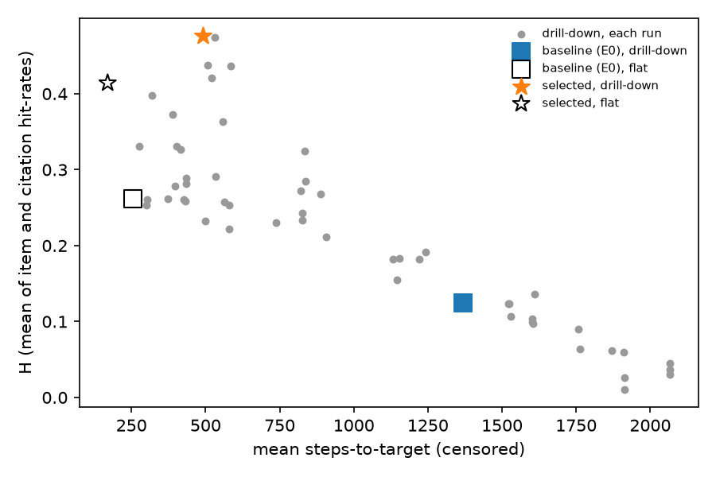

# Extrinsic utility (T6): drill-down retrieval vs flat search

The brief's T6 asks for an extrinsic check: "a retrieval/agent that starts at a coarse level and drills down to find
target nodes, versus a flat baseline, scored on hit-rate or steps-to-target". This report covers that agent, its
evaluator, the series of retrieval experiments that chose its settings (§8), and the result of the applied settings on
the 18 questions in `data/questions.csv`, scored against `data/ground_truth.json`.

**Sources of the numbers:**
- the applied settings: `out/metrics.json["retrieval"]`;
- the experiments: `out/retrieval_experiments.json`, a record of the series run at commit 0174795. The experiment
  code has since been removed (§8.1);
- per-question answers, traces and gold resolution: `out/retrieval_answers.json`.

**What the experiments changed.** The first run (E0: beam 3/4/5, TF-IDF cosine) reached a target on 6 of 16
questions, and its objective H (§3) was 0.125. The experiments vary three things, and leave the hierarchy, the
snapshot rule, the evaluator's scoring rules and k = 10 unchanged:
- nodes kept per level;
- which information is compared with the question;
- keyword matching instead of TF-IDF.

The selected settings are applied:
- beam 10 / 20 / 40;
- keyword overlap as the score;
- the paper's claims added to a method's text.

| Applied vs the first run (16 questions with targets) | First run (E0) | Applied | Applied − E0, 95% CI |
|---|---|---|---|
| H, drill-down | 0.125 | 0.477 | +0.352 [0.195, 0.514] |
| Mean steps-to-target, drill-down | 1368.6 | 490.8 | −877.8 [−1427.5, −344.7] |
| Questions reaching a target | 6 | 14 | |

**Against flat search** with the same scorer:
- **H:** the drill-down is higher, 0.477 vs 0.414 (+0.062 [−0.017, 0.145]). The CI includes zero.
- **Steps:** it needs more, 490.8 vs 169.6 (+321.1 [18.4, 681.1]).

The improvement over E0 mostly comes from the matching function and the leaf text, which help both systems; flat
search improves too (H 0.262 → 0.414). The hierarchy's own contribution is a small, uncertain gain in hit-rate, at the
cost of more steps.

**Selection optimism.** The settings were chosen on these 18 questions. A leave-one-question-out estimate of the
selection gives H = 0.439 (§8.3), compared with 0.477 in-sample.

## 1. Task and protocol

- **Input.** `data/questions.csv` (`question_id;question;type`) holds:
  - 14 type-A questions ("which methods … best suited for …"), whose answer is methods plus their citations;
  - 4 type-B questions (open challenges, mechanisms, evidence), whose answer is claims plus their citations.
- **Ground truth.** `data/ground_truth.json` gives:
  - type A: `expected_methods` and `required_citations` ("Batatia et al. 2022");
  - type B: `required_claims` with their `sources`, a `sources` table, and `required_citations` (source keys).
- **Systems.** Both use the same snapshot, leaf texts, scorer, answer kinds and answer length; only the search differs.
  - **Drill-down:** the agent searches the run's hierarchy, `out/<cutoff>/hierarchy.json`, which has labels and
    glosses at L0–L1.
  - **Flat:** every leaf of the answer kinds is ranked directly.
- **Commands.**
  - `make retrieval` (`python -m eval retrieval --run out`) runs the applied settings. It is part of `make all` and
    writes `metrics.json["retrieval"]`.
  - It is offline (no LLM, no rebuild), takes about 2 s, and a rerun gives identical output.

## 2. The agent (`tkh/retrieve.py`)

The agent implements only the selected configuration (§8). Its constants are `BEAM = (10, 20, 40)` and `K = 10`.

1. **Question type** comes from the question's metadata (the CSV `type` column).
   - Type A answers with method, technique, component and dataset nodes. The GT field `expected_methods` also lists
     datasets and benchmarks (Q14).
   - Type B answers with claim nodes.
2. **Snapshot** (`choose_snapshot`):
   - the latest cutoff not after the year the question names ("by Feb 2026" → 2026, "by March 2023" → 2022);
   - a question without a date gets the latest cutoff (Q16, recorded as `default_latest`);
   - all 18 questions map to 2026, consistent with the type-B `as_of: "2026-02"`.

   After that, only the snapshot's nodes, edges and hierarchy are used. Every vocabulary, IDF and statistic is fitted
   on the snapshot's own leaf texts.
3. **Leaf text** (`leaf_info = "full+claims"`):
   - name and aliases. These are node attributes of the export with no date, so they cannot be filtered by cutoff.
     This has no effect here, because every question uses the last snapshot.
   - the rest comes from the snapshot's edges:
   - the names of relation neighbours (`addresses`, `solves`, `extends`, `uses_*`, `evaluated_on`);
   - the `evaluated_on` metric and task;
   - the title of the presenting article (for a method, added once) or of the claiming article (for a claim);
   - for a presented method, the claims of its paper.
4. **Score** (`scorer = "overlap"`): the share of the question's keywords found in the node text.
   - Only in-vocabulary keywords count, i.e. those occurring in some snapshot leaf text.
   - Tokens are lower-cased, may contain '-' or '+', and exclude English stop words.
   - The question's template words are removed (`query = "stripped"`): the date parenthetical and a fixed word list
     applied anywhere in the question (which, what, are, is, the, method(s), best, suited, leading, most, important,
     commonly, used, give, evidence(s), when, for, of, by, feb, and any year).
5. **Super-node score** (`node_info = "blend"`):
   - L0 and L1: 0.5·s(q, label + gloss) + 0.5·s(q, mean of its members' vectors);
   - L2, which has no labels: the member mean only.
6. **Drill-down** (`descend`, `beam = (10, 20, 40)`):
   - all 15 L0 super-nodes are scored and the best 10 kept;
   - their L1 children are scored and the best 20 kept, then those nodes' L2 children and the best 40 kept;
   - the pool is the leaves of the kept L2 nodes that have the answer kinds, ranked by s(q, leaf);
   - the trace records every super-node scored, with its label, score and whether it was kept;
   - `closest` gives the best match at L0, L1, L2 and leaf level, and `top_leaves` the top-k leaves with their scores.
7. **Answer** (`extract`, k = 10), in the ground-truth format for the scored fields:
   - **Type A:**
     - `expected_methods`: the top 10 distinct names (by `name_key`);
     - `required_citations`: "Surname et al. YYYY" for the articles those leaves come from. The forms are
       "Surname YYYY" for one author, "A & B YYYY" for two, and "Anon. YYYY" when the export has no author.
   - **Type B:**
     - `as_of`;
     - `required_claims`: the top 10 claims as `{id, text, node_id, sources}`;
     - `sources`: key → `{key, title, date, article_id}`;
     - `required_citations`: the keys.

   The GT-only annotation fields are not produced. Examples: `method_claims`, `method_evidence`, `fp_categories`, `coverage`,
   `locations`, `evidence`, `caveat`, `venue`, `doi`, `evidence_type`, `provenance_policy` and `contrast_sources`. Dates are years, and claim ids are R1…Rk.
   The node and article ids an answer was read from are included, so it can be scored without string matching.

## 3. The evaluator (`eval/retrieval.py`)

Only the evaluator reads ground truth. A test (`test_agent_does_not_see_ground_truth`) cuts every question's expected
methods or required claims down to one item and checks that neither system's answers change.

The experiments did not change the evaluator's scoring rules (gold resolution, hit-rate, steps, censoring).

### Gold resolution

Each item is mapped to graph nodes of the question's snapshot, and the tier it matched on is recorded.

- **Methods** take the first tier that matches:
  - an exact `name_key` match on the name or an alias ("DeepH-E3"; "DeepH" via an alias);
  - an acronym in parentheses ("GAP" → "Gaussian approximation potential (GAP) for silicon");
  - a leading segment of at least 3 characters ("Orb" → "Orb-v2", "PET" → "PET-MAD").

  GT names that match no tier are unattainable. These include conceptual names ("physics-informed", "hybrid
  frameworks", "CE→MC→NN→PF") and specific methods absent from the graph (HamGNN, MACE-F, DeePMD+AL).
- **Type-A citations:**
  - an article matches if its author set contains every listed surname (diacritics folded), with the year within ±1
    and the exact year preferred;
  - a parenthetical hint ("(DeepH)") narrows ambiguous matches by title or presented method;
  - when candidates stay ambiguous, any of them counts.
- **Type-B citations:** source titles, matched by `name_key` equality or word Jaccard ≥ 0.8.
- **Type-B claims:** the GT claims are paraphrased summaries, not graph sentences.
  - A required claim is attainable if one of its sources resolves to an article with claims in the snapshot.
  - It is hit if the answer returns any claim of such an article.

### Metrics

- **Hit-rate**, per question: hits ÷ attainable GT items in the top-k answer. Methods (A), claims (B) and citations
  (both) are scored separately.
  - A GT method is hit if the answer contains one of its resolved nodes, or a node with the same `name_key`.
  - Questions with no attainable item of a kind are left out of that kind's mean.
- **Steps-to-target**, per question: one step is one node the agent inspects.
  - **Drill-down:** every super-node scored on the way down, plus the rank of the first target in the pool.
  - **Flat:** the first target's rank among all leaves of the answer kinds (N = 2524 for A, 690 for B).
  - A target missing from the drill-down pool is censored at N + 1.
  - Targets are the resolved method nodes (A) or the claims of resolved source articles (B).
- **Objective H**, the experiments' selection criterion (computed in the removed experiment code): the mean over the 16 questions with targets of
  the mean of their item and citation hit-rates.
- **Summary:**
  - means per type and system;
  - the paired drill-down − flat difference with a bootstrap 95% CI over questions (B = 2000, seed 0);
  - for steps, also the median and the number of questions reaching a target.
- **Diagnostic** `lost_at_level`: the first level at which no kept super-node holds a target.

### Ceilings (attainable / total GT items, 2026 snapshot)

| | Attainable / total |
|---|---|
| Type-A methods | 49 / 63 |
| Type-A citations | 65 / 71 |
| Type-B claims | 26 / 36 |
| Type-B citations | 13 / 19 |

- Q5 and Q11 have no attainable method, so they have no targets.
- The type-B shortfall comes from sources outside the 52 articles (e.g. li2025_ood, jakob2025, deng2025_softening).

## 4. Results of the applied settings

### Summary (means over questions; 95% bootstrap CI)

| Type | Metric | n | Drill-down | Flat | Drill-down − flat |
|---|---|---|---|---|---|
| A | method hit-rate | 12 | 0.283 [0.066, 0.526] | 0.295 [0.090, 0.538] | −0.012 [−0.036, 0.000] |
| A | citation hit-rate | 14 | 0.657 [0.437, 0.847] | 0.578 [0.362, 0.786] | +0.079 [−0.048, 0.249] |
| A | steps-to-target, mean | 12 | 605.3 [196.4, 1165.1] | 224.5 [12.8, 534.3] | +380.8 [−21.6, 847.8] |
| A | steps-to-target, median | 12 | 175.5 | 10.5 | |
| A | questions reaching a target | 12 | 10 | 12 | |
| B | claim hit-rate | 4 | 0.540 [0.179, 0.861] | 0.343 [0.111, 0.482] | +0.196 [0.000, 0.393] |
| B | citation hit-rate | 4 | 0.375 [0.125, 0.625] | 0.312 [0.125, 0.500] | +0.062 [0.000, 0.188] |
| B | steps-to-target, mean | 4 | 147.0 [142.8, 151.8] | 5.0 [2.0, 10.3] | +142.0 [136.8, 148.8] |
| B | steps-to-target, median | 4 | 146.5 | 2.5 | |
| B | questions reaching a target | 4 | 4 | 4 | |

- Type B (n = 4) is descriptive only.
- Every drill-down step count includes 133–162 super-node scores before the first leaf.
- H over all 16 questions with targets: drill-down 0.477, flat 0.414 (`out/retrieval_experiments.json`, selected run).

### Per question

Snapshot 2026 for all questions (Q16 by default). Columns:
- targets / pool / super-nodes scored;
- item hit-rate (drill-down | flat);
- citation hit-rate (drill-down | flat);
- steps (drill-down | flat);
- the level at which the drill-down lost every target: "–" means reached, "n/a" means the question has no targets.

| Q | Type | Targets / pool / scored | Item hit (attainable / total) | Citation hit (attainable / total) | Steps | Lost at |
|---|---|---|---|---|---|---|
| Q1 | A | 15 / 333 / 152 | 0.00 \| 0.14 (7/7) | 0.14 \| 0.43 (7/7) | 304 \| 7 | – |
| Q2 | A | 3 / 376 / 150 | 1.00 \| 1.00 (2/3) | 0.71 \| 0.71 (7/7) | 151 \| 1 | – |
| Q3 | A | 2 / 461 / 143 | 1.00 \| 1.00 (2/2) | 1.00 \| 1.00 (2/2) | 145 \| 2 | – |
| Q4 | A | 2 / 314 / 133 | 0.00 \| 0.00 (1/3) | 1.00 \| 0.00 (3/3) | 2525 \| 42 | L1 |
| Q5 | A | 0 / 417 / 142 | – (0/2) | 0.00 \| 0.00 (1/2) | n/a | n/a |
| Q6 | A | 1 / 446 / 148 | 1.00 \| 1.00 (1/3) | 1.00 \| 1.00 (3/3) | 149 \| 1 | – |
| Q7 | A | 1 / 391 / 141 | 0.00 \| 0.00 (1/2) | 1.00 \| 1.00 (2/2) | 354 \| 1266 | – |
| Q8 | A | 1 / 455 / 148 | 0.00 \| 0.00 (1/2) | 1.00 \| 1.00 (2/2) | 190 \| 78 | – |
| Q9 | A | 2 / 435 / 162 | 0.00 \| 0.00 (1/3) | 1.00 \| 1.00 (2/2) | 472 \| 22 | – |
| Q10 | A | 1 / 488 / 161 | 0.00 \| 0.00 (1/2) | 0.25 \| 0.25 (4/4) | 2525 \| 1252 | L1 |
| Q11 | A | 0 / 447 / 137 | – (0/2) | 1.00 \| 1.00 (1/3) | n/a | n/a |
| Q12 | A | 32 / 418 / 134 | 0.31 \| 0.31 (13/13) | 0.64 \| 0.57 (14/15) | 136 \| 2 | – |
| Q13 | A | 18 / 337 / 147 | 0.00 \| 0.00 (8/8) | 0.00 \| 0.13 (8/8) | 161 \| 11 | – |
| Q14 | A | 24 / 299 / 148 | 0.09 \| 0.09 (11/11) | 0.44 \| 0.00 (9/11) | 152 \| 10 | – |
| Q15 | B | 25 / 203 / 145 | 1.00 \| 0.50 (6/10) | 0.50 \| 0.50 (2/5) | 154 \| 2 | – |
| Q16 | B | 48 / 181 / 140 | 0.44 \| 0.44 (9/9) | 0.25 \| 0.25 (4/4) | 141 \| 2 | – |
| Q17 | B | 65 / 250 / 142 | 0.71 \| 0.43 (7/7) | 0.75 \| 0.50 (4/5) | 145 \| 3 | – |
| Q18 | B | 41 / 284 / 135 | 0.00 \| 0.00 (4/10) | 0.00 \| 0.00 (3/5) | 148 \| 13 | – |

The drill-down reaches a target on 14 of 16 questions. It loses every target at L1 on Q4 and Q10.

### Worked traces

**Q15, a gain for the drill-down.** "What are the most important open scientific challenges … in AI-based multiscale
modeling of solid-state materials?"
- **Closest matches:** L0 "Graph Neural Networks", L1 "Uncertainty Quantification Techniques". The closest leaf is
  the claim "Current challenges limiting AI-driven multiscale modeling include limited data availability, restricted
  model transferability, and limited explainability."
- **Routing:** the two L0 nodes that hold target claims rank 3rd and 4th and are kept. The pool of 203 claims then
  holds 12 of the 25 target claims, the first at rank 9 (step 154).
- **Result:** the drill-down covers all 6 attainable required claims, against 3 of 6 for flat.
- **Caveat:** the hits are source-level. One returned claim of the right paper covers every required claim sourced to
  that paper.

**Q4, a routing loss at L1.** "…phonon property prediction when universal MLIPs show inaccuracies despite good
energy/force performance?"
- The only attainable method is VGNN ("Virtual Node Graph Neural Network", "virtual node method").
- Its L0 node, "Diffusion Coefficient Prediction", ranks 5th and is kept.
- Its L1 nodes, "Diffusion Modeling Methods" and "Virtual Node GNN Techniques", rank 28th and 30th of 42 and fall
  outside the 20 kept.
- Flat search ranks the target 42nd.

## 5. Failure analysis

- **The coarse levels sort poorly by use case.**
  - With beam 3 at L0 (E0), targets were lost at L0 on 6 questions. Q1's 15 targets sit in 5 of the 15 L0 nodes.
  - Under the selected scorer and leaf text (E6), every setting that keeps at most 5 L0 nodes is poor (H ≤ 0.183,
    against 0.477).
  - Under TF-IDF (E1), beam 5 / 8 / 12 had the stage's highest H (0.268), but it lost the steps tie-break (886.9 vs
    302.2 for 15 / 30 / 60).
  - The selected beam keeps 10 of 15 L0 nodes, which hold 60–85% of the leaves. L0 therefore prunes only about a
    quarter of the tree.
  - This is consistent with the intrinsic finding that coherence is not supported at L0 (`docs/evaluation_report.md`
    §3).
- **The labels do not route well on their own.**
  - Scoring super-nodes by label + gloss alone (`label`) is worse than the blend under every scorer (E2, E4).
  - Representing a super-node as one document of its member names (`doc`) is worst on steps.
- **Most of the gain is in the leaves.**
  - Adding the paper's claims to a method's text raised H by 0.07 at fixed search (E3).
  - Keyword overlap raised it by a further 0.14 (E4).
  - Flat search gains too: +0.068 and +0.084 in H.
- **Citation breadth.**
  - Citation hit-rate rises with the number of articles an answer cites.
  - The applied settings cite 11.0 articles per answer on average (E0: 3.3). Citation precision, i.e. hits per article
    cited, moved only from 0.153 to 0.202 (`out/retrieval_experiments.json`, `mean_articles`, `citation_precision`).
  - The method and claim hit-rates are not affected by this, because k is fixed.
- **Steps.**
  - The drill-down scores 133–162 super-nodes before its first leaf. It therefore cannot beat flat search on steps
    whenever flat ranks the first target within that question's super-node count + 1. That happens on 14 of 16
    questions; the drill-down needs fewer steps only on Q7 (354 vs 1266).
  - Fewer steps would need tighter beams, and the tighter beams tested lose targets (§8).

## 6. Threats to validity

- **Selection on the test questions.** The settings were chosen on the 18 evaluation questions. The
  leave-one-question-out estimate (H 0.439) is lower than the in-sample 0.477. Even the LOO estimate covers only the
  configurations explored; it does not cover how the staged search chose them.
- **Small n:** 18 questions, all on the 2026 snapshot. Type B has 4 questions, and its CIs are wide.
- **Lexical scoring.** Keyword overlap and TF-IDF are weak on paraphrase. Both systems share the scorer, so the
  comparison is fair, but the absolute numbers would change under a sentence-embedding model.
- **Gold matching** depends on name normalisation and on the acronym and prefix tiers. Ambiguous citations count if
  any candidate is returned.
- **Claims are matched by source,** not by content (Q15).
- **Author order** is not in the export. Displayed citations use the first listed author; scoring uses the author set.
- **Yearly snapshots:** "by Feb 2026" cannot exclude papers from later in 2026.

## 7. Design decisions

| # | Decision | Rationale | Rejected alternative |
|---|---|---|---|
| 1 | Question type from the CSV metadata | It comes with the question; type detection is not what is evaluated | Regex or LLM type classifier |
| 2 | Snapshot = latest cutoff ≤ the stated year; no date → latest | Never uses content after the question's date (P6); matches GT `as_of` | Always the latest snapshot (would leak for earlier dates) |
| 3 | Only the snapshot's edges build node text, IDF and vocabularies | `tkh.semantic.attached_text` reads all edges and would leak later facts | Reusing `node_texts(mode="context")` |
| 4 | Keyword overlap as the score (selected in E4) | Highest H of the three scorers under every super-node representation. Deterministic, no new dependency, not the char-n-gram LSA that built the tree | Word TF-IDF (the first run), BM25; an embedding model (needs a model download and a new dependency) |
| 5 | Leaf text with the paper's claims for presented methods (selected in E3) | A method's paper states what the method is for; the claims carry use-case words the questions ask about | Name only; name + relations; + title only (the first run) |
| 6 | Titles: once per presented method, and for claim nodes | A title describes its paper's method and claims. Clustering excludes titles to avoid re-encoding "same paper"; retrieval has no such concern | Names only |
| 7 | No LLM in the agent | Deterministic, offline and fast enough for `make all` | LLM query rewriting or re-ranking (a component whose own accuracy would need evaluating) |
| 8 | Super-node score: 0.5 label + 0.5 member mean; L2 member mean (kept in E2, E4) | Best or tied-best H under every scorer; the label alone routes worse | Label only, centroid only, answer-kind centroid, one document of label and member names |
| 9 | Beam 10 / 20 / 40 (selected in E6) | Highest H within the 0.01 tie margin, and fewer steps than 15 / 30 / 60. Tighter beams lose targets at L0 | The first run's 3 / 4 / 5; relative thresholds (keep ≥ rel × best) |
| 10 | Question text with the template removed (kept in E5) | Highest H; the full question adds template words, and the task or condition clause alone drops content | Full question; task phrase; condition clause |
| 11 | Staged search with a fixed objective (H, ties within 0.01 → fewer steps), every run reported, plus a LOO estimate | Fixed in advance so the choice is not post hoc; the LOO estimate states the optimism of choosing on 18 questions | Full grid search; tuning without a held-out estimate |
| 12 | Same scorer, leaf texts, answer kinds and k for both systems, in every run | Only the search differs, so the difference is the hierarchy's | A fixed flat baseline (would credit the hierarchy with the scorer's gains) |
| 13 | k = 10 fixed | A longer answer raises hit-rate trivially | Tuning k |
| 14 | One step = one node inspected; every super-node scored counts | Charges the hierarchy for its routing cost | Counting only leaves (favours the hierarchy) |
| 15 | Missed targets censored at N + 1 | A routing miss is worse than any flat rank, and the count stays finite for means and CIs | Dropping misses (hides routing failures) |
| 16 | Ground truth only in the evaluator; leakage test | Keeps the agent blind to the answers | Agent-side alias lists from the GT |
| 17 | Method gold by tiers (exact → acronym → prefix); no tier → unattainable | GT names are often acronyms or family names of graph nodes; the first matching tier avoids loose matches | Substring matching ("ACE" would match "surface") |
| 18 | Citations by author set, year ±1 and title hint | Author order is lost in the export; preprint and journal years differ | Exact "First author et al. YYYY" strings |
| 19 | Type-B claims hit by source article | GT claims are paraphrases, not graph sentences; a source match is deterministic | Lexical threshold (arbitrary τ); LLM judge (needs live calls) |
| 20 | Datasets among the type-A answer kinds | GT `expected_methods` lists datasets and benchmarks (Q14) | Methods, techniques and components only |
| 21 | Ceilings reported; unattainable items excluded from hit-rates | Separates retrieval failure from graph coverage | Raw recall against all GT items |
| 22 | Paired bootstrap CIs over questions | Both systems, and both configurations, answer the same questions; n is small | Unpaired CIs |
| 23 | `retrieval` in `make all`; the experiment code removed after selection | The check is offline and fast; only the selected configuration is maintained, and the series stays reproducible from git | Keeping every variant in the agent |

## 8. Experiments

### 8.1 Protocol

- **Code.** The series ran with `eval/retrieval_experiments.py` (`make retrieval-sweep`) and a parameterised
  `tkh/retrieve.py`. Both were removed after the selected configuration was applied.
  - To reproduce: `git checkout 0174795 && make retrieval-sweep`.
  - The record of every run is `out/retrieval_experiments.json`, with `docs/figures/retrieval_pareto.png`.

- **Fixed:** the hierarchy, the snapshot rule, the evaluator's scoring rules, the ground truth and k = 10.
- **Objective:** fixed before the experiment series was run, after the first run (E0) had been reported. H is the mean over the 16 questions with targets of (item + citation
  hit-rate) / 2, for the drill-down. When runs are within 0.01 of the best H, the lowest mean steps wins.
- **Flat search** is rerun in every configuration with the same leaf text and scorer.
- **Staged search.** Each stage starts from the previous stage's winner. There are 55 distinct configurations; some
  recur in several stages.
  - E0: the first run.
  - E1: nodes kept per level: fixed beams, and relative thresholds that keep every child ≥ rel × the level's best,
    with at least `min_keep`.
  - E2: super-node information.
  - E3: leaf information.
  - E4: scorer × super-node information.
  - E5: question text.
  - E6: E1's grid again, under the winners of E2–E5.
- **Grid change after the first pass.** The beam grid initially jumped from (7, 15, 30) to (15, 30, 60). After the
  first pass, three intermediate settings were added: (10, 20, 40), (15, 8, 12) and (15, 15, 30). The whole series
  was then rerun. All runs are reported below.

### 8.2 Every run

Column guide:
- Steps: mean steps-to-target over the 16 questions with targets, censored.
- Reached: questions where the drill-down reached a target.
- Articles cited: mean per answer, drill-down.
- Bold: the stage's selected run.

The runs are named `<beam or rel/min_keep> <node_info> <leaf_info> <scorer> <query>`.

**E0 — Baseline reproduction (the first run).** Selected: `beam3-4-5 blend full tfidf stripped`.

| Run | H hier | H flat | A methods | A citations | B claims | B citations | Steps hier | Steps flat | Reached | Super-nodes scored | Articles cited |
|---|---|---|---|---|---|---|---|---|---|---|---|
| **`beam3-4-5 blend full tfidf stripped`** | 0.125 | 0.262 | 0.056 | 0.124 | 0.188 | 0.208 | 1368.6 | 255.4 | 6/16 | 45.1 | 3.3 |

**E1 — Nodes kept per level (from E0).** Selected: `beam15-30-60 blend full tfidf stripped`.

| Run | H hier | H flat | A methods | A citations | B claims | B citations | Steps hier | Steps flat | Reached | Super-nodes scored | Articles cited |
|---|---|---|---|---|---|---|---|---|---|---|---|
| `beam1-1-1 blend full tfidf stripped` | 0.036 | 0.262 | 0.000 | 0.083 | 0.000 | 0.000 | 2066.5 | 255.4 | 0/16 | 24.0 | 1.6 |
| `beam2-3-4 blend full tfidf stripped` | 0.059 | 0.262 | 0.008 | 0.129 | 0.000 | 0.000 | 1911.6 | 255.4 | 1/16 | 37.3 | 2.6 |
| `beam3-4-5 blend full tfidf stripped` | 0.125 | 0.262 | 0.056 | 0.124 | 0.188 | 0.208 | 1368.6 | 255.4 | 6/16 | 45.1 | 3.3 |
| `beam4-6-8 blend full tfidf stripped` | 0.182 | 0.262 | 0.090 | 0.226 | 0.188 | 0.208 | 1220.7 | 255.4 | 7/16 | 58.1 | 3.8 |
| `beam5-8-12 blend full tfidf stripped` | 0.268 | 0.262 | 0.167 | 0.307 | 0.299 | 0.271 | 886.9 | 255.4 | 10/16 | 71.8 | 4.4 |
| `beam7-15-30 blend full tfidf stripped` | 0.231 | 0.262 | 0.056 | 0.278 | 0.370 | 0.333 | 737.1 | 255.4 | 12/16 | 114.2 | 5.2 |
| `beam10-20-40 blend full tfidf stripped` | 0.262 | 0.262 | 0.062 | 0.306 | 0.441 | 0.396 | 372.4 | 255.4 | 15/16 | 151.5 | 5.7 |
| `beam15-8-12 blend full tfidf stripped` | 0.192 | 0.262 | 0.090 | 0.248 | 0.188 | 0.208 | 1241.4 | 255.4 | 7/16 | 109.2 | 4.2 |
| `beam15-15-30 blend full tfidf stripped` | 0.211 | 0.262 | 0.048 | 0.278 | 0.299 | 0.271 | 907.2 | 255.4 | 11/16 | 142.8 | 5.3 |
| **`beam15-30-60 blend full tfidf stripped`** | 0.260 | 0.262 | 0.056 | 0.308 | 0.441 | 0.396 | 302.2 | 255.4 | 16/16 | 208.9 | 6.0 |
| `rel0.5/min1 blend full tfidf stripped` | 0.120 | 0.262 | 0.048 | 0.121 | 0.188 | 0.208 | 1374.2 | 255.4 | 6/16 | 48.7 | 3.5 |
| `rel0.5/min3 blend full tfidf stripped` | 0.107 | 0.262 | 0.006 | 0.126 | 0.188 | 0.208 | 1530.4 | 255.4 | 5/16 | 54.7 | 2.7 |
| `rel0.7/min1 blend full tfidf stripped` | 0.062 | 0.262 | 0.008 | 0.094 | 0.062 | 0.083 | 1871.1 | 255.4 | 2/16 | 32.1 | 3.2 |
| `rel0.7/min3 blend full tfidf stripped` | 0.124 | 0.262 | 0.014 | 0.158 | 0.188 | 0.208 | 1522.9 | 255.4 | 5/16 | 42.9 | 2.9 |
| `rel0.9/min1 blend full tfidf stripped` | 0.045 | 0.262 | 0.000 | 0.104 | 0.000 | 0.000 | 2066.5 | 255.4 | 0/16 | 26.6 | 2.2 |
| `rel0.9/min3 blend full tfidf stripped` | 0.124 | 0.262 | 0.014 | 0.158 | 0.188 | 0.208 | 1522.0 | 255.4 | 5/16 | 41.7 | 2.6 |

**E2 — Super-node information (from the E1 winner).** Selected: `beam15-30-60 blend full tfidf stripped`.

| Run | H hier | H flat | A methods | A citations | B claims | B citations | Steps hier | Steps flat | Reached | Super-nodes scored | Articles cited |
|---|---|---|---|---|---|---|---|---|---|---|---|
| **`beam15-30-60 blend full tfidf stripped`** | 0.260 | 0.262 | 0.056 | 0.308 | 0.441 | 0.396 | 302.2 | 255.4 | 16/16 | 208.9 | 6.0 |
| `beam15-30-60 label full tfidf stripped` | 0.222 | 0.262 | 0.020 | 0.252 | 0.495 | 0.333 | 578.2 | 255.4 | 14/16 | 205.7 | 6.7 |
| `beam15-30-60 centroid full tfidf stripped` | 0.260 | 0.262 | 0.056 | 0.308 | 0.441 | 0.396 | 425.6 | 255.4 | 15/16 | 209.3 | 6.0 |
| `beam15-30-60 kind_centroid full tfidf stripped` | 0.259 | 0.262 | 0.048 | 0.311 | 0.441 | 0.396 | 430.9 | 255.4 | 15/16 | 214.7 | 6.2 |
| `beam15-30-60 doc full tfidf stripped` | 0.243 | 0.262 | 0.056 | 0.267 | 0.441 | 0.396 | 825.8 | 255.4 | 12/16 | 207.7 | 6.7 |

**E3 — Leaf information.** Selected: `beam15-30-60 blend full+claims tfidf stripped`.

| Run | H hier | H flat | A methods | A citations | B claims | B citations | Steps hier | Steps flat | Reached | Super-nodes scored | Articles cited |
|---|---|---|---|---|---|---|---|---|---|---|---|
| `beam15-30-60 blend name tfidf stripped` | 0.232 | 0.256 | 0.027 | 0.344 | 0.424 | 0.396 | 499.7 | 571.1 | 15/16 | 208.4 | 8.0 |
| `beam15-30-60 blend rel tfidf stripped` | 0.253 | 0.271 | 0.056 | 0.308 | 0.384 | 0.396 | 299.7 | 256.8 | 16/16 | 208.3 | 6.1 |
| `beam15-30-60 blend full tfidf stripped` | 0.260 | 0.262 | 0.056 | 0.308 | 0.441 | 0.396 | 302.2 | 255.4 | 16/16 | 208.9 | 6.0 |
| **`beam15-30-60 blend full+claims tfidf stripped`** | 0.331 | 0.330 | 0.174 | 0.368 | 0.441 | 0.396 | 276.8 | 185.4 | 16/16 | 208.6 | 6.4 |

**E4 — Matching function × super-node information.** Selected: `beam15-30-60 blend full+claims overlap stripped`.

| Run | H hier | H flat | A methods | A citations | B claims | B citations | Steps hier | Steps flat | Reached | Super-nodes scored | Articles cited |
|---|---|---|---|---|---|---|---|---|---|---|---|
| `beam15-30-60 blend full+claims tfidf stripped` | 0.331 | 0.330 | 0.174 | 0.368 | 0.441 | 0.396 | 276.8 | 185.4 | 16/16 | 208.6 | 6.4 |
| `beam15-30-60 label full+claims tfidf stripped` | 0.258 | 0.330 | 0.098 | 0.268 | 0.495 | 0.333 | 562.3 | 185.4 | 14/16 | 205.7 | 6.8 |
| `beam15-30-60 centroid full+claims tfidf stripped` | 0.331 | 0.330 | 0.174 | 0.368 | 0.441 | 0.396 | 401.8 | 185.4 | 15/16 | 209.6 | 6.3 |
| `beam15-30-60 kind_centroid full+claims tfidf stripped` | 0.327 | 0.330 | 0.167 | 0.366 | 0.441 | 0.396 | 415.2 | 185.4 | 15/16 | 215.6 | 6.5 |
| `beam15-30-60 doc full+claims tfidf stripped` | 0.233 | 0.330 | 0.049 | 0.252 | 0.441 | 0.396 | 827.7 | 185.4 | 12/16 | 207.6 | 6.3 |
| `beam15-30-60 blend full+claims bm25 stripped` | 0.289 | 0.292 | 0.042 | 0.350 | 0.566 | 0.396 | 435.1 | 184.6 | 15/16 | 204.2 | 6.1 |
| `beam15-30-60 label full+claims bm25 stripped` | 0.253 | 0.292 | 0.083 | 0.271 | 0.495 | 0.333 | 579.4 | 184.6 | 14/16 | 205.9 | 6.5 |
| `beam15-30-60 centroid full+claims bm25 stripped` | 0.279 | 0.292 | 0.042 | 0.362 | 0.441 | 0.396 | 397.2 | 184.6 | 15/16 | 204.8 | 5.9 |
| `beam15-30-60 kind_centroid full+claims bm25 stripped` | 0.282 | 0.292 | 0.042 | 0.370 | 0.441 | 0.396 | 434.1 | 184.6 | 15/16 | 211.5 | 6.4 |
| `beam15-30-60 doc full+claims bm25 stripped` | 0.272 | 0.292 | 0.125 | 0.275 | 0.441 | 0.396 | 821.1 | 184.6 | 12/16 | 205.6 | 6.6 |
| **`beam15-30-60 blend full+claims overlap stripped`** | 0.475 | 0.414 | 0.306 | 0.671 | 0.468 | 0.312 | 531.1 | 169.6 | 14/16 | 203.9 | 12.3 |
| `beam15-30-60 label full+claims overlap stripped` | 0.363 | 0.414 | 0.163 | 0.526 | 0.495 | 0.333 | 557.6 | 169.6 | 14/16 | 205.4 | 13.1 |
| `beam15-30-60 centroid full+claims overlap stripped` | 0.438 | 0.414 | 0.309 | 0.619 | 0.343 | 0.312 | 506.2 | 169.6 | 14/16 | 206.0 | 11.4 |
| `beam15-30-60 kind_centroid full+claims overlap stripped` | 0.421 | 0.414 | 0.270 | 0.614 | 0.343 | 0.312 | 519.8 | 169.6 | 14/16 | 212.3 | 12.6 |
| `beam15-30-60 doc full+claims overlap stripped` | 0.285 | 0.414 | 0.092 | 0.457 | 0.343 | 0.312 | 836.9 | 169.6 | 12/16 | 213.4 | 11.7 |

**E5 — Question text.** Selected: `beam15-30-60 blend full+claims overlap stripped`.

| Run | H hier | H flat | A methods | A citations | B claims | B citations | Steps hier | Steps flat | Reached | Super-nodes scored | Articles cited |
|---|---|---|---|---|---|---|---|---|---|---|---|
| **`beam15-30-60 blend full+claims overlap stripped`** | 0.475 | 0.414 | 0.306 | 0.671 | 0.468 | 0.312 | 531.1 | 169.6 | 14/16 | 203.9 | 12.3 |
| `beam15-30-60 blend full+claims overlap full` | 0.373 | 0.355 | 0.198 | 0.531 | 0.468 | 0.312 | 389.4 | 168.9 | 15/16 | 203.9 | 12.7 |
| `beam15-30-60 blend full+claims overlap task` | 0.291 | 0.303 | 0.216 | 0.395 | 0.361 | 0.188 | 533.2 | 233.6 | 14/16 | 202.4 | 8.2 |
| `beam15-30-60 blend full+claims overlap condition` | 0.398 | 0.371 | 0.240 | 0.553 | 0.468 | 0.312 | 318.9 | 252.9 | 16/16 | 205.6 | 12.4 |

**E6 — Nodes kept per level again, under the E2–E5 winners.** Selected: `beam10-20-40 blend full+claims overlap stripped`.

| Run | H hier | H flat | A methods | A citations | B claims | B citations | Steps hier | Steps flat | Reached | Super-nodes scored | Articles cited |
|---|---|---|---|---|---|---|---|---|---|---|---|
| `beam1-1-1 blend full+claims overlap stripped` | 0.030 | 0.414 | 0.000 | 0.068 | 0.000 | 0.000 | 2066.5 | 169.6 | 0/16 | 23.3 | 1.7 |
| `beam2-3-4 blend full+claims overlap stripped` | 0.090 | 0.414 | 0.006 | 0.199 | 0.000 | 0.000 | 1756.4 | 169.6 | 2/16 | 35.4 | 3.6 |
| `beam3-4-5 blend full+claims overlap stripped` | 0.097 | 0.414 | 0.006 | 0.217 | 0.000 | 0.000 | 1603.8 | 169.6 | 3/16 | 43.4 | 3.8 |
| `beam4-6-8 blend full+claims overlap stripped` | 0.155 | 0.414 | 0.131 | 0.242 | 0.000 | 0.000 | 1145.4 | 169.6 | 6/16 | 57.6 | 4.7 |
| `beam5-8-12 blend full+claims overlap stripped` | 0.183 | 0.414 | 0.131 | 0.306 | 0.000 | 0.000 | 1152.8 | 169.6 | 6/16 | 71.1 | 5.8 |
| `beam7-15-30 blend full+claims overlap stripped` | 0.437 | 0.414 | 0.277 | 0.534 | 0.459 | 0.333 | 586.1 | 169.6 | 13/16 | 109.1 | 9.3 |
| **`beam10-20-40 blend full+claims overlap stripped`** | 0.477 | 0.414 | 0.283 | 0.657 | 0.540 | 0.375 | 490.8 | 169.6 | 14/16 | 144.9 | 11.0 |
| `beam15-8-12 blend full+claims overlap stripped` | 0.182 | 0.414 | 0.138 | 0.256 | 0.062 | 0.083 | 1133.0 | 169.6 | 7/16 | 109.7 | 6.7 |
| `beam15-15-30 blend full+claims overlap stripped` | 0.325 | 0.414 | 0.179 | 0.511 | 0.312 | 0.208 | 834.9 | 169.6 | 10/16 | 141.2 | 10.1 |
| `beam15-30-60 blend full+claims overlap stripped` | 0.475 | 0.414 | 0.306 | 0.671 | 0.468 | 0.312 | 531.1 | 169.6 | 14/16 | 203.9 | 12.3 |
| `rel0.5/min1 blend full+claims overlap stripped` | 0.063 | 0.414 | 0.006 | 0.139 | 0.000 | 0.000 | 1763.2 | 169.6 | 2/16 | 48.2 | 3.5 |
| `rel0.5/min3 blend full+claims overlap stripped` | 0.136 | 0.414 | 0.006 | 0.305 | 0.000 | 0.000 | 1608.9 | 169.6 | 3/16 | 53.6 | 3.4 |
| `rel0.7/min1 blend full+claims overlap stripped` | 0.026 | 0.414 | 0.000 | 0.060 | 0.000 | 0.000 | 1913.0 | 169.6 | 1/16 | 30.8 | 2.3 |
| `rel0.7/min3 blend full+claims overlap stripped` | 0.099 | 0.414 | 0.006 | 0.222 | 0.000 | 0.000 | 1603.1 | 169.6 | 3/16 | 41.3 | 2.9 |
| `rel0.9/min1 blend full+claims overlap stripped` | 0.010 | 0.414 | 0.000 | 0.024 | 0.000 | 0.000 | 1913.0 | 169.6 | 1/16 | 26.3 | 1.8 |
| `rel0.9/min3 blend full+claims overlap stripped` | 0.104 | 0.414 | 0.006 | 0.232 | 0.000 | 0.000 | 1603.1 | 169.6 | 3/16 | 39.1 | 3.2 |

### 8.3 Selected settings vs the first run, and the selection estimate

- **Selected:** `beam10-20-40 blend full+claims overlap stripped`, now the agent's only configuration.
- **Against E0** (paired over the 16 questions with targets):
  - H: +0.352 [0.195, 0.514];
  - mean steps: −877.8 [−1427.5, −344.7].
- **Against flat search** with the same settings:
  - H: +0.062 [−0.017, 0.145];
  - mean steps: +321.1 [18.4, 681.1].
- **Leave-one-question-out.** For each question, the configuration best on the other 15 questions with targets (same
  rule) is scored on it.
  - Result: H 0.439 and mean steps 494.4.
  - The selected configuration wins on 14 of the 16 held-out folds; `beam15-30-60 … overlap` wins on the other 2.
- **Figure:** `docs/figures/retrieval_pareto.png` plots H against mean steps for every run, marking E0 and the
  selected run, each with its flat counterpart.



### 8.4 What the series shows

- **Nodes per level** (E1, E6):
  - Under the selected scorer and leaf text (E6), wider beams raise H (0.030 at 1 / 1 / 1 to 0.477 at 10 / 20 / 40)
    and mostly cut mean steps, because fewer targets are censored.
  - Under TF-IDF (E1), H is not monotone in the beam: it peaks at 5 / 8 / 12, and wider beams mainly cut steps.
  - The gains stop at about 10 of 15 L0 nodes: (10, 20, 40) ≈ (15, 30, 60) in H, with fewer steps.
  - Relative thresholds keep too few nodes: their runs score 26–55 super-nodes, against 145 for the selected beam. None
    beat the wider fixed beams.
  - Keeping all 15 L0 nodes but few below (15, 8, 12) is poor, so pruning at L1 also loses targets.
- **Super-node information** (E2, E4): `blend` has the best or tied-best H under every scorer. `label` and `doc` are
  the two worst under every scorer.
- **Leaf information** (E3): adding the paper's claims is the only leaf change that helps (+0.071 H). Names alone, or
  names plus relations (no titles), are worse than the first run's text.
- **Matching** (E4): keyword overlap has the highest H under every super-node representation. TF-IDF beats BM25
  except under `doc` (0.233 vs 0.272). Overlap has no IDF and no length normalisation, so long
  leaf texts (methods with their paper's claims) match many question words. That helps recall here.
- **Question text** (E5): the template-stripped question is best. The use-case clause alone ("condition") gives the
  fewest steps (318.9) but lower H (0.398).

## 9. Reproduction

```
make retrieval                       # applied settings -> out/metrics.json["retrieval"], out/retrieval_answers.json
.venv/bin/python -m pytest tests/test_retrieval.py -q
git checkout 0174795 && make retrieval-sweep   # the experiment series (§8), with the code as it was then
```

Options of `eval retrieval`: `--questions` and `--gt`.
