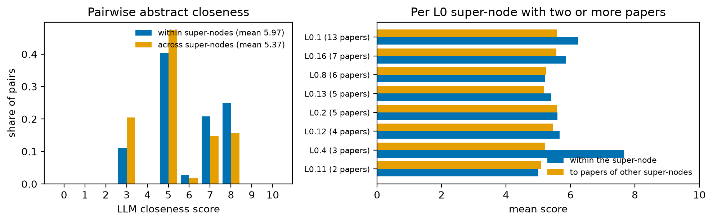

# Semantic coherence of L0 super-nodes on paper abstracts

*Extra evaluation of the shipped run (`out/`, α = 0.75), outside the main protocol of `docs/report.md`. Tables are
generated by `python -m eval.extra.abstract_coherence` from `eval/extra/results.json`; the prose quotes no values.*

## Question and method

Are papers that the hierarchy places in the same coarsest-level super-node closer in topic than papers it places in
different ones, judged from their abstracts? For the latest snapshot, every paper is attributed to the L0 super-node
that holds its article node. An article is anchored to the method it presents, so a paper sits where its own method
was grouped. Every pair of papers with a verified abstract is shown to an open-source LLM (phi4), with both titles and
abstracts and nothing about the hierarchy. The model rates the pair's topical closeness on an integer scale from 0
(unrelated) to 10 (same problem, same kind of approach) (`eval/extra/pair_prompt.txt`). The answers are cached in
`eval/extra/llm_cache.json`, so the evaluation replays offline.

The comparison is the mean score of pairs in the same super-node against the mean score of pairs in different
super-nodes. Two kinds of uncertainty are reported:
- **a paper-cluster bootstrap interval of the difference:** papers are resampled with replacement, and a pair counts
  with the product of its papers' multiplicities;
- **a permutation null:** the paper → super-node assignment is shuffled with every super-node keeping its number of
  papers. This keeps the group sizes and the rater's scores and breaks only which papers share a super-node.

Abstracts never enter the method, which sees concept names and the six clustering relations only. This makes the
check independent of the structural term and of the citation ruler of the main report. It is not independent of the
semantic term: the concept names come from the same papers and share their vocabulary.

## Results

*Table E1. Coverage.*

<!-- table:coverage -->
| Item | Value |
|---|---|
| Snapshot; level | ≤2026; L0 (15 super-nodes) |
| Papers in the snapshot; with a verified abstract | 52; 49 |
| Abstract sources | arXiv API (v1) 33; OpenAlex (title search) 13; arXiv (title search) 1; arXiv API (v1; title matches latest version) 2 |
| L0 super-nodes holding papers with abstracts (papers per super-node) | 12 (13, 7, 6, 5, 5, 4, 3, 2, 1, 1, 1, 1) |
| Pairs rated; unparsable answers | 1176; 0 |
| Scores used by the rater (pairs) | 3: 227; 5: 548; 6: 22; 7: 182; 8: 197 |
| Rater; decoding | phi4; temperature 0, one order per pair (id order) |
<!-- /table:coverage -->

*Table E2. Mean LLM closeness of paper pairs within and across L0 super-nodes.*

<!-- table:summary -->
|  | Pairs | Mean closeness (0–10) |
|---|---|---|
| Same L0 super-node | 144 | 5.97 |
| Different L0 super-nodes | 1032 | 5.37 |
| Difference [95% paper-bootstrap CI] |  | 0.60 [0.02, 1.20] |
| Permutation null (R = 9999): mean; 97.5% quantile |  | -0.00; 0.42 |
| One-sided permutation p |  | 0.0036 |
| Difference with one super-node's papers left out: lowest; highest |  | 0.46 (without L0.1); 0.70 (without L0.16) |
<!-- /table:summary -->

*Table E3. Per L0 super-node: mean closeness of its papers to each other and to the papers of all other super-nodes.*

<!-- table:per_super_node -->
| L0 super-node | Label | Papers | Pairs within | Mean within | Mean to other papers |
|---|---|---|---|---|---|
| L0.1 | Equivariant Graph Neural Networks | 13 | 78 | 6.24 | 5.59 |
| L0.16 | Diffusion Coefficient Prediction | 7 | 21 | 5.86 | 5.56 |
| L0.8 | Equivariant GNNs for Materials | 6 | 15 | 5.20 | 5.25 |
| L0.13 | Graph Neural Networks for Materials | 5 | 10 | 5.40 | 5.19 |
| L0.2 | Graph Neural Networks | 5 | 10 | 5.60 | 5.58 |
| L0.12 | MLIP generalization frameworks | 4 | 6 | 5.67 | 5.46 |
| L0.4 | Gaussian Approximation Potentials | 3 | 3 | 7.67 | 5.22 |
| L0.11 | Graph Neural Networks | 2 | 1 | 5.00 | 5.10 |
| L0.17 | Graph Neural Networks | 1 | 0 | — | 3.75 |
| L0.5 | Long-range MLIP Models | 1 | 0 | — | 5.54 |
| L0.6 | Long-range MLIP techniques | 1 | 0 | — | 4.50 |
| L0.9 | Graph Neural Networks | 1 | 0 | — | 5.65 |
<!-- /table:per_super_node -->

*Figure E1. (a) Distribution of scores for pairs within and across super-nodes; (b) per super-node with at least two
papers, the mean within against the mean to other papers.*

## Conclusions

- **Papers in the same L0 super-node are rated closer in topic than papers in different ones.** The difference of the
  means lies above the whole permutation null, and its paper-bootstrap interval excludes zero (Table E2). The L0 level
  therefore carries semantic signal that an independent reader of the abstracts recognises.
- **The effect is modest.** Both means sit near the scale's middle anchor ("related problems or a shared kind of
  method"), because the corpus is narrow: every paper is about machine learning for materials or chemistry, so most
  pairs are moderately related whatever the hierarchy does. The difference is less than one step between the anchors
  the rater uses.
- **It does not rest on one super-node.** Leaving out the papers of any single super-node keeps the difference
  positive. The lowest value comes from removing the largest group, which supplies most within-pairs (Table E2, last
  row).
- **Coherence varies between super-nodes.** Some super-nodes are clearly closer within than to other papers, notably
  the largest group and the Gaussian-approximation-potential group. A few are rated no closer within than to the
  papers of other super-nodes (Table E3, Figure E1b). This mirrors the main report's per-cell results: L0 coherence is
  real on average but uneven.
- **Read together with the main report**, the check supports the semantic grouping at L0 but cannot separate it from
  shared vocabulary (first caveat). It complements, and does not replace, the held-out citation ruler.

## Caveats

- **Not independent of names.** The semantic term groups concept nodes by their names, and these names were
  extracted from the same papers whose abstracts are rated here. Agreement with this check therefore partly restates
  the semantic signal; it cannot validate it in the way the held-out citation ruler does.
- **Attribution through one method.** A paper is attributed to the super-node of the method it presents, although
  its other concepts may sit in other super-nodes. A paper that spans several groups counts in one only.
- **Small and unbalanced sample.** The pairs within super-nodes come from few super-nodes, and the largest group
  contributes a large share of them. Several super-nodes hold a single paper and contribute no within-pair.
- **One unvalidated rater on a coarse scale.** One model, one prompt and one order per pair (id order), so position
  effects are not averaged out; the scale anchors are the only calibration. The rater uses only a few score values,
  mostly the anchors (Table E1), so means move in coarse steps.
- **Abstract versions.** Abstracts come from arXiv (first version) or OpenAlex and are verified by title only.
