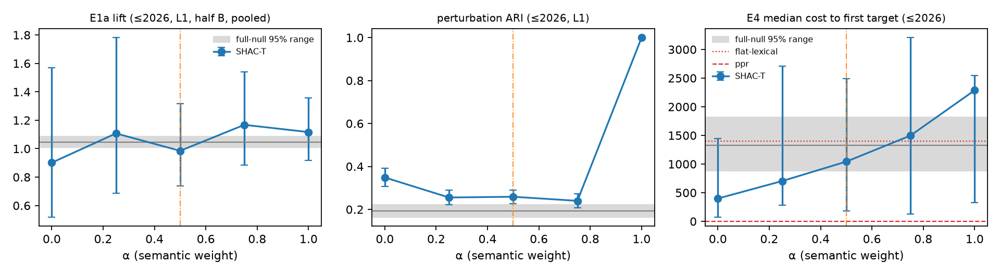
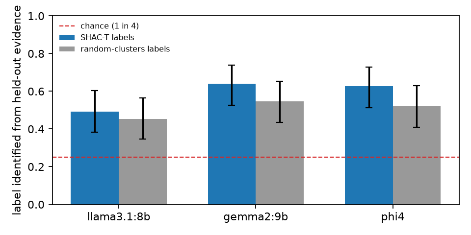

# Multi-resolution semantic abstraction over an evolving knowledge hypergraph

**Method: SHAC-T**, semantic–hypergraph agglomerative coarsening with temporal coupling.

- **Data.** The collection-10 TKH export, cut into cumulative snapshots ≤2020, ≤2022,
  ≤2024 and ≤2026, with budgets N = 15 / 60 / 240 super-nodes at levels 0 / 1 / 2.
- **Sources of numbers.** Every number table below is generated by `make_tables.py` from
  `out/metrics.json`. The prose refers to the tables and does not restate their numbers.
- **Companion documents.** The full formal statement, with proofs, is in
  [docs/formal_statement.md](docs/formal_statement.md). The method diagnostics (sizes,
  paper and type purity, the coarse hypergraph) are in
  [notebooks/04_method.ipynb](notebooks/04_method.ipynb).

<!-- table:data -->
| snapshot (cumulative) | ≤2020 | ≤2022 | ≤2024 | ≤2026 |
|---|---|---|---|---|
| papers | 16 | 22 | 38 | 52 |
| nodes (all types) | 1475 | 2144 | 4094 | 5798 |
| concept nodes (clustered) | 1018 | 1464 | 2829 | 3980 |
| hyper-edges (all relations) | 374 | 554 | 983 | 1429 |
| clustering edges (concept relations, hubs removed) | 141 | 230 | 406 | 554 |
| clustering edges per paper | 8.8 | 10.5 | 10.7 | 10.7 |
| max clustering-edge arity | 43 | 42 | 48 | 48 |
| hubs removed (> 20% of papers) | 5 | 8 | 7 | 6 |
| concept nodes in ≤ 1 clustering edge | 0.91 | 0.89 | 0.89 | 0.88 |
| node pairs sharing no clustering edge | 0.980 | 0.987 | 0.992 | 0.994 |
| papers with citations (E1a ruler) | 9 | 14 | 25 | 37 |

Ground-truth questions usable for E1b/E4 (≥ 1 expected method matches a node): 12 of 14.
<!-- /table:data -->

The data shapes everything that follows:
- **Edges.** Every clustering edge is a star around one paper's method, so structure is
  mostly paper co-occurrence.
- **Isolation.** Most concept nodes sit in a single edge, and almost no two nodes share
  an edge.
- **Citations.** Only part of the papers have citations, which limits the independent
  coherence ruler.

## 1. Problem and formal statement (Deliverable 0)

At each cutoff *t*, the concept nodes V_t (method, task, problem, technique, component,
dataset, metric) are partitioned into P_{t,2} ⊑ P_{t,1} ⊑ P_{t,0}, with exactly
min(N_k, |V_t|) super-nodes at level k. All other nodes are anchored to one concept node
of their paper. Super-nodes carry persistent ids and an event log across snapshots (T3).

**Criterion.** SHAC-T claims no global optimum: even single-level relatives of this
problem are NP-hard. It is a deterministic greedy procedure. Level by level, finest
first, it merges the feasible pair maximising

  s_t(A,B) = (1−γ)·[α·F_S(S) + (1−α)·F_H(H)] + γ·Π, subject to |A| + |B| ≤ ρ·|V_t|/N_k.

- **H** is the merge's reduction of the weighted connectivity cut Σ_e w_e(λ_e − 1),
  normalised by √(d_A d_B) and computed on the current collapsed incidence (T4, §3).
- **S** is the mean cosine of centred character-n-gram LSA vectors of the names, fitted
  per snapshot.
- **F** are mid-rank empirical CDFs.
- **Π** is the previous snapshot's co-membership, the history cost of evolutionary
  clustering, used as a prior.

**Trade-off.** Structure and semantics almost never agree, because H is zero for nearly
every pair (data table). Rank-normalising both and mixing them with one weight α turns the
reconciliation into a single interpretable parameter, which is selected by a
pre-registered rule on an independent signal. The cost is that magnitudes within each
signal are lost.

**By construction:**
- P1 (laminarity) and P2 (exact budgets; a lemma shows ρ ≥ 2 always leaves a feasible
  pair);
- a size bound;
- hypergraph-native scoring at every level (P4);
- determinism;
- no post-cutoff membership, structure or temporal input. Text is covered only up to
  assumption A5: names and aliases are export-wide.

**Measured:** P3, P5 and P6 (section 4).

**Complexity.** O(n²(m + d)) per level, plus O(n(m + d)) per merge, plus stale-row rescans;
O(n²) memory. A full build runs in well under a minute.

**Rejected alternative: hypergraph modularity** and its greedy or Louvain-style optimisers
(Kamiński et al. 2019; Chodrow et al. 2021).
- It controls the number of communities only through a resolution parameter, while P2 is
  hard.
- It has a resolution limit.
- On per-paper stars it rewards the paper bundles that structure already yields.

An attributed hypergraph SBM was set aside: inference is under-determined at this edge
density, and the model is not natively hierarchical with fixed budgets. Proofs and the
remaining trade-offs are in the formal statement.

## 2. Literature positioning

- **Hypergraph partitioning.** SHAC-T borrows the λ−1 (connectivity) metric of multilevel
  partitioning (hMETIS and KaHyPar) and the splitting-function view of hypergraph cuts
  (Veldt, Benson and Kleinberg, SIAM Review 2022). It differs in using
  connectivity-cut reduction as an agglomeration gain, not as a k-way objective.
- **Graph coarsening.** From coarsening (Loukas, JMLR 2019; HyperEF, Aghdaei and Feng,
  ICCAD 2022) it takes the idea of a multi-resolution hierarchy built by successive
  contraction. It contracts by an interpretable score under a hard size budget, not by
  spectral preservation, because P2 is a display constraint.
- **Evolutionary clustering.** The temporal term follows Chakrabarti et al. (KDD 2006)
  and the preserving-cluster-membership form of Chi et al. (KDD 2007), applied as a merge
  prior. Identities and events come from overlap matching, as in Greene, Doyle and
  Cunningham (ASONAM 2010).
- **What this setting needs.** Edges here are large per-paper stars. A pairwise
  projection splits each of them into a clique of equal-weight pairs, so the method needs
  a score that counts an edge once per pair of super-nodes, which SHAC-T does by working on
  the hypergraph directly; no pairwise projection is built.

## 3. Hyper-edge collapse (T4), as implemented

An arity-n edge whose endpoints fall into λ distinct super-nodes:
- **λ = 1 (m = n):** becomes *internal*. It is kept as metadata and gives no affinity.
- **1 < λ < n:** becomes a coarse edge over the λ super-nodes, with endpoint counts kept.
- **λ ≥ 3:** stays **one multi-way coarse hyper-edge** and is never split into pairs.

**What it loses.** The merge score uses presence (λ), so multiplicity drops out of the
score (it is kept as metadata), as does which fine members took part.

**Output and diagnostics.** Coarse edges are written per snapshot to
`out/<t>/coarse_hyperedges.json`, and an independent verifier re-derived them from the
raw edges. Notebook 04 shows that a substantial share of coarse edges stays multi-way at
every level. Those are exactly the edges a clique projection would split.

## 4. Evaluation design: method-independent, and how circularity is neutralised

**The evaluator judges artefacts, not the algorithm.**
- `scripts/evaluate.py` scores any run directory in the output format (`hierarchy.json`, `temporal_events.json`, optionally `label_inputs.json`) against the export.
- It uses only its own definitions (`tkh/evalkit/`, `tkh/structure.py`) and imports no coarsening code, which a test enforces.
- Re-runs on perturbed and null graphs go through one shell hook (`build_cmd`). A deliberately simple non-SHAC-T coarsening is evaluated through the same interface.
- The data contract is the same for every method: concept-node scope (the schema's method-centred member types), a fixed evaluator hub share, the citation residual filter, and the snapshot rule.
- The protocol is committed in `configs/eval.toml` before the run it governs.

**M1, coherence (P3): residual citation coupling.**
- *Independence.* Citations enter no coarsening input. Cited works named like a concept of the citing paper are removed (an `extends X` paper cites X).
- *Score.* The lift is the citation coupling of paper pairs, weighted by how often their single-paper concepts share a super-node, divided by the average coupling.
- *Primary stratum.* Pairs sharing no non-hub concept. In the other stratum, shared structure alone explains part of the coupling (notebook 03, §8), so it is descriptive.
- *Splits.* Dev half A of the cited works is used for selection and iteration; half B for this report.
- *Interval.* A log-scale paper jackknife.

**M2, stability (P5, T6).**
- *Perturbation.* Remove 10% of **all** hyper-edges per period, five seeds, re-run through `build_cmd`. The same perturbed files are used for every run.
- *Scores.* Per-level ARI, plus a laminar analogue: the level-pooled adjusted Rand index HARI = Σ_k(I_k − E_k)/Σ_k(M_k − E_k).
- *Test.* Against the null graph perturbed with the same seeds, paired by seed. Stability is never read alone, because a method that ignores the perturbed input is trivially stable.
- *Over time.* Cross-snapshot HARI. Change localisation, where "touched" means being in any edge of a new paper. Event counts per level and transition.

**M3, label faithfulness (P6). Implemented, deferred in this iteration.** The LLM judge is switched off in evaluation runs (`[m3] enabled = false`) to keep method iteration fast. Only the deterministic label checks are reported; the judge will be run at a later stage. The design: claim-level entailment by one judge from a different model family than the labeller.
- *Decomposition.* Each label and gloss is split into atomic claims, and the split is checked deterministically.
- *Support.* A claim is supported only if the judge quotes an evidence line that is actually in the evidence. The evidence is the evaluator's held-out half of the members, plus their papers' claims and titles (the circularity control). A second pass uses all members.
- *Judge validity.* Known-answer controls estimate it: claims of other super-nodes, of siblings, scope inflation and post-cutoff dates (false), and held-out facts (true). The over-claim rate is reported raw and corrected for judge error.
- *Gate.* If Youden's J on the hard controls is below 0.4, the rate is not interpretable.
- *Contract.* `validate.py` checks that the labeller only saw the evaluator's seen half.

**M4, extrinsic retrieval (T6).**
- *Queries.* Known-item queries are generated from claim sentences, with the target method's names masked.
- *Methods compared.* A best-first drill-down over the hierarchy (profiles from member names, or from labels) vs flat lexical ranking, personalised PageRank on the evaluator's hypergraph, and a query-independent degree ranking.
- *Reporting.* Results are broken down by target popularity. Each query is also compared against the best flat method for that query.

**M5, null model.** The type- and period-preserving **hypergraph configuration model**, the standard null in the hypergraph-clustering literature (degree- and edge-size-preserving; Chodrow 2020; the reference model of hypergraph modularity).
- *Sampling.* Curveball trades between edges of the same relation and period, within a member type. Each node's degree per relation and period is kept, as are every edge's arity and type mix, its hub (`members[0]`), and the `presents` edges.
- *Use.* Frozen null exports, so every method is re-run on the same null graphs. The random-labels permutation of the evaluated tree is a cheap companion.

**Sensitivity and comparison.**
- *Sensitivity.* Each metric is checked by swapping the whole ancestor paths of a growing share of nodes. A metric that does not get worse under degradation cannot rank variants.
- *Comparison.* Variants are compared with the selected run by paired deltas on dev evidence (`scripts/compare_runs.py`).

**Statistics.**
- *Primary tests.* Three, one per family, Holm-corrected: M1 against the configuration null; M2 against the perturbed null, paired by seed; M4 against flat lexical retrieval, paired by target.
- *M3.* Deferred (see above). When run, it is an estimate with its validity gate, with no null comparison.

## 5. Results

**Selection.** Only α is selected (one-SE rule on E1a, half A).

<!-- table:selection -->
| α | E1a lift (half A) | SE | level-0 giant share | eligible | within 1 SE |  |
|---|---|---|---|---|---|---|
| 0 | 0.99 | 0.51 | 0.13 | yes | yes |  |
| 0.25 | 1.50 | 0.98 | 0.12 | yes | yes |  |
| 0.5 | 1.41 | 0.62 | 0.13 | yes | yes | **selected** |
| 0.75 | 1.25 | 0.25 | 0.13 | yes | yes |  |
| 1 | 1.08 | 0.06 | 0.13 | yes | yes |  |

Same winner under 50 other cited-work splits: 0.56.
<!-- /table:selection -->

*α sweep. The selected α is dashed; grey is the full-null 95% range. The E4 panel shows
the median cost to the first target (lower is better), with flat and PPR as lines.*

**Every α lies within one SE of the best.** The rule therefore falls to its pre-registered
tie-break, and α = 0.5 is shipped as the protocol's outcome, not as a demonstrated
optimum. Its stability across other cited-work splits is low (last line of the table).

**Coherence (E1a, reporting half B).**

<!-- table:e1 -->
| variant (E1a lift, ≤2026, split B, pooled) | level 0 (15) | level 1 (60) | level 2 (240) |
|---|---|---|---|
| **SHAC-T (selected, α=0.5)** | 0.98 [0.77, 1.25] | 0.99 [0.74, 1.32] | 1.24 [0.80, 1.92] |
| struct-null | 1.02 [1.00, 1.05] | 1.06 [1.03, 1.11] | 1.20 [1.15, 1.24] |
| sem-null | 1.01 [0.89, 1.12] | 1.08 [0.95, 1.23] | 1.17 [0.82, 1.39] |
| full-null | 1.01 [0.99, 1.05] | 1.04 [1.01, 1.08] | 1.17 [1.11, 1.22] |
| random-labels | 1.01 [0.98, 1.04] | 1.05 [1.02, 1.09] | 1.19 [1.13, 1.24] |
<!-- /table:e1 -->

<!-- table:e1_strata -->
| level 1, ≤2026, split B | overlap pairs | no-overlap pairs | pooled | unstratified |
|---|---|---|---|---|
| **SHAC-T (selected, α=0.5)** | 0.98 [0.68, 1.42] | 0.99 [0.54, 1.81] | 0.99 [0.74, 1.32] | 1.09 [0.84, 1.41] |
| full-null | 1.02 [0.99, 1.05] | 1.09 [1.05, 1.16] | 1.04 [1.01, 1.08] | 1.06 [1.02, 1.12] |

Paper pairs: 253 with a shared non-hub concept, 342 without.
<!-- /table:e1_strata -->

<!-- table:e1_strict -->
| E1a lift, ≤2026, level 1, split B, pooled | pre-registered filter (exact name) | strict filter (substring), sensitivity |
|---|---|---|
| **SHAC-T (selected, α=0.5)** | 0.99 [0.74, 1.32] | 0.94 [0.69, 1.28] |
| full-null | 1.04 [1.01, 1.08] | 1.07 [1.02, 1.11] |
| random-labels | 1.05 [1.02, 1.09] | 1.08 [1.04, 1.12] |

Citation incidences removed by the residual filter at ≤2026 (counted before the A/B split): 260 (exact); 342 (strict).
<!-- /table:e1_strict -->

**The selected hierarchy is not shown to be more coherent than chance by this ruler.**
- The model's lift is indistinguishable from 1 at levels 0 and 1, where it lies below
  every null. At level 2 its point estimate is above every null, and nominally so against
  random-labels in one uncorrected cell (`tests` in `metrics.json`), but its interval is
  wide.
- The nulls themselves sit slightly above 1, because they keep entry period, and papers
  of the same period cite similar work. That makes them a conservative baseline.
- The pooled ratio and the stricter residual filter tell the same story.
- The unstratified lift is higher than both strata, a Simpson-type effect of structural
  overlap that stratification removes.
- The ruler covers only the citing papers and has wide intervals. A null result here is
  therefore weak evidence of absence, not strong evidence.

**Configurations, ablations and nulls side by side (≤2026, level 1).**

<!-- table:configs -->
| configuration (≤2026, level 1) | E1a lift (B) | perturbation ARI | cross-snapshot ARI 2024→26 | change localisation | E4 median cost | E4 recall@200 | level-0 giant share |
|---|---|---|---|---|---|---|---|
| **SHAC-T (selected, α=0.5)** | 0.99 [0.74, 1.32] | 0.26 [0.23, 0.29] | 0.96 | 1.54 | 1043 [178, 2493] | 0.01 | 0.13 |
| α = 0 | 0.90 [0.52, 1.57] | 0.35 [0.31, 0.39] | 0.85 | 1.52 | 398 [71, 1445] | 0.27 | 0.13 |
| α = 0.25 | 1.11 [0.69, 1.78] | 0.26 [0.22, 0.29] | 0.96 | 2.27 | 703 [282, 2711] | 0.13 | 0.12 |
| α = 0.75 | 1.17 [0.89, 1.54] | 0.24 [0.21, 0.27] | 0.94 | 0.94 | 1497 [130, 3207] | 0.03 | 0.13 |
| α = 1 | 1.12 [0.92, 1.36] | 1.00 [1.00, 1.00] | 0.98 | 0.79 | 2287 [329, 2549] | 0.02 | 0.13 |
| ablation: gamma0 | 1.41 [0.92, 2.16] | 0.37 [0.30, 0.44] | 0.37 | 1.08 | 859 [342, 2310] | 0.03 | 0.13 |
| ablation: rho_inf | 1.14 [0.92, 1.42] | 0.18 [0.08, 0.28] | 1.00 | – | 447 [308, 1491] | 0.08 | 0.93 |
| ablation: projection | 1.75 [1.15, 2.65] | 0.26 [0.24, 0.29] | 0.93 | 1.07 | 1471 [222, 2910] | 0.02 | 0.13 |
| ablation: freeze | 1.22 [0.61, 2.45] | 0.35 [0.25, 0.44] | 1.00 | – | 240 [181, 1164] | 0.09 | 0.22 |
| full-null | 1.04 [1.01, 1.08] | 0.19 [0.16, 0.22] | 0.89 | 1.25 | 1331 [883, 1816] | 0.02 | – |
| struct-null | 1.06 [1.03, 1.11] | 0.20 [0.16, 0.23] | 0.90 | 1.19 | 1758 [903, 2285] | 0.01 | – |
| sem-null | 1.08 [0.95, 1.23] | 0.20 [0.18, 0.23] | 0.89 | 1.26 | 795 [399, 1442] | 0.09 | – |

α = 1 ignores edges, so its perturbation ARI is 1 by construction (not a stability result). Change localisation is undefined (–) when no untouched old node is reassigned.
<!-- /table:configs -->

**Stability by level, and change localisation.**

<!-- table:e2_levels -->
| variant (≤2026) | pert. ARI L0 | pert. ARI L1 | pert. ARI L2 | 2024→26 ARI L0 | L1 | L2 |
|---|---|---|---|---|---|---|
| **SHAC-T (selected, α=0.5)** | 0.12 [0.10, 0.14] | 0.26 [0.23, 0.29] | 0.58 [0.53, 0.63] | 0.98 | 0.96 | 0.96 |
| ablation: gamma0 | 0.21 [0.18, 0.24] | 0.37 [0.30, 0.44] | 0.64 [0.57, 0.72] | 0.19 | 0.37 | 0.57 |
| ablation: freeze | 0.18 [0.15, 0.21] | 0.35 [0.25, 0.44] | 0.47 [0.37, 0.58] | 1.00 | 1.00 | 1.00 |
| full-null | 0.10 [0.09, 0.11] | 0.19 [0.16, 0.22] | 0.49 [0.44, 0.54] | 0.87 | 0.89 | 0.94 |
<!-- /table:e2_levels -->

<!-- table:e2_localisation -->
| variant | 20→22 L0 | 20→22 L1 | 20→22 L2 | 22→24 L0 | 22→24 L1 | 22→24 L2 | 24→26 L0 | 24→26 L1 | 24→26 L2 |
|---|---|---|---|---|---|---|---|---|---|
| **SHAC-T (selected, α=0.5)** | 1.62 | 1.36 | 2.22 | 1.27 | 1.49 | 1.23 | 0.59 | 1.54 | 1.33 |
| ablation: gamma0 | 1.15 | 1.06 | 1.36 | 1.04 | 1.11 | 1.27 | 0.94 | 1.08 | 1.34 |
| full-null | 1.36 | 1.77 | 2.05 | 1.08 | 1.23 | 1.78 | 1.15 | 1.25 | 2.00 |
| struct-null | 1.47 | 1.83 | 2.41 | 1.11 | 1.35 | 1.53 | 1.09 | 1.19 | 1.89 |
| sem-null | 1.21 | 1.67 | 2.29 | 1.08 | 1.28 | 1.75 | 1.13 | 1.26 | 1.93 |
<!-- /table:e2_localisation -->

**Reading E2:**
- *Cross-snapshot identity.* Cross-snapshot ARI is high, and the temporal prior produces
  it: without it (γ = 0) it collapses. That is the intended P5 mechanism.
- *Change localisation.* Against γ = 0, the prior *raises* localisation in most cells,
  concentrating change on nodes the new edges touch. Against the nulls, which also use the
  prior, the model is less localised at levels 0 and 2 of the last transition. So the
  structure the model finds does not by itself make change more local.
- *Perturbation.* Removing 10% of the clustering edges reshuffles much of the partition
  at every level. The model is more stable than the full-null, but not significantly so
  after correction. With five seeds, the paired test cannot reach significance after Holm
  correction.

**Label faithfulness.**

*Share of labels the judge picks out of four from evidence the labeller never saw (95%
Wilson intervals), for the model's labels and for labels of randomly regrouped nodes.*

<!-- table:e3 -->
| judge | labels (≤2026, levels 0–1) | n | identified among 4 (chance 0.25) | over-claim = not identified | most-chosen position share |
|---|---|---|---|---|---|
| llama3.1:8b (primary) | **SHAC-T (selected, α=0.5)** | 75 | 0.49 [0.38, 0.60] | 0.51 [0.40, 0.62] | 0.42 |
| llama3.1:8b (primary) | random-clusters | 75 | 0.45 [0.35, 0.57] | 0.55 [0.43, 0.65] | 0.48 |
| gemma2:9b | **SHAC-T (selected, α=0.5)** | 75 | 0.64 [0.53, 0.74] | 0.36 [0.26, 0.47] | 0.31 |
| gemma2:9b | random-clusters | 75 | 0.55 [0.43, 0.65] | 0.45 [0.35, 0.57] | 0.37 |
| phi4 | **SHAC-T (selected, α=0.5)** | 75 | 0.63 [0.51, 0.73] | 0.37 [0.27, 0.49] | 0.27 |
| phi4 | random-clusters | 75 | 0.52 [0.41, 0.63] | 0.48 [0.37, 0.59] | 0.33 |

Primary judge over all four snapshots: 0.53 [0.48, 0.59] identified (n = 300). 'random-clusters' = the model's tree with concept nodes permuted, relabelled by the same labeller and judged on its own held-out half. 8 of 300 labelled super-nodes have a single concept; their judge sees only paper texts.

Absolute rating by the primary judge (failed its negative control):

| labels judged against own held-out evidence (≤2026) | n | accurate | vague | wrong |
|---|---|---|---|---|
| model | 75 | 1.00 [0.95, 1.00] | 0.00 [0.00, 0.05] | 0.00 [0.00, 0.05] |
| swapped-gloss | 75 | 1.00 [0.95, 1.00] | 0.00 [0.00, 0.05] | 0.00 [0.00, 0.05] |
| random-clusters | 75 | 1.00 [0.95, 1.00] | 0.00 [0.00, 0.05] | 0.00 [0.00, 0.05] |

Deterministic checks (all snapshots, levels 0–1): year after cutoff 0/300, named non member 12/300, future entity 1/300.
<!-- /table:e3 -->

**Reading E3:**
- *The pre-registered absolute rating failed its negative control.* The judge rates
  glosses accurate just as often when they are judged against *another* super-node's
  evidence. Its over-claim rate of zero is therefore uninformative, and we do not report
  it as a faithfulness result.
- *The forced-choice replacement discriminates.* All three judges pick the right label
  far above chance, so labels are faithful to their group's held-out composition, by
  this proxy.
- *Labels of randomly regrouped nodes are about as identifiable.* So identifiability
  reflects the labeller's faithfulness to *whatever* group it is given. It is not
  evidence that the groups are meaningful.
- *Deterministic checks.* They find no year after the cutoff. The named-non-member and
  future-entity flags trace to shared aliases and generic acronyms of the export (one
  remaining future flag is "GNN", which the graph knows only as an alias introduced
  later).

**Extrinsic task.**

<!-- table:e4 -->
| method (≤2026, 12 questions) | median cost to first target | recall@50 | recall@200 | wrong-domain@200 |
|---|---|---|---|---|
| **SHAC-T (selected, α=0.5)** | 1043 [178, 2493] | 0.00 [0.00, 0.01] | 0.01 [0.00, 0.03] | 0.00 [0.00, 0.00] |
| flat-lexical | 1400 [128, 2031] | 0.01 [0.00, 0.02] | 0.05 [0.03, 0.08] | 0.05 [0.02, 0.08] |
| ppr | 4 [2, 174] | 0.33 [0.13, 0.54] | 0.44 [0.23, 0.66] | 1.08 [0.50, 1.67] |
| degree-popularity | 11 [1, 40] | 0.47 [0.28, 0.67] | 0.64 [0.44, 0.82] | 2.62 [1.67, 3.58] |
| full-null | 1331 [883, 1816] | 0.00 [0.00, 0.02] | 0.02 [0.00, 0.07] | 0.03 [0.00, 0.08] |
| struct-null | 1758 [903, 2285] | 0.00 [0.00, 0.01] | 0.01 [0.00, 0.04] | 0.04 [0.00, 0.21] |
| sem-null | 795 [399, 1442] | 0.01 [0.00, 0.09] | 0.09 [0.00, 0.21] | 0.04 [0.00, 0.17] |
| random-labels | 1416 [748, 2470] | 0.00 [0.00, 0.01] | 0.01 [0.00, 0.08] | 0.04 [0.00, 0.21] |

Ranked baselines are scored by their expected value under random tie-breaking. 'degree-popularity' ignores the question.
<!-- /table:e4 -->

**Reading E4:**
- *Against flat search and the nulls.* The drill-down for the selected model does not beat
  flat lexical search or the nulls significantly. All rankings are scored under random
  tie-breaking.
- *Against the structure baselines.* Personalised PageRank (best median cost) and a ranking
  that *ignores the question* (best recall) both dominate every hierarchy. The expected
  methods are among the most connected nodes, so this task largely measures popularity,
  and it is weak evidence for any navigation structure.
- *Across configurations.* The median cost falls monotonically as α decreases, while
  recall@200 is not monotone. The freeze reference has the lowest median cost. A plausible
  reading, not tested here: low-α clusters are paper-pure (notebook 04), so a paper's
  method stays next to the task phrases a question uses. Freeze also differs in having no
  size cap.

**Primary tests (pre-registered, Holm-corrected).**

<!-- table:tests -->
| family | pre-registered primary test | model | null / baseline | p | p (Holm) |
|---|---|---|---|---|---|
| E1 | E1a model vs full | 0.985 | 1.044 | 1.000 | 1.000 |
| E2 | E2 perturbation ARI model vs full | 0.259 | 0.193 | 0.031 | 0.125 |
| E3 | E3 absolute over-claim (wrong share) model vs random-clusters — pre-registered; the instrument failed its swapped-gloss control | 0.000 | 0.000 | 1.000 | 1.000 |
| E4 | E4 cost hierarchy vs flat-lexical | 1042.600 | 1400.333 | 0.830 | 1.000 |
<!-- /table:tests -->

<!-- table:tests_secondary -->
| family | secondary / post-hoc test (descriptive, no correction) | model | null / baseline | p |
|---|---|---|---|---|
| E3 | E3 absolute rating discriminates: accurate share true vs swapped glosses | 1.000 | 1.000 | 1.000 |
| E3 | E3 forced-choice identification model vs random-clusters (llama3.1:8b) — post hoc, added after the absolute rating failed | 0.493 | 0.453 | 0.372 |
| E3 | E3 forced-choice identification model vs chance (llama3.1:8b) — post hoc | 0.493 | 0.250 | <0.001 |
| E3 | E3 forced-choice identification model vs random-clusters (gemma2:9b) — post hoc, added after the absolute rating failed | 0.640 | 0.547 | 0.159 |
| E3 | E3 forced-choice identification model vs chance (gemma2:9b) — post hoc | 0.640 | 0.250 | <0.001 |
| E3 | E3 forced-choice identification model vs random-clusters (phi4) — post hoc, added after the absolute rating failed | 0.627 | 0.520 | 0.124 |
| E3 | E3 forced-choice identification model vs chance (phi4) — post hoc | 0.627 | 0.250 | <0.001 |
| E4 | E4 median cost model vs full-null | 1042.600 | 1330.834 | 0.238 |
| E4 | E4 median cost model vs random-labels | 1042.600 | 1416.154 | 0.210 |
| E4 | E4 cost hierarchy vs ppr | 1042.600 | 3.500 | 1.000 |
| E4 | E4 cost hierarchy vs degree-popularity | 1042.600 | 10.750 | 1.000 |
<!-- /table:tests_secondary -->

**Which variant would we ship?**
- *The deliverable.* `out/` is the protocol's selection, α = 0.5, because changing it
  after seeing E2 and E4 would spend the same data twice.
- *What the evidence favours.* Of the variants, α = 0 is better on perturbation stability
  and the extrinsic task, and no worse on E1a. Its lower cross-snapshot ARI is the price of
  less semantic smoothing.
- *Recommendation for the next iteration.* α = 0 with γ = 0.5 and ρ = 2, re-selected on a
  fresh split.
- *A lead, not a result.* The `projection` ablation has the highest E1a lift of all
  variants on half B. Its interval lies above the full-null range and excludes the
  selected model's point estimate, though not its interval. It is a single
  post-hoc comparison, it is not better on E2 or E4, and the native score is the
  pre-registered P4 choice. So we report it as the most interesting lead, to be tested on
  an independent split, rather than switch to it. If it holds, it would mean that
  counting a large star once per member pair (the clique view) groups citation-coupled
  papers better than counting it once per super-node pair.
- *The honest headline.* On this export, the selected hierarchy has not shown coherence or
  navigational value beyond the nulls in any pre-registered test. Two ablations exceed the
  full-null range descriptively, post hoc and uncorrected: projection on E1a, and freeze
  on E4 cost. They are the leads for the next iteration. The temporal machinery works as
  designed. The labels are faithful to their groups, but the groups are not shown to be
  better than random ones.

## 6. Verified vs assumed

**Verified** (by independent verifier agents that reimplemented each check, in two rounds,
the second after the fixes it prompted; scripts in the session log):
- `validate.py out/` passes. An independent validator agrees, and the broken fixtures are
  rejected.
- The reported E1a, E2, E3 and E4 values, the coverage counts, the coarse edges, Holm and
  the selection table were recomputed from the raw export and the outputs. Round 2
  covered the regenerated nulls, E3 and the E4 scoring. The final tie-randomised E4 values
  were matched by an independent drill-down to within Monte Carlo error.
- A clean clone of the round-1 commit passed the tests, rebuilt byte-identical
  hierarchies offline from the committed LLM cache, and reproduced that commit's
  `metrics.json`. The full sweep was not re-run on a clean clone.
- The leakage audit found no path from citations, ground truth or labels into clustering
  or selection.
- Data counts come from the generated data table.

**Assumed or not verifiable:**
- A1, that within-paper relations indicate relatedness.
- A5, that export-wide names and aliases carry no post-cutoff information that matters.
- That citation coupling is a valid proxy for semantic relatedness.
- That forced-choice identifiability is a proxy for faithfulness. It is not an
  entailment check, and there is no human rating sample.
- That the 12 ground-truth questions are representative. They were curated from the same
  papers, and we saw the ground truth and coupling statistics while designing the
  evaluation.
- The cited-work halves share all papers, so half B is not an independent replication of
  the selection cell.
- E2 is confounded with α, because semantics does not depend on edges.

## 7. With four more weeks

1. **Coherence ruler.**
   - A second independent ruler: abstracts, which notebook 02 shows can be retrieved,
     embedded with a different model family.
   - A selection split by citing paper, so that the halves are independent.
2. **Human ratings for E3.** A blinded sample to calibrate the judges, plus an entailment
   check per gloss.
3. **A popularity-controlled extrinsic task**, and a drill-down that gets the same
   structural information as PPR.
4. **Test the two leads on fresh data:** projection on E1a, and α = 0 / freeze on E4. Try a
   two-stage scheme: structural communities first, semantic merging across them.
5. **A localisation-aware temporal prior:** apply γ only to nodes that no new edge touches.
